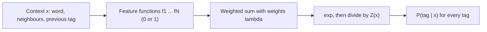
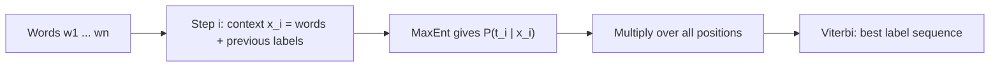

**In one line:** <mark>The Maximum Entropy (MaxEnt) model, also known as Multinomial Logistic Regression, is a discriminative probabilistic framework</mark> that picks the tag by <mark>weighing many clues about the word and its neighbours</mark>. <Cite id="class-nlp-pyq3" loc="p. 8" />

<Box kind="key">

**Key points to write:**

- <mark>MaxEnt = Multinomial Logistic Regression, a discriminative model</mark>: it models $P(y \mid x)$, the tag given the context.
- <mark>HMM is generative ($P(x, y)$); MaxEnt is discriminative ($P(y \mid x)$)</mark>.
- Principle: <mark>model what is known; assume uniform uncertainty about the unknown</mark>; choose the distribution of maximum entropy that fits the constraints.
- <mark>Feature functions $f_i(x, y)$ are binary (0 or 1)</mark>; they can be rich and overlapping (word, previous tag, ending, capital letter).
- Formula: <mark>$P(y \mid x) = \frac{1}{Z(x)} \exp(\sum \lambda_i f_i(x, y))$</mark>.
- Sequence tagging: **MEMM** with Viterbi. Limits: <mark>label bias and costly training</mark>.

</Box>

## Core answer (5 marks, fits every question here)

<Box kind="definition">

The **Maximum Entropy (MaxEnt) model**, also known as a Multinomial Logistic Regression model, is a discriminative probabilistic framework widely used for POS tagging. <Cite id="class-nlp-pyq3" loc="p. 8" />

</Box>

**HMM versus MaxEnt:** an HMM is generative: it models the joint probability $P(x, y)$ of words and tags. MaxEnt directly models the conditional probability $P(y \mid x)$ of a tag $y$ given the context $x$. <Cite id="class-nlp-pyq3" loc="p. 8" />

**Core idea:** set constraints from facts seen in training data (the word *run* is often a verb). Among all distributions that satisfy them, choose the one with **maximum entropy**, the most uniform and unbiased one, so no arbitrary assumption is made about what was not observed. <Cite id="class-nlp-pyq3" loc="p. 9" /> <Cite id="web-nlp-1-berger-maxent" />

**Formula:**

$$
P(y \mid x) = \frac{1}{Z(x)} \exp\Big(\sum_{i=1}^{N} \lambda_i f_i(x, y)\Big), \qquad Z(x) = \sum_{y'} \exp\Big(\sum_{i=1}^{N} \lambda_i f_i(x, y')\Big)
$$

$f_i$ are binary feature functions, $\lambda_i$ their learned weights (positive raises the chance of the tag, negative lowers it) and $Z(x)$ makes all tag probabilities add to 1. <Cite id="class-nlp-pyq3" loc="p. 9" />

**Conclusion:** MaxEnt is a discriminative model that combines many overlapping features to predict the tag.

## Extended answer (10 marks): add these

### 1. Feature functions

A feature is 1 when a condition on the context holds for a candidate tag, else 0. Its power is that it can use rich, overlapping, non-independent features. <Cite id="class-nlp-pyq3" loc="p. 9" />

| Feature type | Example (equals 1 when true) |
|---|---|
| Current word | word is "bank" and tag is NN |
| Previous tag | previous tag is DT and tag is NN |
| Surrounding words | next word is "of" and tag is NN |
| Morphology | word ends with "-ing" and tag is VBG |
| Capitalization | word is capitalized and tag is NNP |

A tagger built this way reached high accuracy on the Penn Treebank. <Cite id="web-nlp-1-ratnaparkhi-tagger" />

### 2. Sequence tagging with MEMM

To tag a sentence $W = (w_1, \ldots, w_n)$ with tags $T = (t_1, \ldots, t_n)$ the model is used step by step as a **Maximum Entropy Markov Model**:

$$
P(T \mid W) = \prod_{i=1}^{n} P(t_i \mid x_i)
$$

The context $x_i$ has the current and surrounding words and the previously predicted tags $t_{i-1}, t_{i-2}$. The best tag sequence is found with Viterbi decoding. <Cite id="class-nlp-pyq3" loc="p. 10" /> <Cite id="web-nlp-1-wiki-memm" />

### 3. HMM versus MaxEnt

| Point | HMM | MaxEnt (MEMM) |
|---|---|---|
| Type | Generative, $P(x, y)$ | Discriminative, $P(y \mid x)$ |
| Features | Words and tags only | Rich, overlapping features |
| Training | Counting | Iterative optimization (L-BFGS, GIS, IIS) |
| Normalization | Joint | Local, at each step |

### 4. Limitations

1. **Label bias:** probabilities are normalized locally at each step ($Z(x_i)$) and not over the whole sentence, so a high-probability move from a state with few outgoing choices can dominate even when the whole sequence is unlikely. <Cite id="class-nlp-pyq3" loc="p. 10" />
2. **Computational cost:** parameter estimation needs iterative optimization, heavier than the counting of an HMM. <Cite id="class-nlp-pyq3" loc="p. 10" />

## Fit it to each question

- **"Explain Maximum Entropy Model for POS Tagging"** (10 marks) <PYQ id="2023-05-ce/q6b" /> <PYQ id="assignment-1/q3c" />: core answer plus the feature table (section 1), MEMM (section 2) and limitations (section 4).
- **"Explain how Maximum Entropy is used for sequence labeling."** (10 marks) <PYQ id="2024-12-ce/q6b" />: one short definition with the formula, then section 2 (MEMM, product formula, Viterbi diagram), the feature table, the label-bias limit and the uses (POS tagging, named entity recognition).

## Exam tips

- **Write the formula with $Z(x)$** and say what each symbol means.
- Always say **discriminative vs generative** when comparing with HMM.
- Finish with **label bias**; it is the standard limitation (and the reason for CRF).
