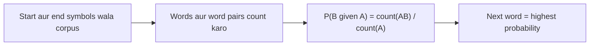
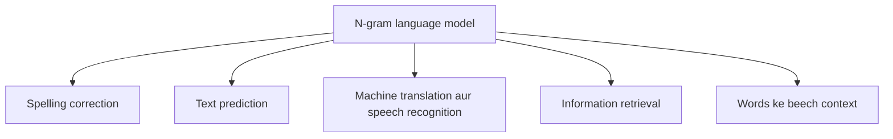

**Ek line mein:** <mark>Language model ek statistical ya machine learning model hai jo pichhle words dekhkar agla word predict karta hai</mark>; <mark>N-gram model corpus mein n words ke continuous sequences ginkar ye karta hai</mark>. <Cite id="class-nlp-pyq2" loc="p. 1" />

<Box kind="key">

**Language model ya N-gram ke har question mein ye points likho:**

- <mark>Language model: pichhle words ke basis pe agla word predict karta hai</mark>; ye $P(w_t \mid w_1, \dots, w_{t-1})$ estimate karta hai.
- <mark>N-gram: a continuous sequence of n words in a text</mark>; **unigram** (1), **bigram** (2), **trigram** (3).
- <mark>Bigram probability: $P(B \mid A) = \text{count}(AB)/\text{count}(A)$</mark>.
- Uses: <mark>spelling correction, text prediction, machine translation, speech recognition, information retrieval</mark>.
- Limits: <mark>fixed context (long-range links nahi) aur data sparsity</mark>; fix: **smoothing** (add-one, add-k, Good-Turing, Kneser-Ney).
- Spelling example: "I want to go to skul": **to school** ki probability to stool ya to skill se zyada hai.

</Box>

## Core answer (5 marks, yahan ke har question ke liye)

<Box kind="definition">

**Language model:** a statistical or machine learning model used to predict the next word in a sequence given the previous words. **N-gram:** a continuous sequence of n words in a text. <Cite id="class-nlp-pyq2" loc="p. 1" /> <Cite id="class-nlp-m2" loc="p. 8" />

</Box>

**N-gram model kaise kaam karta hai:** corpus mein word sequences count karo, counts ko probabilities banao, aur sabse probable next word chuno. <Cite id="class-nlp-m2" loc="p. 9" />

- **Unigram:** ek time pe ek word. **Bigram:** pichhla ek word use karta hai. **Trigram:** pichhle do words use karta hai. <Cite id="class-nlp-m6" loc="slide 43" />
- Example: "The dog barks. The cat sleeps. The dog runs. The cat jumps." mein The 4 baar aur The dog 2 baar, isliye $P(\text{dog} \mid \text{The}) = 2/4 = 0.5$. <Cite id="class-nlp-m2" loc="p. 9" />

**Spelling correction (5-mark case):** N-gram model galat word ke aas-paas ke words se sahi spelling chunta hai. "I want to go to skul": bigram model *to school*, *to stool* aur *to skill* compare karke **school** chunta hai. <Cite id="class-nlp-pyq2" loc="p. 8" />

**Conclusion:** context mein sabse zyada N-gram probability wala candidate ya word chuna jaata hai.

## Extended answer (10 marks): ye add karo

### 1. Language model detail mein

Language model word sequence ki probability $P(w_1, \dots, w_n)$ aur agle word ki $P(w_t \mid w_1, \dots, w_{t-1})$ estimate karta hai. Ye machine translation, speech recognition, text generation aur sentiment analysis mein use hota hai. <Cite id="class-nlp-m6" loc="slide 41" /> <Cite id="class-nlp-pyq2" loc="p. 1" />

N-gram ka idea context chhota karna hai: saare pichhle words ki jagah sirf pichhle n - 1 words. <Cite id="web-nlp-1-slp3-ch3" /> <Cite id="web-nlp-1-wiki-lm" />

| Model | Context mein kitne words | Kya predict karta hai |
|---|---|---|
| Unigram | koi nahi | har word ko uski apni frequency se |
| Bigram | pichhla 1 word | P(word given previous word) |
| Trigram | pichhle 2 words | P(word given previous two words) |

### 2. N-grams ke applications

<Cite id="class-nlp-pyq2" loc="p. 1" /> <Cite id="class-nlp-pyq2" loc="p. 8" />

- **Spelling correction:** steps: (1) misspelled word pehchano, (2) candidates banao, (3) context check karo, (4) probabilities nikalo, (5) best candidate chuno.
- **Text prediction:** predictive typing agla word suggest karta hai.
- **Translation aur voice assistants:** agla likely word chunne ke liye guess karte hain.
- **Information retrieval:** word patterns se documents rank karna.

| Candidate | Bigram | Probability |
|---|---|---|
| school | to school | high |
| stool | to stool | lower |
| skill | to skill | lower |

### 3. Limitations aur smoothing

- Fixed context **long-range dependencies** nahi pakad sakta. <Cite id="class-nlp-m6" loc="slide 43" />
- Rare ya unseen sequence ki **probability zero** ho jaati hai (data sparsity). **Smoothing** use chhoti probability deta hai: add-one (Laplace), add-k, Good-Turing, Kneser-Ney. <Cite id="class-nlp-m6" loc="slide 44" />

## Har question mein kaise fit karein

- **"Explain how N-gram model is used in spelling correction"** (5 marks) <PYQ id="2023-05-ce/q1b" />: N-gram idea pe ek line, phir spelling-correction ka paanch-step flow, candidate table aur skul example.
- **"What is language model? Write a note on N-gram model."** (10 marks) <PYQ id="2024-12/q2a" /> <PYQ id="assignment-1/q2a" />: language model ki definition (section 1), N-gram types, formula dog example ke saath, phir limits (section 3).
- **"Explain the N-gram language model and its application."** (10 marks) <PYQ id="2024-12-ce/q4b" />: core answer plus section 2 (applications diagram aur list) aur limits pe ek line.

## Exam tips

- **Draw karo** unigram, bigram, trigram ki picture aur count se probability ka flow.
- **Formula aur ek chhota numeric example** (The dog = 2/4) likho; isse samajh dikhti hai.
- "Applications" mein spelling correction pehle likho; wo class ka apna example hai.

Exam mein English mein likho.
