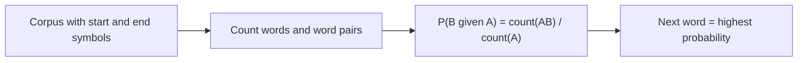
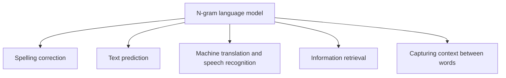

**In one line:** <mark>A language model is a statistical or machine learning model used to predict the next word in a sequence given the previous words</mark>; an <mark>N-gram model does this by counting continuous sequences of n words</mark> in a corpus. <Cite id="class-nlp-pyq2" loc="p. 1" />

<Box kind="key">

**Key points to write (any language model or N-gram question):**

- <mark>Language model: predicts the next word given the previous words</mark>; it estimates $P(w_t \mid w_1, \dots, w_{t-1})$.
- <mark>N-gram: a continuous sequence of n words in a text</mark>; **unigram** (1), **bigram** (2), **trigram** (3).
- <mark>Bigram probability: $P(B \mid A) = \text{count}(AB)/\text{count}(A)$</mark>.
- Uses: <mark>spelling correction, text prediction, machine translation, speech recognition, information retrieval</mark>.
- Limits: <mark>fixed context (no long-range links) and data sparsity</mark>; fixed by **smoothing** (add-one, add-k, Good-Turing, Kneser-Ney).
- Spelling example: "I want to go to skul": **to school** is more probable than to stool or to skill.

</Box>

## Core answer (5 marks, fits every question here)

<Box kind="definition">

**Language model:** a statistical or machine learning model used to predict the next word in a sequence given the previous words. **N-gram:** a continuous sequence of n words in a text. <Cite id="class-nlp-pyq2" loc="p. 1" /> <Cite id="class-nlp-m2" loc="p. 8" />

</Box>

**How the N-gram model works:** count word sequences in a corpus, turn counts into probabilities, and pick the most probable next word. <Cite id="class-nlp-m2" loc="p. 9" />

- **Unigram:** one word at a time. **Bigram:** uses the previous one word. **Trigram:** uses the previous two words. <Cite id="class-nlp-m6" loc="slide 43" />
- Example: in "The dog barks. The cat sleeps. The dog runs. The cat jumps." The appears 4 times and The dog 2 times, so $P(\text{dog} \mid \text{The}) = 2/4 = 0.5$. <Cite id="class-nlp-m2" loc="p. 9" />

**Spelling correction (5-mark case):** an N-gram model uses the words around a wrong word to choose the right spelling. "I want to go to skul": the bigram model compares *to school*, *to stool* and *to skill* and picks **school**. <Cite id="class-nlp-pyq2" loc="p. 8" />

**Conclusion:** the candidate or word with the highest N-gram probability in its context is chosen.

## Extended answer (10 marks): add these

### 1. Language model in detail

A language model estimates the probability of a word sequence $P(w_1, \dots, w_n)$ and, for the next word, $P(w_t \mid w_1, \dots, w_{t-1})$. It is used in machine translation, speech recognition, text generation and sentiment analysis. <Cite id="class-nlp-m6" loc="slide 41" /> <Cite id="class-nlp-pyq2" loc="p. 1" />

The N-gram idea is to shorten the context: instead of all earlier words, use only the previous n - 1 words. <Cite id="web-nlp-1-slp3-ch3" /> <Cite id="web-nlp-1-wiki-lm" />

| Model | Words used as context | Predicts |
|---|---|---|
| Unigram | none | each word on its own frequency |
| Bigram | previous 1 word | P(word given previous word) |
| Trigram | previous 2 words | P(word given previous two words) |

### 2. Applications of N-grams

<Cite id="class-nlp-pyq2" loc="p. 1" /> <Cite id="class-nlp-pyq2" loc="p. 8" />

- **Spelling correction:** steps are (1) identify the misspelled word, (2) generate candidates, (3) check the context, (4) calculate probabilities, (5) select the best candidate.
- **Text prediction:** predictive typing suggests the next word.
- **Translation and voice assistants:** guess what comes next to choose the likely word.
- **Information retrieval:** rank documents by word patterns.

| Candidate | Bigram | Probability |
|---|---|---|
| school | to school | high |
| stool | to stool | lower |
| skill | to skill | lower |

### 3. Limitations and smoothing

- A fixed context cannot catch **long-range dependencies**. <Cite id="class-nlp-m6" loc="slide 43" />
- A rare or unseen sequence gets **probability zero** (data sparsity). **Smoothing** gives it a small probability: add-one (Laplace), add-k, Good-Turing, Kneser-Ney. <Cite id="class-nlp-m6" loc="slide 44" />

## Fit it to each question

- **"Explain how N-gram model is used in spelling correction"** (5 marks) <PYQ id="2023-05-ce/q1b" />: one line on the N-gram idea, then the spelling-correction five-step flow, the candidate table and the skul example.
- **"What is language model? Write a note on N-gram model."** (10 marks) <PYQ id="2024-12/q2a" /> <PYQ id="assignment-1/q2a" />: definition of language model (section 1), N-gram types, formula with the dog example, then limits (section 3).
- **"Explain the N-gram language model and its application."** (10 marks) <PYQ id="2024-12-ce/q4b" />: core answer plus section 2 (the applications diagram and list) and one line on limits.

## Exam tips

- **Draw** the unigram, bigram and trigram picture and the count to probability flow.
- Quote the **formula and one tiny numeric example** (The dog = 2/4); it shows you understood.
- For "applications" always name spelling correction first; it is the class's own example.
