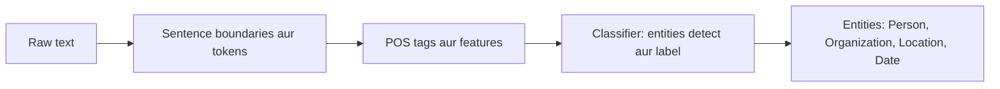
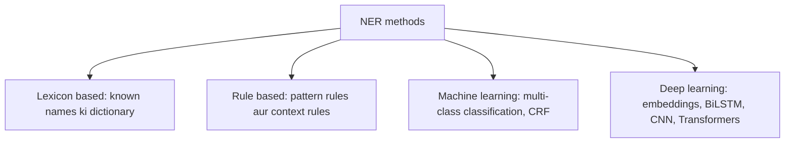

**Ek line mein:** <mark>Named Entity Recognition (NER) text mein important information, yaani entities (log, jagah, organizations, dates), ko pehchanta aur categorize karta hai</mark>, aur unstructured text ko structured information mein badalta hai. <Cite id="class-nlp-m6" loc="slide 35" />

<Box kind="key">

**Ye points likho:**

- <mark>NER: text mein entities ko identify aur categorize karna</mark> jaise persons, places, organizations, dates aur quantities.
- <mark>Ye unstructured text ko structured information mein badalta hai</mark>, jo summarization, knowledge graphs aur question answering mein kaam aata hai.
- Entity types: **person (Albert Einstein), organization (GeeksforGeeks), location (Paris), date and time (5th May 2025), quantity (50%)**.
- <mark>Type ka decision context karta hai</mark>: "Amazon is expanding rapidly" (organization) vs "The Amazon is the largest rainforest" (location).
- Working: **text analyze, sentence boundaries, tokenize aur POS tag, entities detect aur classify, train aur refine, adapt**.
- Methods: <mark>lexicon-based, rule-based, machine learning (CRF), deep learning</mark>.

</Box>

## Core answer (5 marks, yahan ke har question ke liye)

<Box kind="definition">

**Named Entity Recognition (NER)** in NLP focuses on identifying and categorizing important information, known as entities, in text. These entities can be names of people, places, organizations, dates and so on. It helps transform unstructured text into structured information, which helps tasks like text summarization, knowledge graph creation and question answering. <Cite id="class-nlp-m6" loc="slide 35" />

</Box>

**Entity types:** person names (Albert Einstein), organizations (GeeksforGeeks), locations (Paris), dates aur times (5th May 2025), quantities aur percentages (50%, 100 dollars). NER ambiguity ko aas-paas ke words, sentence structure aur overall context se handle karta hai. <Cite id="class-nlp-m6" loc="slide 36" />

**Working:** <Cite id="class-nlp-m6" loc="slide 37" />

1. Text analyze karo aur wo words ya phrases dhoondho jo entities ho sakte hain.
2. Sentence boundaries dhoondho (punctuation, capitalization).
3. Tokenize aur POS tag karo; tags entities ke clues dete hain.
4. Entities detect karo aur Person, Organization, Location jaisi categories mein classify karo.
5. Labelled data pe train karo aur time ke saath refine karo.
6. Nayi languages, styles aur unseen entity types ke liye adapt ho.

**Conclusion:** NER text ke names dhoondhta hai aur har ko type deta hai, taaki text structured data ban jaye.

## Extended answer (10 marks): ye add karo

### 1. NER ke methods

- **Lexicon-based:** text ko known entity names ki dictionary se check karta hai; common nahi kyunki dictionary ko constantly update karna padta hai.
- **Rule-based:** patterns (word ka form) aur context (aas-paas ke words) pe predefined rules.
- **Machine learning:** labelled data pe train classifier; **Conditional Random Field (CRF)** ek probabilistic model hai jo words ki sequence aur context samajhta hai, isliye predictions zyada accurate.
- **Deep learning:** word embeddings ke saath BiLSTM, CNN ya Transformers; bade, varied data pe high accuracy. <Cite id="class-nlp-m6" loc="slide 38" /> <Cite id="class-nlp-m6" loc="slide 39" /> <Cite id="web-nlp-1-wiki-crf" />

### 2. NER sequence labelling ke roop mein (BIO tags)

Har word ko ek tag milta hai: **B** (entity shuru), **I** (entity ke andar), **O** (entity ke bahar). Isse NER ko POS tagging ki tarah solve kar sakte hain. <Cite id="web-nlp-1-slp3-seqlabel" loc="§18.3" />

| Word | Barack | Obama | was | born | in | Honolulu |
|---|---|---|---|---|---|---|
| BIO tag | B-PER | I-PER | O | O | O | B-LOC |

### 3. NER mushkil kyun hai

- **Segmentation:** naam kahan shuru aur khatam hota hai? Zyadatar words entities nahi hote.
- **Type ambiguity:** *Washington* person, organization, location ya political area ho sakta hai, aur *Amazon* company ya nadi. <Cite id="web-nlp-1-slp3-seqlabel" loc="§18.3" />
- Naye names hamesha aate rehte hain, isliye fixed list kabhi complete nahi hoti.

### 4. Evaluation

NER ko precision, recall aur F1 se judge karte hain, poori entity ko ek response gin kar. <Cite id="web-nlp-1-slp3-seqlabel" loc="§18.6" />

<Sum>

<Given>

Text mein 5 asli entities hain. NER system 4 entities nikalta hai aur unme se 3 sahi hain. (Made-up counts.)

</Given>

<Find>

precision, recall aur F1.

</Find>

<Steps>

1. Precision $=$ sahi / output $= 3/4 = 0.75$.
2. Recall $=$ sahi / asli $= 3/5 = 0.60$.
3. $F_1 = 2PR/(P+R) = 2 \times 0.75 \times 0.60 / 1.35 = 0.667$.

</Steps>

<Answer>

P = 0.75, R = 0.60, F1 = 0.667.

</Answer>

<Box kind="verify">

F1 (0.667) P aur R ke beech hai, chhote wale ke paas, jaisa harmonic mean ko hona chahiye.

</Box>

</Sum>

### 5. Applications

Summarization, knowledge graph creation, question answering, search aur information extraction. <Cite id="class-nlp-m6" loc="slide 35" /> <Cite id="web-nlp-2-ner" />

## Har question mein kaise fit karein

- **"Named Entity Resolution"** (5 marks) <PYQ id="2024-12/q6b" />: core answer. Sawal mein *Resolution* likha hai, lekin class answer **Recognition** ka hai; pehli line mein "Named Entity Recognition (NER)" likho.
- **"Short Note on: Named Entity Resolution; Question Answering System."** (10 marks) <PYQ id="assignment-2/q6b" />: part (i) is page ka core answer plus section 1 ke methods; part (ii) question answering system answer ka core answer. Har part ko lagbhag aadha page do.

## Exam tips

- **Full form likho** "Named Entity Recognition" aur batao ki ise named entity identification ya entity extraction bhi kehte hain.
- **Entity types ko ek-ek example ke saath** likho, aur *Amazon* wali ambiguity.
- **Working flow** ya BIO table draw karo.

Exam mein English mein likho.
