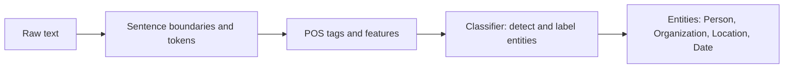
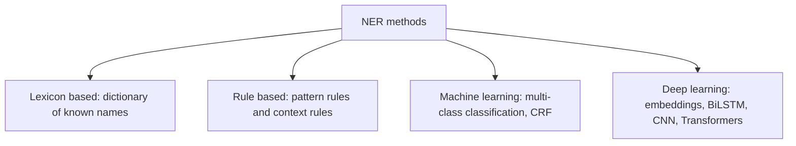

**In one line:** <mark>Named Entity Recognition (NER) focuses on identifying and categorizing important information, known as entities (people, places, organizations, dates), in text</mark>, turning unstructured text into structured information. <Cite id="class-nlp-m6" loc="slide 35" />

<Box kind="key">

**Key points to write:**

- <mark>NER: identifying and categorizing entities in text</mark> such as persons, places, organizations, dates and quantities.
- <mark>It turns unstructured text into structured information</mark>, which helps summarization, knowledge graphs and question answering.
- Entity types: **person (Albert Einstein), organization (GeeksforGeeks), location (Paris), date and time (5th May 2025), quantity (50%)**.
- <mark>Context decides the type</mark>: "Amazon is expanding rapidly" (organization) versus "The Amazon is the largest rainforest" (location).
- Working: **analyze the text, sentence boundaries, tokenize and POS tag, detect and classify entities, train and refine, adapt**.
- Methods: <mark>lexicon-based, rule-based, machine learning (CRF), deep learning</mark>.

</Box>

## Core answer (5 marks, fits every question here)

<Box kind="definition">

**Named Entity Recognition (NER)** in NLP focuses on identifying and categorizing important information, known as entities, in text. These entities can be names of people, places, organizations, dates and so on. It helps transform unstructured text into structured information, which helps tasks like text summarization, knowledge graph creation and question answering. <Cite id="class-nlp-m6" loc="slide 35" />

</Box>

**Entity types:** person names (Albert Einstein), organizations (GeeksforGeeks), locations (Paris), dates and times (5th May 2025), quantities and percentages (50%, 100 dollars). NER handles ambiguity by using the surrounding words, the sentence structure and the overall context. <Cite id="class-nlp-m6" loc="slide 36" />

**Working:** <Cite id="class-nlp-m6" loc="slide 37" />

1. Analyze the text and find words or phrases that could be entities.
2. Find sentence boundaries (punctuation, capitalization).
3. Tokenize and POS tag; the tags give clues for entities.
4. Detect and classify entities into Person, Organization, Location and so on.
5. Train on labelled data and refine over time.
6. Adapt to new languages, styles and unseen entity types.

**Conclusion:** NER finds the names in a text and gives each one a type, so that the text becomes structured data.

## Extended answer (10 marks): add these

### 1. Methods of NER

- **Lexicon-based:** checks the text against a dictionary of known names; not common because the dictionary needs constant updating.
- **Rule-based:** predefined rules on patterns (the form of words) and context (the words around).
- **Machine learning:** a classifier trained on labelled data; a **Conditional Random Field (CRF)** is a probabilistic model that understands the sequence and context of words, so its predictions are more accurate.
- **Deep learning:** word embeddings with BiLSTM, CNN or Transformers; high accuracy on large, varied data. <Cite id="class-nlp-m6" loc="slide 38" /> <Cite id="class-nlp-m6" loc="slide 39" /> <Cite id="web-nlp-1-wiki-crf" />

### 2. NER as sequence labelling (BIO tags)

Each word gets one tag: **B** (begins an entity), **I** (inside an entity), **O** (outside). This lets NER be solved like POS tagging. <Cite id="web-nlp-1-slp3-seqlabel" loc="§18.3" />

| Word | Barack | Obama | was | born | in | Honolulu |
|---|---|---|---|---|---|---|
| BIO tag | B-PER | I-PER | O | O | O | B-LOC |

### 3. Why NER is hard

- **Segmentation:** where does the name start and end? Most words are not entities.
- **Type ambiguity:** *Washington* can be a person, an organization, a location or a political area, and *Amazon* a company or a river. <Cite id="web-nlp-1-slp3-seqlabel" loc="§18.3" />
- New names appear all the time, so a fixed list is never complete.

### 4. Evaluation

NER is judged by precision, recall and F1, counting each whole entity as one response. <Cite id="web-nlp-1-slp3-seqlabel" loc="§18.6" />

<Sum>

<Given>

A text has 5 real entities. The NER system outputs 4 entities and 3 of them are correct. (Made-up counts.)

</Given>

<Find>

precision, recall and F1.

</Find>

<Steps>

1. Precision $=$ correct / output $= 3/4 = 0.75$.
2. Recall $=$ correct / real $= 3/5 = 0.60$.
3. $F_1 = 2PR/(P+R) = 2 \times 0.75 \times 0.60 / 1.35 = 0.667$.

</Steps>

<Answer>

P = 0.75, R = 0.60, F1 = 0.667.

</Answer>

<Box kind="verify">

F1 (0.667) lies between P and R, closer to the smaller one, as the harmonic mean should.

</Box>

</Sum>

### 5. Applications

Summarization, knowledge graph creation, question answering, search and information extraction. <Cite id="class-nlp-m6" loc="slide 35" /> <Cite id="web-nlp-2-ner" />

## Fit it to each question

- **"Named Entity Resolution"** (5 marks) <PYQ id="2024-12/q6b" />: the core answer. The question says *Resolution*, but the class answer is about **Recognition**; write "Named Entity Recognition (NER)" in the first line.
- **"Short Note on: Named Entity Resolution; Question Answering System."** (10 marks) <PYQ id="assignment-2/q6b" />: part (i) the core answer of this page plus the methods of section 1; part (ii) the core answer of the question answering system answer. Give each part about half the page.

## Exam tips

- **Write the full form** "Named Entity Recognition" and say it is also called named entity identification or entity extraction.
- Give the **entity types with an example each**, and the *Amazon* ambiguity.
- Draw the **working flow** or the BIO table.
