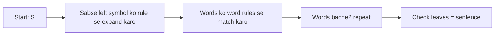
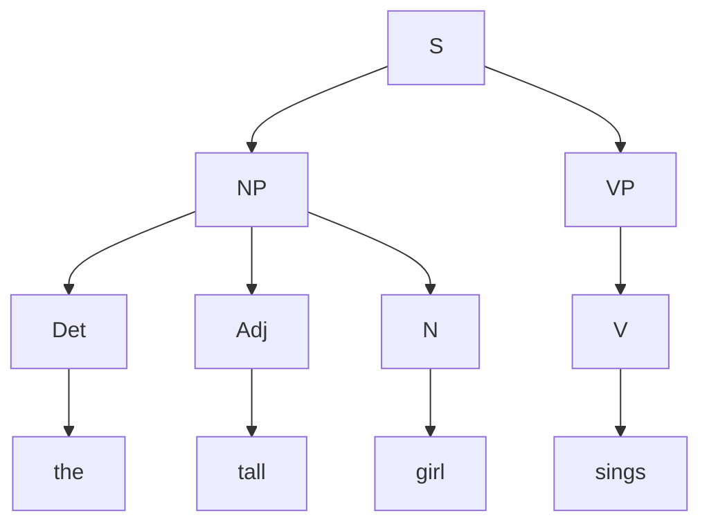

**Ek line mein:** <mark>Parse tree dikhata hai ki har step pe kaunsa grammar rule use hua</mark> aur S se sentence kaise bana; hum <mark>S se shuru karke rules top-down lagate hain jab tak sirf diye hue words bachein</mark>. <Cite id="class-nlp-pyq3" loc="p. 6" />

<Box kind="key">

**Parse tree ke har question mein ye points likho:**

- <mark>CFG = rewrite rules ki list</mark>: S se shuru karo aur symbol ko rule ke right side se replace karo.
- <mark>Top-down parsing start symbol se shuru hoti hai aur rules se neeche jaati hai</mark>.
- Wo rule chuno jiske **words ki ginti sentence se fit** ho; galat rule kuch words unmatched chhod deta hai.
- **Derivation** (har rewrite step) aur **tree** (words leaves ke roop mein) likho.
- Check: <mark>leaves ko left se right padhne par original sentence milna chahiye</mark>.

</Box>

## Core answer (5 marks, yahan ke har question ke liye)

<Box kind="definition">

A **context-free grammar (CFG)** is a list of rewrite rules. S se shuru karke symbol ko rule ke right side se replace karte hain jab tak sirf words bachein. **Parse tree** dikhata hai ki kahan kaunsa rule use hua. <Cite id="web-nlp-1-wiki-cfg" />

</Box>

**Method (top-down):** <Cite id="class-nlp-pyq3" loc="p. 6" />

1. S se shuru karo aur uska rule likho (S → NP VP).
2. Sabse left symbol lo aur uska wo rule chuno jo agle words se fit ho.
3. Word rules lagao (Det → "the", N → "girl" aadi) taaki symbols words ban jaayein.
4. Tab tak repeat karo jab tak har leaf ek word na ho.
5. Check karo ki leaves left se right padhne par sentence dete hain aur har parent apne children ke saath ek rule hai.

**Conclusion:** S se neeche rules lagane par derivation milti hai, aur use draw karne par tree.

## Extended answer (10 marks): ye add karo

### 1. Poochha gaya question solve karna

<Sum>

<Given>

sentence *The tall girl sings* (capital T ko lexical entry "the" maana gaya hai). Rules: S → NP VP; NP → Det Adj N | Det N; VP → V | V NP; Det → "the"; Adj → "tall"; N → "girl"; V → "sings".

</Given>

<Find>

sentence ka parse tree.

</Find>

<Steps>

1. **Start:** S → NP VP. *Reason: S ka sirf yahi rule hai.*
2. **NP rule chuno.** Verb se pehle ke words *the tall girl* hain, teen words, isliye NP → Det Adj N. Rule NP → Det N sirf *the* aur *girl* cover karta hai aur *tall* ko unmatched chhod deta hai, isliye fail.
3. **Word rules:** Det → the, Adj → tall, N → girl.
4. **VP rule chuno.** Sirf *sings* bacha hai, isliye VP → V. Rule VP → V NP fail hota hai kyunki NP ke liye koi word nahi bacha.
5. **Word rule:** V → sings.

Leftmost derivation:

$$
\begin{aligned}
S &\Rightarrow NP\ VP \Rightarrow Det\ Adj\ N\ VP \Rightarrow \text{the}\ Adj\ N\ VP \\
&\Rightarrow \text{the tall}\ N\ VP \Rightarrow \text{the tall girl}\ VP \\
&\Rightarrow \text{the tall girl}\ V \Rightarrow \text{the tall girl sings}
\end{aligned}
$$

</Steps>

<Answer>

Bracket form: `[S [NP [Det the] [Adj tall] [N girl]] [VP [V sings]]]`. Tree neeche hai.

</Answer>

<Box kind="verify">

Leaves ko left se right padhne par *the tall girl sings* milta hai. Har parent apne children ke saath ek rule match karta hai. Derivation mein 7 rules lage (S, NP, VP aur 4 word rules) aur tree mein 7 internal nodes hain: S, NP, VP, Det, Adj, N, V.

</Box>

</Sum>

Is grammar se is sentence ka sirf ek parse milta hai, isliye ambiguity nahi hai.

### 2. Doosra example: class ka sentence

Class grammar S → NP VP, NP → Det N, VP → V NP se *The man read this book* ka tree neeche jaisa banta hai; VP doosra NP (*this book*) leta hai kyunki *read* ko object chahiye. <Cite id="class-nlp-pyq3" loc="p. 8" />

### 3. Agar doosra sentence poochha jaaye

Wahi method lagao, aur do jaal dhyan mein rakho: ek rule jo sirf kuch words ko fit kare (to doosra rule try karo), aur ek grammar jo do trees allow kare (to dono draw karo). <Cite id="web-nlp-1-slp3-cfg" />

## Har question mein kaise fit karein

- **"Construct a parse tree for the following sentence using the given CFG rules: The tall girl sings. Rules: S → NP VP NP → Det Adj N | Det N VP → V | V NP ..."** (10 marks) <PYQ id="2024-12-ce/q5b" />: method chhote mein, phir section 1 ka poora Sum derivation, bracket form aur diagram ke saath.

## Exam tips

- **Derivation line by line likho** aur phir tree; dono pe marks hain.
- Likho ki **doosra rule kyun fail hua** (ek word unmatched reh gaya); isse dikhta hai ki choice soch-samajh ke ki gayi.
- Aakhir mein **leaf check** likho (leaves left se right padhne par sentence).

Exam mein English mein likho.
