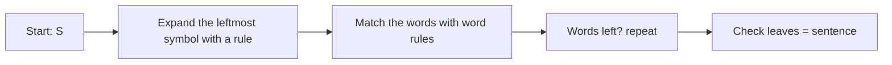
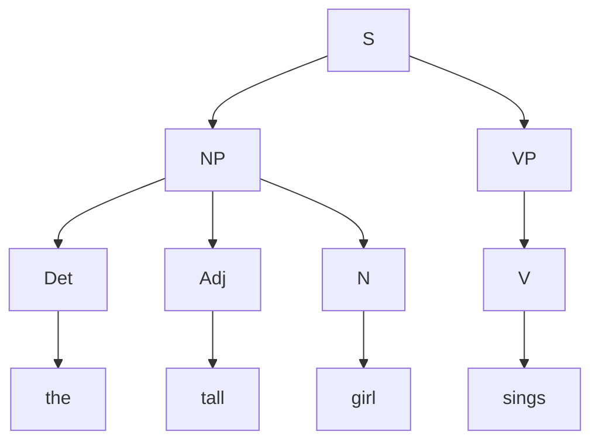

**In one line:** <mark>A parse tree shows which grammar rule was used at each step</mark> to build a sentence from S; we <mark>start from S and apply the rules top-down until only the given words remain</mark>. <Cite id="class-nlp-pyq3" loc="p. 6" />

<Box kind="key">

**Key points to write (any parse tree question):**

- <mark>CFG = a list of rewrite rules</mark>: start from S and replace a symbol by the right side of a rule.
- <mark>Top-down parsing starts from the start symbol and works down using the rules</mark>.
- Choose the rule whose **number of words fits** the sentence; a wrong rule leaves words unmatched.
- Write the **derivation** (each rewrite step) and the **tree** with the words as leaves.
- Check: <mark>the leaves read left to right give the original sentence</mark>.

</Box>

## Core answer (5 marks, fits every question here)

<Box kind="definition">

A **context-free grammar (CFG)** is a list of rewrite rules. Starting from S, replace a symbol by the right side of a rule until only words remain. The **parse tree** shows which rule was used where. <Cite id="web-nlp-1-wiki-cfg" />

</Box>

**Method (top-down):** <Cite id="class-nlp-pyq3" loc="p. 6" />

1. Start with S and write its rule (S → NP VP).
2. Take the leftmost symbol and choose the rule of that symbol that fits the next words.
3. Apply the word rules (Det → "the", N → "girl" and so on) to turn symbols into words.
4. Repeat until every leaf is a word.
5. Check that the leaves, read left to right, give the sentence, and that every parent with its children is a rule.

**Conclusion:** applying the rules from S downward gives the derivation, and drawing it gives the tree.

## Extended answer (10 marks): add these

### 1. Solving the asked question

<Sum>

<Given>

sentence *The tall girl sings* (the capital T is treated as the lexical entry "the"). Rules: S → NP VP; NP → Det Adj N | Det N; VP → V | V NP; Det → "the"; Adj → "tall"; N → "girl"; V → "sings".

</Given>

<Find>

the parse tree of the sentence.

</Find>

<Steps>

1. **Start:** S → NP VP. *Reason: S has only this rule.*
2. **Choose the NP rule.** The words before the verb are *the tall girl*, three words, so use NP → Det Adj N. The rule NP → Det N covers only *the* and *girl* and leaves *tall* unmatched, so it fails.
3. **Word rules:** Det → the, Adj → tall, N → girl.
4. **Choose the VP rule.** Only *sings* is left, so VP → V. The rule VP → V NP fails because no words remain for the NP.
5. **Word rule:** V → sings.

Leftmost derivation:

$$
\begin{aligned}
S &\Rightarrow NP\ VP \Rightarrow Det\ Adj\ N\ VP \Rightarrow \text{the}\ Adj\ N\ VP \\
&\Rightarrow \text{the tall}\ N\ VP \Rightarrow \text{the tall girl}\ VP \\
&\Rightarrow \text{the tall girl}\ V \Rightarrow \text{the tall girl sings}
\end{aligned}
$$

</Steps>

<Answer>

Bracket form: `[S [NP [Det the] [Adj tall] [N girl]] [VP [V sings]]]`. The tree is below.

</Answer>

<Box kind="verify">

The leaves read left to right give *the tall girl sings*. Every parent and its children match a rule. The derivation used 7 rules (S, NP, VP and 4 word rules) and the tree has 7 internal nodes: S, NP, VP, Det, Adj, N, V.

</Box>

</Sum>

The grammar gives only one parse for this sentence, so there is no ambiguity.

### 2. A second example: the class sentence

The class grammar S → NP VP, NP → Det N, VP → V NP gives *The man read this book* the tree below; the VP takes the second NP (*this book*) because *read* needs an object. <Cite id="class-nlp-pyq3" loc="p. 8" />

### 3. If another sentence is asked

Use the same method, and watch for two traps: a rule that fits only part of the words (then try the other rule), and a grammar that allows two trees (then draw both). <Cite id="web-nlp-1-slp3-cfg" />

## Fit it to each question

- **"Construct a parse tree for the following sentence using the given CFG rules: The tall girl sings. Rules: S → NP VP NP → Det Adj N | Det N VP → V | V NP ..."** (10 marks) <PYQ id="2024-12-ce/q5b" />: the method in short, then the full Sum of section 1 with the derivation, the bracket form and the diagram.

## Exam tips

- **Write the derivation line by line** and then the tree; both carry marks.
- Explain **why the other rule fails** (it leaves a word unmatched); this shows the choice was reasoned.
- Finish with the **leaf check** (leaves read left to right equal the sentence).
