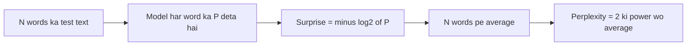
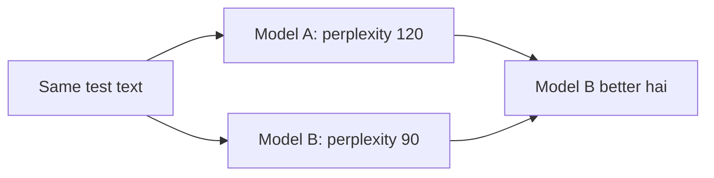

**Ek line mein:** <mark>Perplexity language model ki predictions mein uncertainty ka measurement hai</mark>; ye batati hai ki model asli text se kitna surprised hai, aur <mark>perplexity jitni kam, model utna better</mark>. <Cite id="class-nlp-pyq2" loc="p. 5" />

<Box kind="key">

**Ye points likho:**

- <mark>Perplexity: a measurement of uncertainty in the predictions of a language model</mark>; model actual outcomes se kitna surprised hai.
- <mark>Kam perplexity = better model</mark> (agla word better predict karta hai).
- Formula: <mark>$PP = 2^{-\frac{1}{N}\sum \log_2 P(w_i \mid \text{context})}$</mark>, average negative log-likelihood ka exponential.
- <mark>Perplexity 1 ideal hai</mark> (perfect prediction); perplexity 10 matlab 10 equally likely words mein se chunne jitni uncertainty.
- Use: **do language models ko compare karna**, same test text pe.

</Box>

## Core answer (5 marks, yahan ke har question ke liye)

<Box kind="definition">

**Perplexity** is a measurement of uncertainty in the predictions of a language model. It indicates how surprised a model is by the actual outcomes. The lower the perplexity, the better the model at predicting the next word. <Cite id="class-nlp-pyq2" loc="p. 5" />

</Box>

N words ke text ke liye:

$$
\text{Perplexity}(P) = 2^{-\frac{1}{N}\sum_{i=1}^{N}\log_2 P(w_i \mid w_1, \dots, w_{i-1})}
$$

Ye context diye hue words ke average negative log-likelihood ka exponential hai. <Cite id="class-nlp-pyq2" loc="p. 5" />

| Perplexity | Matlab |
|---|---|
| 1 | Ideal score: model har baar agla word perfectly predict karta hai |
| 1 se zyada | Kuch uncertainty; jitni zyada, model utna kam confident |
| 10 | 10 alag possible next words mein se chunne jitni uncertainty |

Aakhri row ka check: agar har word ki probability 1/10 hai, to perplexity $(10^{-N})^{-1/N} = 10$.

**Conclusion:** perplexity se language models compare karo; jiski value kam hai wo better hai.

## Extended answer (10 marks): ye add karo

### 1. Bigram model ke saath worked example

<Sum>

<Given>

Sam corpus (`<s>` I am Sam `</s>`, `<s>` I like college `</s>`, ...) ki bigram probabilities aur test sentence `<s>` I like college `</s>`.

</Given>

<Find>

perplexity.

</Find>

<Steps>

1. Probability $= P(I \mid \langle s\rangle)\,P(like \mid I)\,P(college \mid like)\,P(\langle/s\rangle \mid college) = \frac{3}{7} \times \frac{3}{6} \times \frac{3}{5} \times \frac{3}{3} = \frac{9}{70} = 0.1286$.
2. $N = 4$ predicted tokens (I, like, college, `</s>`).
3. $PP = (9/70)^{-1/4} = (70/9)^{1/4} = 7.778^{0.25} \approx 1.67$.

</Steps>

<Answer>

perplexity $\approx 1.67$.

</Answer>

<Box kind="verify">

$1.67^4 = 2.789^2 = 7.78 = 70/9$. 1 ke paas value matlab model har word ke baare mein lagbhag sure hai. Logs se bhi wahi: average $-\log_2 P = 0.7388$ aur $2^{0.7388} = 1.67$.

</Box>

</Sum>

### 2. Perplexity branching factor ke roop mein

Agar model teen words ko 1/2, 1/4, 1/4 probability de, to $PP = 2^{-\frac13(\log_2 \frac12 + \log_2 \frac14 + \log_2 \frac14)} = 2^{5/3} \approx 3.17$: model aise behave karta hai jaise har step pe lagbhag 3 words mein se chun raha ho. <Cite id="web-nlp-1-slp3-ch3" /> <Cite id="web-nlp-1-wiki-perplexity" />

### 3. Perplexity ka use

- Kam perplexity matlab model asli text ko zyada probability deta hai.
- Models ko sirf **same test text aur same vocabulary** pe compare karo. <Cite id="web-nlp-1-slp3-ch3" />

## Har question mein kaise fit karein

- **"Explain perplexity of any language model."** (5 marks) <PYQ id="2022-12-ce/q1f" />: core answer: definition, formula, meaning table aur one-line conclusion.
- **"Write a short note on: i) Perplexity of any language model ii) Rule based taggers"** (10 marks) <PYQ id="2025-05/q6b" />: part (i) ke liye core answer plus section 1 ka worked example (lagbhag 5 marks); part (ii) alag topic hai: rule-based POS tagging predefined grammatical rules se tags deta hai, jo word endings aur context se bante hain, jaise -tion ya -ment pe khatam hone wale words noun hain. <Cite id="class-nlp-pyq3" loc="p. 3" />

## Exam tips

- **Exponent ka minus sign aur $1/N$ (average) kabhi mat bhoolo**.
- Saaf likho: **kam better hai; 1 sabse best hai**.
- Number poochha ho to probabilities ka product, N ki value, phir root dikhao.

Exam mein English mein likho.
