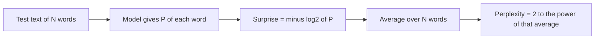
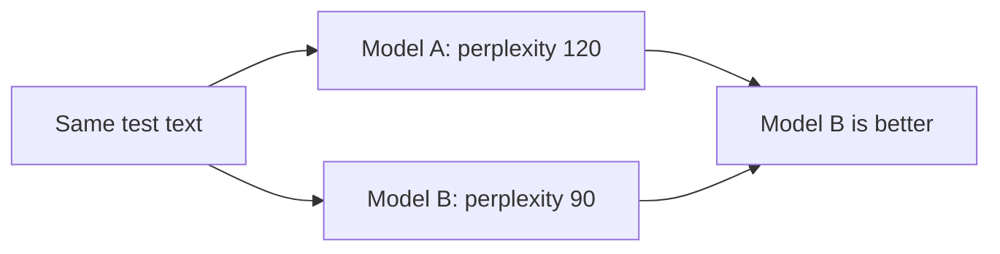

**In one line:** <mark>Perplexity is a measurement of uncertainty in the predictions of a language model</mark>; it shows how surprised the model is by the real text, and <mark>the lower the perplexity, the better the model</mark>. <Cite id="class-nlp-pyq2" loc="p. 5" />

<Box kind="key">

**Key points to write:**

- <mark>Perplexity: a measurement of uncertainty in the predictions of a language model</mark>; how surprised it is by the actual outcomes.
- <mark>Lower perplexity = better model</mark> (better at predicting the next word).
- Formula: <mark>$PP = 2^{-\frac{1}{N}\sum \log_2 P(w_i \mid \text{context})}$</mark>, the exponential of the average negative log-likelihood.
- <mark>Perplexity 1 is ideal</mark> (perfect prediction); perplexity 10 means as uncertain as choosing between 10 equally likely words.
- Use: **compare two language models** on the same test text.

</Box>

## Core answer (5 marks, fits every question here)

<Box kind="definition">

**Perplexity** is a measurement of uncertainty in the predictions of a language model. It indicates how surprised a model is by the actual outcomes. The lower the perplexity, the better the model at predicting the next word. <Cite id="class-nlp-pyq2" loc="p. 5" />

</Box>

For a text of N words:

$$
\text{Perplexity}(P) = 2^{-\frac{1}{N}\sum_{i=1}^{N}\log_2 P(w_i \mid w_1, \dots, w_{i-1})}
$$

It is the exponential of the average negative log-likelihood of the words given their context. <Cite id="class-nlp-pyq2" loc="p. 5" />

| Perplexity | Meaning |
|---|---|
| 1 | The ideal score: the model predicts the next word perfectly every time |
| Above 1 | Some uncertainty; the higher, the less confident the model |
| 10 | As uncertain as choosing between 10 different possible next words |

Check of the last row: if every word has probability 1/10, perplexity is $(10^{-N})^{-1/N} = 10$.

**Conclusion:** use perplexity to compare language models; the one with the lower value is better.

## Extended answer (10 marks): add these

### 1. Worked example with a bigram model

<Sum>

<Given>

the bigram probabilities of the Sam corpus (`<s>` I am Sam `</s>`, `<s>` I like college `</s>`, ...) and the test sentence `<s>` I like college `</s>`.

</Given>

<Find>

the perplexity.

</Find>

<Steps>

1. Probability $= P(I \mid \langle s\rangle)\,P(like \mid I)\,P(college \mid like)\,P(\langle/s\rangle \mid college) = \frac{3}{7} \times \frac{3}{6} \times \frac{3}{5} \times \frac{3}{3} = \frac{9}{70} = 0.1286$.
2. $N = 4$ predicted tokens (I, like, college, `</s>`).
3. $PP = (9/70)^{-1/4} = (70/9)^{1/4} = 7.778^{0.25} \approx 1.67$.

</Steps>

<Answer>

perplexity $\approx 1.67$.

</Answer>

<Box kind="verify">

$1.67^4 = 2.789^2 = 7.78 = 70/9$. A value close to 1 means the model is almost sure of each word. Using logs gives the same: average $-\log_2 P = 0.7388$ and $2^{0.7388} = 1.67$.

</Box>

</Sum>

### 2. Perplexity as a branching factor

If a model gives probabilities 1/2, 1/4, 1/4 to three words, then $PP = 2^{-\frac13(\log_2 \frac12 + \log_2 \frac14 + \log_2 \frac14)} = 2^{5/3} \approx 3.17$: the model behaves as if it chose among about 3 words at each step. <Cite id="web-nlp-1-slp3-ch3" /> <Cite id="web-nlp-1-wiki-perplexity" />

### 3. Using perplexity

- Lower perplexity means the model gives higher probability to the real text.
- Compare models only on the **same test text and the same vocabulary**. <Cite id="web-nlp-1-slp3-ch3" />

## Fit it to each question

- **"Explain perplexity of any language model."** (5 marks) <PYQ id="2022-12-ce/q1f" />: core answer: definition, formula, meaning table and the one-line conclusion.
- **"Write a short note on: i) Perplexity of any language model ii) Rule based taggers"** (10 marks) <PYQ id="2025-05/q6b" />: for part (i) write the core answer plus the worked example of section 1 (about 5 marks); part (ii) is a separate topic: rule-based POS tagging assigns tags from predefined grammatical rules built from word endings and context, for example words ending in -tion or -ment are nouns. <Cite id="class-nlp-pyq3" loc="p. 3" />

## Exam tips

- **Never forget the minus sign** in the exponent and the $1/N$ (average).
- Say clearly: **lower is better; 1 is the best possible**.
- If a number is asked, show the product of probabilities, the value of N and then the root.
