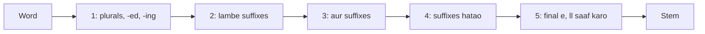
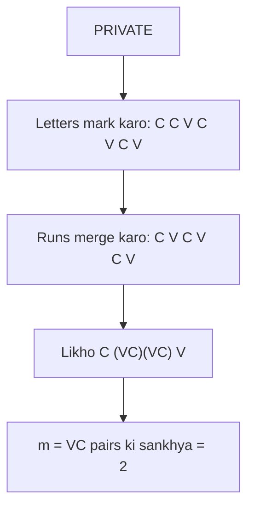

**Ek line mein:** <mark>Stemming morphological analysis ka simplified form hai jo root word dhoondhta hai</mark>; <mark>Porter stemmer ek simple rule-based algorithm hai jisme 5 sets of rules hain, aur wo speed aur simplicity ke liye jaana jaata hai</mark>. <Cite id="class-nlp-m2" loc="p. 19" />

<Box kind="key">

**Porter ke har question mein ye points likho:**

- <mark>Porter stemmer: a simple rule-based algorithm for stemming, with 5 sets of rules</mark>; ye suffix hatakar stem nikalta hai. **Martin F. Porter** ne banaya.
- <mark>Consonant: a letter other than a, e, i, o, u and other than y preceded by a consonant</mark>; baaki sab letters vowel hain.
- <mark>Word ka form: $[C](VC)^m[V]$</mark>; $m$ (**measure**) VC pairs ki sankhya hai.
- Yaad rakhne wale measures: <mark>TREE 0, TROUBLE 1, TRAP 1, TROUBLES 2, PRIVATE 2, RELATIONAL 4</mark>.
- <mark>Rule form: (condition) S1 to S2</mark>. Example: (m > 1) EMENT to nothing: REPLACEMENT se REPLAC.
- Use: **information retrieval**, kyunki terms kam ho jaate hain, space aur time bachta hai.

</Box>

## Core answer (5 marks, yahan ke har question ke liye)

<Box kind="definition">

**Stemming** is a simplified form of morphological analysis which is basically used to find the root word. The **Porter stemmer** is a simple rule-based algorithm for stemming. It consists of 5 sets of rules and is known for its speed and simplicity. <Cite id="class-nlp-m2" loc="p. 19" />

</Box>

**Kyun:** ye English words se suffix hatata hai, jisse information retrieval mein terms kam hote hain (space aur time bachta hai). Example: connect, connected, connecting, connection sab **connect** ban jaate hain. <Cite id="class-nlp-pyq2" loc="p. 2" /> <Cite id="web-nlp-1-wiki-stemming" />

**Consonants aur vowels:** consonant wo letter hai jo a, e, i, o, u nahi hai aur consonant ke baad aane wala y nahi hai; baaki sab vowel. C consonants ki string, V vowels ki string. <Cite id="class-nlp-pyq2" loc="p. 2" />

**Form aur measure:** har word $[C](VC)^m[V]$ hai aur $m$ VC pairs ki sankhya hai. TREE m = 0, TROUBLE aur TRAP m = 1, TROUBLES aur PRIVATE m = 2, RELATIONAL m = 4. <Cite id="class-nlp-m2" loc="p. 20" /> <Cite id="class-nlp-m2" loc="p. 21" />

**Rule form:** (condition) S1 to S2. Agar word S1 pe khatam hota hai aur S1 se pehle ka stem condition poori karta hai, to S1 ko S2 se badlo. Example: (m > 1) EMENT to nothing se REPLACEMENT ban jaata hai REPLAC, kyunki REPLAC ka m = 2. <Cite id="class-nlp-pyq2" loc="p. 3" />

**Conclusion:** Porter stemmer fast aur simple hai, par crude: stem ka dictionary word hona zaroori nahi (happy se happi).

## Extended answer (10 marks): ye add karo

### 1. m kaise nikalein (teen steps)

1. Har consonant ke liye C aur har vowel ke liye V likho.
2. Barabar letters ki runs merge karo: CC se C, VV se V.
3. Gino kitni baar V ke baad C aata hai. Wahi m hai.

### 2. Paanch steps aur unke main rules

Class sirf rule form deti hai; ye Porter ke paper ke standard rules hain, chhote kiye hue. <Cite id="web-nlp-1-porter-1980" /> <Cite id="web-nlp-1-porter-site" /> Examples mein word **us step ke baad** dikhaya hai.

| Step | Kaam | Main rules | Examples |
|---|---|---|---|
| 1a | Plurals | SSES to SS, IES to I, S to nothing | caresses to caress, ponies to poni, cats to cat |
| 1b | -ed aur -ing | (stem mein vowel ho) ED ya ING to nothing | plastered to plaster, motoring to motor |
| 1c | Final y | (stem mein vowel ho) Y to I | happy to happi |
| 2 | Lambe suffixes, (m > 0) | ATIONAL to ATE, IZER to IZE, IZATION to IZE, FULNESS to FUL | relational to relate, hopefulness to hopeful |
| 3 | Aur suffixes, (m > 0) | ICATE to IC, ALIZE to AL, FUL to nothing, NESS to nothing | triplicate to triplic, hopeful to hope |
| 4 | Suffixes hatao, (m > 1) | AL, ANCE, ER, IC, ABLE, MENT, EMENT, ENT, ISM, ATE, OUS, IVE, IZE to nothing | revival to reviv, replacement to replac |
| 5a | Final e | (m > 1) E to nothing | probate to probat |
| 5b | Double l | (m > 1) LL to L | controll to control |

Agar ek se zyada rule match karein to **sabse lamba S1** wala rule chalta hai.

### 3. Worked traces

<Sum>

<Given>

word **generalizations**.

</Given>

<Find>

uska Porter stem.

</Find>

<Steps>

1. Step 1a: S to nothing: generalizations se **generalization**.
2. Step 2: (m > 0) IZATION to IZE. Stem GENERAL ka m = 3: **generalize**.
3. Step 3: (m > 0) ALIZE to AL. Stem GENER ka m = 2: **general**.
4. Step 4: (m > 1) AL to nothing. Stem GENER ka m = 2: **gener**.
5. Step 5: final e ya double l nahi, isliye kuch nahi badla.

</Steps>

<Answer>

**gener**

</Answer>

<Box kind="verify">

GENERAL = C V C V C V C, to VC teen baar (m = 3); GENER = C V C V C, to m = 2. Dono un limits se bade hain jo rules ko chahiye. Standard Porter program bhi gener deta hai.

</Box>

</Sum>

Aur traces: **relational**: step 2 se relate (stem REL ka m = 1), step 5a e hatata hai (RELAT ka m = 2): **relat**. **hopefulness**: step 2 se hopeful, step 3 se hope, aur step 5a e rakhta hai kyunki HOP consonant-vowel-consonant hai aur m = 1: **hope**.

### 4. Advantages aur limits

| Advantages | Limits |
|---|---|
| Fast aur simple, rule based | Crude: roots real words hone zaroori nahi (happy se happi, studies se studi) |
| Terms kam, IR mein space aur time kam <Cite id="class-nlp-m2" loc="p. 19" /> | Alag words ka ek stem (universe, university, universal sab univers) |
| Dictionary nahi chahiye | Lemmatization dictionary use karta hai aur real words deta hai (better se good) <Cite id="class-nlp-asol" loc="p. 12" /> |

## Har question mein kaise fit karein

- **"Explain Porter Stemming algorithm in detail"** (10 marks) <PYQ id="2022-12-ce/q6b" /> <PYQ id="2023-12-ce/q5a" /> <PYQ id="2024-12-ce/q5a" /> <PYQ id="2025-05/q3a" />: poora core answer, section 1, steps table (section 2) aur ek trace.
- **"Explain Porter Stemmer algorithm with rules"** (10 marks) <PYQ id="2023-05-ce/q5b" /> <PYQ id="2026-05/q6b" />: core chhota karo, **steps table** poori likho aur ek trace.
- **"Explain Porter's Stemming Algorithm with example and rules."** (10 marks) <PYQ id="assignment-1/q2b" />: rule form EMENT example ke saath, steps table aur generalizations trace.
- **"Explain Porter's Stemming algorithm with example."** (10 marks) <PYQ id="2024-12/q2b" />: rule form, flow diagram aur section 3 ke teen traces.
- **"Illustrate the working of Porter stemmer algorithm"** (10 marks) <PYQ id="2024-05-ce/q2b" />: paanch-step flow diagram aur step-by-step trace (generalizations).

## Exam tips

- **Paanch-step flow draw karo** aur form $[C](VC)^m[V]$ chhe measure examples ke saath likho.
- Trace mein har step pe **rule aur m ki value** likho; isse marks milte hain.
- Ek limit (happi jaise crude stems) likho; dikhta hai ki aapko stemmer ki kamzori pata hai.

Exam mein English mein likho.
