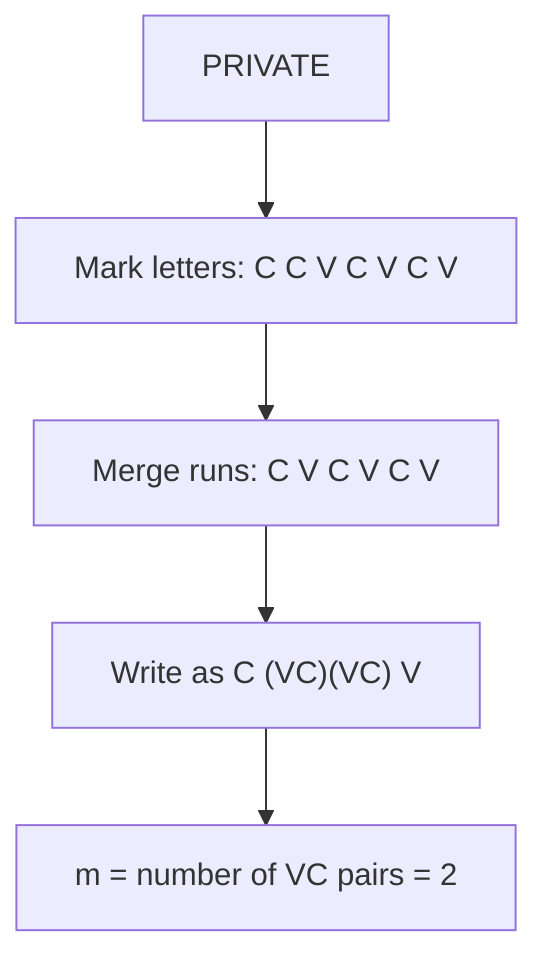

**In one line:** <mark>Stemming is a simplified form of morphological analysis used to find the root word</mark>; the <mark>Porter stemmer is a simple rule-based algorithm with 5 sets of rules, known for its speed and simplicity</mark>. <Cite id="class-nlp-m2" loc="p. 19" />

<Box kind="key">

**Key points to write (any Porter question):**

- <mark>Porter stemmer: a simple rule-based algorithm for stemming, with 5 sets of rules</mark>; it removes suffixes to get the stem. Developed by **Martin F. Porter**.
- <mark>Consonant: a letter other than a, e, i, o, u and other than y preceded by a consonant</mark>; every other letter is a vowel.
- <mark>Form of a word: $[C](VC)^m[V]$</mark>; $m$ (the **measure**) is the number of VC pairs.
- Measures to remember: <mark>TREE 0, TROUBLE 1, TRAP 1, TROUBLES 2, PRIVATE 2, RELATIONAL 4</mark>.
- <mark>Rule form: (condition) S1 to S2</mark>. Example: (m > 1) EMENT to nothing: REPLACEMENT becomes REPLAC.
- Use: **information retrieval**, because it reduces the number of terms, saving space and time.

</Box>

## Core answer (5 marks, fits every question here)

<Box kind="definition">

**Stemming** is a simplified form of morphological analysis which is basically used to find the root word. The **Porter stemmer** is a simple rule-based algorithm for stemming. It consists of 5 sets of rules and is known for its speed and simplicity. <Cite id="class-nlp-m2" loc="p. 19" />

</Box>

**Why:** it removes suffixes from English words, which helps information retrieval by reducing the number of terms (saving space and time). Example: connect, connected, connecting, connection all become **connect**. <Cite id="class-nlp-pyq2" loc="p. 2" /> <Cite id="web-nlp-1-wiki-stemming" />

**Consonants and vowels:** a consonant is a letter other than a, e, i, o, u and other than y preceded by a consonant; every other letter is a vowel. C is a string of consonants and V a string of vowels. <Cite id="class-nlp-pyq2" loc="p. 2" />

**Form and measure:** every word is $[C](VC)^m[V]$ and $m$ is the number of VC pairs. TREE has m = 0, TROUBLE and TRAP m = 1, TROUBLES and PRIVATE m = 2, RELATIONAL m = 4. <Cite id="class-nlp-m2" loc="p. 20" /> <Cite id="class-nlp-m2" loc="p. 21" />

**Rule form:** (condition) S1 to S2. If the word ends with S1 and the stem before S1 meets the condition, replace S1 with S2. Example: (m > 1) EMENT to nothing makes REPLACEMENT into REPLAC, since REPLAC has m = 2. <Cite id="class-nlp-pyq2" loc="p. 3" />

**Conclusion:** the Porter stemmer is fast and simple, but crude: the stem need not be a dictionary word (happy becomes happi).

## Extended answer (10 marks): add these

### 1. How to find m (three steps)

1. Write C for each consonant and V for each vowel.
2. Merge each run of equal letters: CC becomes C, VV becomes V.
3. Count how many times V is followed by C. That is m.

### 2. The five steps and their main rules

The class gives only the rule form; these are the standard rules from Porter's paper, shortened. <Cite id="web-nlp-1-porter-1980" /> <Cite id="web-nlp-1-porter-site" /> In the examples, a word is shown after **that step**.

| Step | Job | Main rules | Examples |
|---|---|---|---|
| 1a | Plurals | SSES to SS, IES to I, S to nothing | caresses to caress, ponies to poni, cats to cat |
| 1b | -ed and -ing | (stem has a vowel) ED or ING to nothing | plastered to plaster, motoring to motor |
| 1c | Final y | (stem has a vowel) Y to I | happy to happi |
| 2 | Long suffixes, (m > 0) | ATIONAL to ATE, IZER to IZE, IZATION to IZE, FULNESS to FUL | relational to relate, hopefulness to hopeful |
| 3 | More suffixes, (m > 0) | ICATE to IC, ALIZE to AL, FUL to nothing, NESS to nothing | triplicate to triplic, hopeful to hope |
| 4 | Remove suffixes, (m > 1) | AL, ANCE, ER, IC, ABLE, MENT, EMENT, ENT, ISM, ATE, OUS, IVE, IZE to nothing | revival to reviv, replacement to replac |
| 5a | Final e | (m > 1) E to nothing | probate to probat |
| 5b | Double l | (m > 1) LL to L | controll to control |

If more than one rule matches, the rule with the **longest S1** is used.

### 3. Worked traces

<Sum>

<Given>

the word **generalizations**.

</Given>

<Find>

its Porter stem.

</Find>

<Steps>

1. Step 1a: S to nothing: generalizations to **generalization**.
2. Step 2: (m > 0) IZATION to IZE. The stem GENERAL has m = 3: **generalize**.
3. Step 3: (m > 0) ALIZE to AL. The stem GENER has m = 2: **general**.
4. Step 4: (m > 1) AL to nothing. The stem GENER has m = 2: **gener**.
5. Step 5: no final e or double l, so nothing changes.

</Steps>

<Answer>

**gener**

</Answer>

<Box kind="verify">

GENERAL is C V C V C V C, so VC three times (m = 3); GENER is C V C V C, so m = 2. Both exceed the limits the rules need. The standard Porter program also returns gener.

</Box>

</Sum>

More traces: **relational**: step 2 gives relate (stem REL has m = 1), step 5a removes e (RELAT has m = 2): **relat**. **hopefulness**: step 2 gives hopeful, step 3 gives hope, and step 5a keeps the e because HOP is consonant-vowel-consonant with m = 1: **hope**.

### 4. Advantages and limits

| Advantages | Limits |
|---|---|
| Fast and simple, rule based | Crude: roots need not be real words (happy to happi, studies to studi) |
| Fewer terms, so less space and time in IR <Cite id="class-nlp-m2" loc="p. 19" /> | Different words get one stem (universe, university, universal all give univers) |
| No dictionary needed | Lemmatization uses a dictionary and returns real words (better to good) <Cite id="class-nlp-asol" loc="p. 12" /> |

## Fit it to each question

- **"Explain Porter Stemming algorithm in detail"** (10 marks) <PYQ id="2022-12-ce/q6b" /> <PYQ id="2023-12-ce/q5a" /> <PYQ id="2024-12-ce/q5a" /> <PYQ id="2025-05/q3a" />: full core answer, section 1, the steps table (section 2) and one trace.
- **"Explain Porter Stemmer algorithm with rules"** (10 marks) <PYQ id="2023-05-ce/q5b" /> <PYQ id="2026-05/q6b" />: shorten the core, give the **steps table** in full and one trace.
- **"Explain Porter's Stemming Algorithm with example and rules."** (10 marks) <PYQ id="assignment-1/q2b" />: rule form with the EMENT example, the steps table and the generalizations trace.
- **"Explain Porter's Stemming algorithm with example."** (10 marks) <PYQ id="2024-12/q2b" />: rule form, the flow diagram and the three traces of section 3.
- **"Illustrate the working of Porter stemmer algorithm"** (10 marks) <PYQ id="2024-05-ce/q2b" />: the five-step flow diagram and a step-by-step trace (generalizations).

## Exam tips

- **Draw the five-step flow** and write the form $[C](VC)^m[V]$ with the six measure examples.
- In a trace, write **the rule and the value of m** at every step; that earns the marks.
- Mention one limit (crude stems like happi) to show you know the stemmer's weakness.
