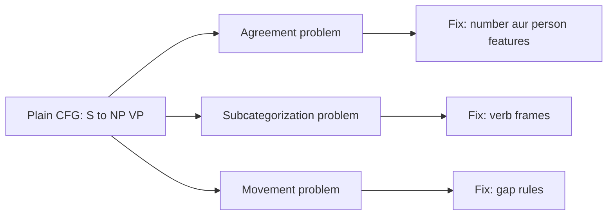
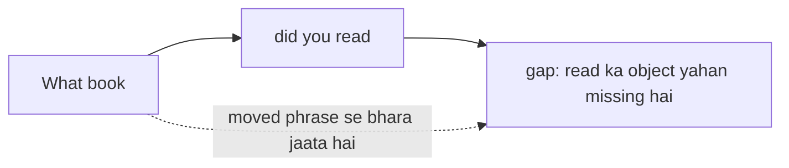

**Ek line mein:** <mark>Plain CFG sentence ki shape batata hai par agreement, verb ke complements aur moved phrases check nahi kar sakta</mark>: teen problems hain <mark>agreement, subcategorization aur movement</mark>. <Cite id="class-nlp-qb1" loc="Module 3" />

<Box kind="key">

**Ye points likho:**

- <mark>Agreement: words ka number, person aur gender match hona chahiye</mark> ("He walks", "He walk" nahi).
- <mark>Subcategorization: a verb allows only certain complements</mark> (sleep: koi nahi, eat: ek object, give: do).
- <mark>Movement: a phrase appears away from its normal place</mark> ("What book did you read?").
- Plain rule <mark>S → NP VP galat sentences bhi accept kar leta hai</mark>.
- Remedies: <mark>features (number, person), verb frames, gap (slash) rules</mark>.
- Har problem ke liye **ek sahi aur ek galat sentence** do.

</Box>

## Core answer (5 marks, yahan ke har question ke liye)

<Box kind="definition">

**Context-free grammar (CFG)** rewrite rules ki list hai jaise S → NP VP. Ye sentence ka structure banata hai par sirf word **categories** dekhta hai, words ke beech ke chhote links nahi. <Cite id="web-nlp-1-wiki-cfg" />

</Box>

| Problem | Sahi sentence | Galat sentence jo plain CFG accept kar leta hai | Remedy |
|---|---|---|---|
| Agreement | He walks. The dogs bark. | He walk. The dogs barks. | Features (number, person) jo match karein |
| Subcategorization | He eats rice. | He sleeps a book. | Verb types ya frames |
| Movement | What book did you read? | (object verb se door hai) | Gap (slash) rules |

Class question bank mein ye teen problems listed hain par notes nahi hain, isliye yahan standard short explanation hai. <Cite id="class-nlp-qb1" loc="Module 3" />

**Conclusion:** asli language describe karne ke liye plain CFG ko extra information (features, verb frames, gap rules) chahiye.

## Extended answer (10 marks): ye add karo

### 1. Agreement

Rule S → NP VP number check nahi karta. "The dogs barks" ko plain rules se rokne ke liye alag rules likhne padte hain: S → NP-sg VP-sg aur S → NP-pl VP-pl, aur person ke liye bhi. Grammar **bahut bada** ho jaata hai. Features se ek hi rule likhte hain aur condition lagate hain **number(NP) = number(VP)**. <Cite id="web-nlp-1-slp3-cfg" />

| Words | Number | Valid? |
|---|---|---|
| He walks | singular + singular | haan |
| He walk | singular + plural verb | nahi |
| The dogs bark | plural + plural | haan |
| The dogs barks | plural + singular verb | nahi |

### 2. Subcategorization

Verb sirf kuch complements allow karta hai. Plain rule VP → V NP har verb ko object ke saath accept kar leta hai. <Cite id="web-nlp-1-wiki-subcat" />

| Verb type | Kya leta hai | Rule | Example |
|---|---|---|---|
| Intransitive | koi object nahi | VP → V | He sleeps |
| Transitive | ek object | VP → V NP | He eats rice |
| Ditransitive | do objects | VP → V NP NP | He gave her a book |

"He sleeps a book" galat hai kyunki *sleep* intransitive hai. Remedy: verbs ko types mein baanto (upar jaisa), ya har verb ka frame (jo complements allow hain) store karo.

### 3. Movement

"What book did you read?" mein *book*, *read* ka object hai, par shuru mein aa gaya; *read* ke baad ek **gap** reh gaya. Simple CFG object verb ke turant baad expect karta hai, isliye moved phrase ko gap se nahi jod pata. Remedy: gap (slash) rules jo missing phrase yaad rakhte hain aur tree mein neeche pass karte hain. <Cite id="web-nlp-1-wiki-whmove" />

### 4. Teeno ka summary

| | Agreement | Subcategorization | Movement |
|---|---|---|---|
| Kya check hota hai | Number, person ka match | Verb ke allowed complements | Moved phrase ka gap se link |
| Plain CFG ki problem | He walk accept karta hai | He sleeps a book accept karta hai | Door ke words jod nahi paata |
| Fix | Features | Verb frames | Gap rules |

## Har question mein kaise fit karein

- **"Discuss the following potential problems in CFG such as 1) Agreement 2) Sub categorization 3) Movement"** (10 marks) <PYQ id="2024-12/q5b" /> <PYQ id="assignment-1/q3d" />: core table aur diagram, phir section 1, 2, 3 har ek example ke saath, aur section 4 summary. Teeno cover karo: har ek ke lagbhag teesre hisse ke marks hain.

## Exam tips

- Har problem ke liye **ek sahi aur ek galat sentence** do; galat wala problem dikhata hai.
- Har ka **remedy** ek phrase mein likho (features, frames, gap rules).
- Pehle teen-branch diagram draw karo; isse answer organised hota hai.

Exam mein English mein likho.
