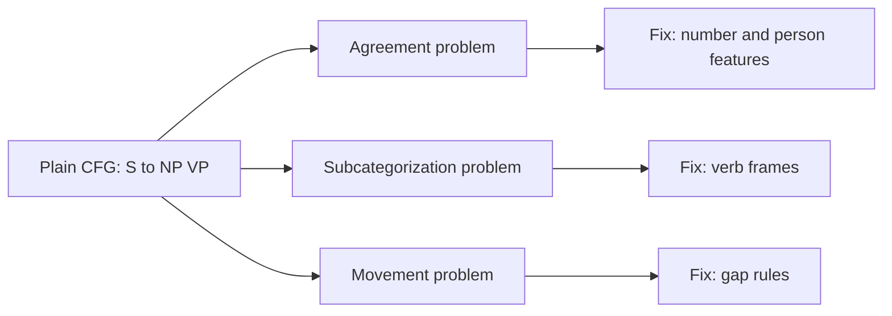
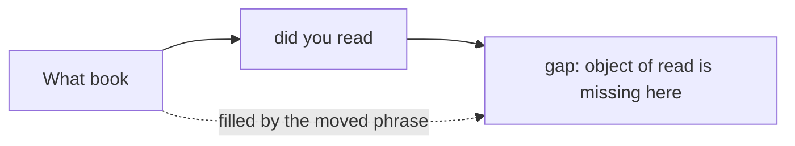

**In one line:** <mark>A plain CFG describes the shape of a sentence but cannot check agreement, verb complements or moved phrases</mark>: the three problems are <mark>agreement, subcategorization and movement</mark>. <Cite id="class-nlp-qb1" loc="Module 3" />

<Box kind="key">

**Key points to write:**

- <mark>Agreement: words must match in number, person and gender</mark> ("He walks", not "He walk").
- <mark>Subcategorization: a verb allows only certain complements</mark> (sleep: none, eat: one object, give: two).
- <mark>Movement: a phrase appears away from its normal place</mark> ("What book did you read?").
- A plain rule such as <mark>S → NP VP accepts the wrong sentences</mark> too.
- Remedies: <mark>features (number, person), verb frames, gap (slash) rules</mark>.
- Always give **one right and one wrong sentence** for each problem.

</Box>

## Core answer (5 marks, fits every question here)

<Box kind="definition">

A **context-free grammar (CFG)** is a list of rewrite rules such as S → NP VP. It builds the structure of a sentence but looks only at word **categories**, not at small links between words. <Cite id="web-nlp-1-wiki-cfg" />

</Box>

| Problem | Right sentence | Wrong sentence a plain CFG still accepts | Remedy |
|---|---|---|---|
| Agreement | He walks. The dogs bark. | He walk. The dogs barks. | Features (number, person) that must match |
| Subcategorization | He eats rice. | He sleeps a book. | Verb types or frames |
| Movement | What book did you read? | (object is far from its verb) | Gap (slash) rules |

The class question bank lists these three problems but gives no notes, so the explanation here is the standard short version. <Cite id="class-nlp-qb1" loc="Module 3" />

**Conclusion:** a plain CFG needs extra information (features, verb frames, gap rules) to describe real language.

## Extended answer (10 marks): add these

### 1. Agreement

The rule S → NP VP has no check on number. To block "The dogs barks" with plain rules we must write separate rules: S → NP-sg VP-sg and S → NP-pl VP-pl, and the same for person. The grammar then becomes **very large**. With features we write one rule and add the condition **number(NP) = number(VP)**. <Cite id="web-nlp-1-slp3-cfg" />

| Words | Number | Valid? |
|---|---|---|
| He walks | singular + singular | yes |
| He walk | singular + plural verb | no |
| The dogs bark | plural + plural | yes |
| The dogs barks | plural + singular verb | no |

### 2. Subcategorization

A verb allows only some complements. A plain rule VP → V NP would accept any verb with an object. <Cite id="web-nlp-1-wiki-subcat" />

| Verb type | Takes | Rule | Example |
|---|---|---|---|
| Intransitive | no object | VP → V | He sleeps |
| Transitive | one object | VP → V NP | He eats rice |
| Ditransitive | two objects | VP → V NP NP | He gave her a book |

"He sleeps a book" is wrong because *sleep* is intransitive. Remedy: split the verbs into types (as above), or store each verb's frame (the complements it allows).

### 3. Movement

In "What book did you read?" the word *book* is the object of *read*, yet it stands at the start; a **gap** is left after *read*. A simple CFG expects the object right after the verb, so it cannot connect the moved phrase to its gap. Remedy: gap (slash) rules that remember the missing phrase and pass it down the tree. <Cite id="web-nlp-1-wiki-whmove" />

### 4. Summary of the three

| | Agreement | Subcategorization | Movement |
|---|---|---|---|
| What is checked | Match of number, person | Allowed complements of a verb | Link of moved phrase to its gap |
| Plain CFG problem | Accepts He walk | Accepts He sleeps a book | Cannot link far words |
| Fix | Features | Verb frames | Gap rules |

## Fit it to each question

- **"Discuss the following potential problems in CFG such as 1) Agreement 2) Sub categorization 3) Movement"** (10 marks) <PYQ id="2024-12/q5b" /> <PYQ id="assignment-1/q3d" />: core table and diagram, then sections 1, 2 and 3 with one example each, and the section 4 summary. Cover all three: each carries about a third of the marks.

## Exam tips

- **Give a right and a wrong sentence** for every problem; the wrong one shows the problem.
- Name the **remedy** for each in one phrase (features, frames, gap rules).
- Draw the three-branch diagram first; it organises the answer.
