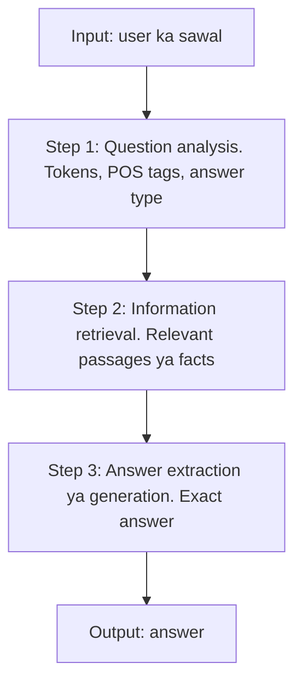
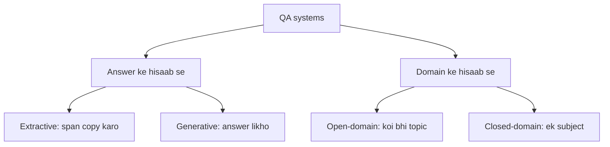

**Ek line mein:** <mark>Question Answering (QA) system ek AI program hai jo human-language ke sawalon ka jawab precise facts ya chhote passages se deta hai, documents ki lambi list se nahi</mark>. <Cite id="class-nlp-m6" loc="slide 15" />

<Box kind="key">

**Ye points likho:**

- <mark>QA system: human-language sawalon ka jawab precise facts ya short passages se deta hai</mark>, documents ki list nahi.
- <mark>Pipeline: question analysis, information retrieval, answer extraction ya generation</mark>.
- <mark>Question analysis: tokenize, stop words hatao, POS tag, expected answer type dhoondho</mark> (who = person, when = date).
- <mark>Retrieval: document store, knowledge graph ya vector database mein relevant passages search karo</mark>.
- <mark>Answer extraction ya generation: BERT ya LLM exact answer chunta ya likhta hai</mark>.
- Types: **extractive, generative, open-domain, closed-domain**.

</Box>

## Core answer (5 marks, yahan ke har question ke liye)

<Box kind="definition">

A **Question Answering (QA) system** in NLP is an artificial intelligence program that automatically answers human-language questions with precise facts or short passages instead of returning a long list of whole documents. <Cite id="class-nlp-m6" loc="slide 15" />

</Box>

**Algorithm (pipeline):** <Cite id="class-nlp-m6" loc="slide 15" /> <Cite id="class-nlp-m6" loc="slide 16" />

1. **Question analysis / processing:** question ko tokenize karta hai, stop words hatata hai, part-of-speech (POS) tagging karta hai aur expected answer type pehchanta hai (person, location, date ya definition, who, what, when jaise words se).
2. **Information retrieval (IR):** document store, knowledge graph ya vector database mein relevant passages ya facts search karta hai.
3. **Answer extraction / generation:** deep learning ya Transformer models (BERT ya generative LLMs) retrieved context se exact answer nikalte ya likhte hain.

**Example:** "Who wrote Hamlet?" Step 1 *who* se answer type *person* nikalta hai. Step 2 Hamlet ke passages retrieve karta hai. Step 3 span "Shakespeare" chunta hai. (Ye example samajhne ke liye add kiya hai; slides mein nahi hai.)

**Conclusion:** QA algorithm hai question analysis, phir retrieval, phir answer extraction ya generation.

## Extended answer (10 marks): ye add karo

### 1. QA systems ke types

- **Extractive QA:** diye gaye document se exact text span nikalta hai, start aur end positions compute karke.
- **Generative (abstractive) QA:** large language model retrieved data ya seekhi hui cheezon se fluent answer likhta hai.
- **Open-domain:** unrestricted data (Wikipedia, virtual assistants) se broad sawal.
- **Closed-domain:** special vocabulary wala narrow subject (medical ya legal). <Cite id="class-nlp-m6" loc="slide 16" />

### 2. Stages detail mein

| Stage | Kya karta hai | "Who wrote Hamlet?" ke liye |
|---|---|---|
| Question analysis | tokens, stop-word removal, POS tags, answer type | keywords: wrote, Hamlet; type: person |
| Retrieval | IR system se relevant passages | Hamlet wale passages |
| Answer extraction | answer chuno ya likho | "Shakespeare" |

Retrieval stage information retrieval hai: sawal query ban jaata hai, aur system best passages deta hai. <Cite id="web-nlp-2-slp3-ir" loc="§11.1" /> Phir language model un passages se answer likh sakta hai; ise **retrieval-augmented generation (RAG)** kehte hain. <Cite id="web-nlp-2-slp3-ir" loc="§11.4" />

### 3. QA system ka evaluation

- **Exact match:** predicted answers ka wo percentage jo gold answer se bilkul match karte hain.
- **Token F1:** free-text answers ke liye predicted aur gold answer ke words ka overlap. <Cite id="web-nlp-2-slp3-ir" loc="§11.6" />

<Sum>

<Given>

Sawal "Who wrote Hamlet?" Gold answer "Shakespeare". Predicted answer "William Shakespeare".

</Given>

<Find>

exact match aur token F1.

</Find>

<Steps>

1. Strings alag hain, isliye exact match $= 0$.
2. Common tokens: *Shakespeare* (1). Precision $= 1/2 = 0.5$ (2 predicted tokens mein se 1). Recall $= 1/1 = 1$ (1 gold token mein se 1).
3. $F_1 = 2PR/(P+R) = 2 \times 0.5 \times 1 / 1.5 = 0.667$.

</Steps>

<Answer>

Exact match 0, token F1 = 0.667.

</Answer>

<Box kind="verify">

F1 precision (0.5) aur recall (1) ke beech hai aur chhote wale ke paas hai, jaisa harmonic mean ko hona chahiye.

</Box>

</Sum>

### 4. Advantages, limits aur uses

| Advantages | Limits |
|---|---|
| Exact answer deta hai, user ka time bachta hai | Retrieval galat passage laye to answer galat |
| Natural language mein kaam karta hai | Reasoning ya opinion wale sawal mushkil |
| Search engines, virtual assistants, customer support mein use | Generative models galat facts bol sakte hain |

<Cite id="web-nlp-2-qa" />

## Har question mein kaise fit karein

- **"Explain Question Answering system (QAS) in detail."** (10 marks) <PYQ id="2023-12-ce/q6a" />: pipeline diagram aur image ke saath core answer, phir sections 1, 2 aur 4.
- **"Question Answering System"** (5 marks) <PYQ id="2024-12/q6d" />: core answer.
- **"Explain Question Answering System with Algorithmic approach"** (10 marks) <PYQ id="2025-05-ce/q6b" />: teen-step algorithm step diagram aur *Who wrote Hamlet* example ke saath, phir section 1 (types) aur section 3 (evaluation).

## Exam tips

- **Draw karo:** teen-box pipeline; step 1 mein "answer type" likho.
- Bolo **"precise answer, documents ki list nahi"**; search engine se yahi farq hai.
- 10 marks ke liye **extractive aur generative** types add karo.

Exam mein English mein likho.
