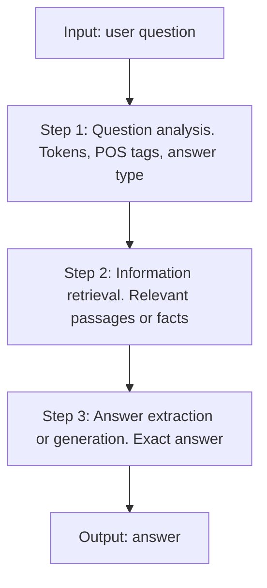
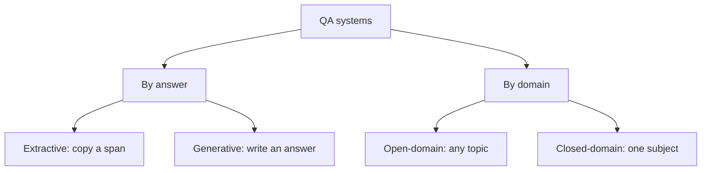

**In one line:** <mark>A Question Answering (QA) system is an AI program that automatically answers human-language questions with precise facts or short passages instead of a long list of documents</mark>. <Cite id="class-nlp-m6" loc="slide 15" />

<Box kind="key">

**Key points to write:**

- <mark>QA system: answers human-language questions with precise facts or short passages</mark>, not a list of documents.
- <mark>Pipeline: question analysis, information retrieval, answer extraction or generation</mark>.
- <mark>Question analysis: tokenize, remove stop words, POS tag, find the expected answer type</mark> (who = person, when = date).
- <mark>Retrieval: search a document store, knowledge graph or vector database for relevant passages</mark>.
- <mark>Answer extraction or generation: BERT or an LLM picks or writes the exact answer</mark>.
- Types: **extractive, generative, open-domain, closed-domain**.

</Box>

## Core answer (5 marks, fits every question here)

<Box kind="definition">

A **Question Answering (QA) system** in NLP is an artificial intelligence program that automatically answers human-language questions with precise facts or short passages instead of returning a long list of whole documents. <Cite id="class-nlp-m6" loc="slide 15" />

</Box>

**Algorithm (the pipeline):** <Cite id="class-nlp-m6" loc="slide 15" /> <Cite id="class-nlp-m6" loc="slide 16" />

1. **Question analysis / processing:** tokenizes the question, removes stop words, does part-of-speech (POS) tagging and identifies the expected answer type (person, location, date or definition, using words like who, what, when).
2. **Information retrieval (IR):** searches a document store, knowledge graph or vector database for relevant passages or facts.
3. **Answer extraction / generation:** uses deep learning or Transformer models (like BERT or generative LLMs) to pinpoint or write the exact answer from the retrieved context.

**Example:** "Who wrote Hamlet?" Step 1 finds the answer type *person* (from *who*). Step 2 retrieves passages about Hamlet. Step 3 picks the span "Shakespeare". (This example is added for clarity; it is not on the slides.)

**Conclusion:** the QA algorithm is question analysis, then retrieval, then answer extraction or generation.

## Extended answer (10 marks): add these

### 1. Types of QA systems

- **Extractive QA:** pulls the exact text span from a given document, computing start and end positions.
- **Generative (abstractive) QA:** a large language model writes a fluent answer from retrieved data or from what it learned.
- **Open-domain:** broad questions from unrestricted data (Wikipedia, virtual assistants).
- **Closed-domain:** a narrow subject with special vocabulary (medical or legal). <Cite id="class-nlp-m6" loc="slide 16" />

### 2. The stages in more detail

| Stage | What it does | Example for "Who wrote Hamlet?" |
|---|---|---|
| Question analysis | tokens, stop-word removal, POS tags, answer type | keywords: wrote, Hamlet; type: person |
| Retrieval | find relevant passages with an IR system | passages that mention Hamlet |
| Answer extraction | pick or write the answer | "Shakespeare" |

The retrieval stage is information retrieval: the question becomes a query, and the system returns the best passages. <Cite id="web-nlp-2-slp3-ir" loc="§11.1" /> A language model can then write the answer from those passages; this is **retrieval-augmented generation (RAG)**. <Cite id="web-nlp-2-slp3-ir" loc="§11.4" />

### 3. Evaluating a QA system

- **Exact match:** the percentage of predicted answers that match the gold answer exactly.
- **Token F1:** the overlap of words between the predicted and the gold answer, for free-text answers. <Cite id="web-nlp-2-slp3-ir" loc="§11.6" />

<Sum>

<Given>

Question "Who wrote Hamlet?" Gold answer "Shakespeare". Predicted answer "William Shakespeare".

</Given>

<Find>

exact match and token F1.

</Find>

<Steps>

1. The strings differ, so exact match $= 0$.
2. Common tokens: *Shakespeare* (1). Precision $= 1/2 = 0.5$ (1 of the 2 predicted tokens). Recall $= 1/1 = 1$ (1 of the 1 gold token).
3. $F_1 = 2PR/(P+R) = 2 \times 0.5 \times 1 / 1.5 = 0.667$.

</Steps>

<Answer>

Exact match 0, token F1 = 0.667.

</Answer>

<Box kind="verify">

F1 lies between precision (0.5) and recall (1) and is closer to the smaller one, as the harmonic mean should be.

</Box>

</Sum>

### 4. Advantages, limits and uses

| Advantages | Limits |
|---|---|
| Gives the exact answer, saving the user's time | Wrong answer if retrieval brings the wrong passage |
| Works in natural language | Hard for questions needing reasoning or opinion |
| Used in search engines, virtual assistants, customer support | Generative models can state wrong facts |

<Cite id="web-nlp-2-qa" />

## Fit it to each question

- **"Explain Question Answering system (QAS) in detail."** (10 marks) <PYQ id="2023-12-ce/q6a" />: the core answer with the pipeline diagram and the image, then sections 1, 2 and 4.
- **"Question Answering System"** (5 marks) <PYQ id="2024-12/q6d" />: the core answer.
- **"Explain Question Answering System with Algorithmic approach"** (10 marks) <PYQ id="2025-05-ce/q6b" />: the three-step algorithm with the step diagram and the *Who wrote Hamlet* example, then section 1 (types) and section 3 (evaluation).

## Exam tips

- **Draw** the three-box pipeline; write "answer type" in step 1.
- Say **"precise answer, not a list of documents"**; it is the difference from a search engine.
- Add the **extractive and generative** types for 10 marks.
