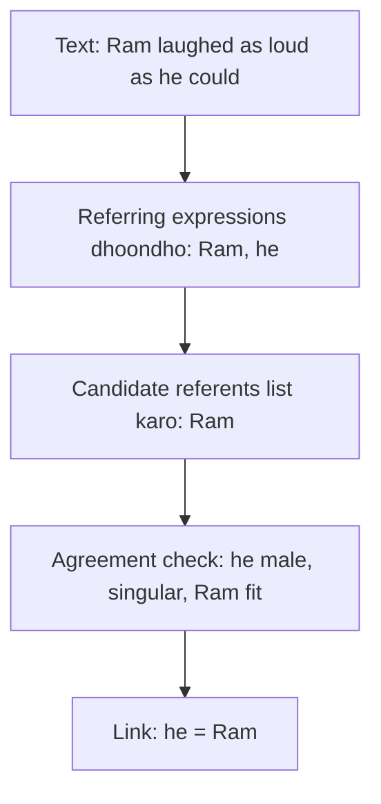
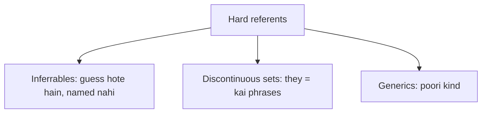

**Ek line mein:** <mark>Reference resolution har referring expression (jaise he, it, the book, Ram) ka referent (duniya ki wo cheez ya insaan jise wo point karta hai) dhoondhne ka kaam hai</mark>, taaki ek hi cheez ke saare mentions jud jayein. <Cite id="class-nlp-asol" loc="p. 5" />

<Box kind="key">

**Ye points likho:**

- <mark>Referring expression: kisi insaan, object ya idea ko point karne wala word ya phrase. Referent: jise wo point karta hai. Antecedent: pehle wala phrase jiski taraf wo peeche point karta hai</mark>.
- <mark>Reference resolution: har referring expression ka referent ya antecedent dhoondhna</mark>. "Ram laughed as loud as he could": *he* = Ram.
- Referring expressions ke paanch types: **indefinite NP, definite NP, pronoun, demonstrative, name**.
- **Anaphora** peeche point karta hai; **cataphora** aage.
- <mark>Hard cases: inferrables, discontinuous sets, generics</mark> (koi ek earlier noun fit nahi hota).
- <mark>Constraints: pronoun aur antecedent ka number, person, case aur gender mein agreement</mark>.

</Box>

## Core answer (5 marks, yahan ke har question ke liye)

<Box kind="definition">

A **referring expression** is a word or phrase used to point to a person, object or idea. The thing it points to is its **referent**. When it points back to an earlier phrase, that phrase is the **antecedent**. **Reference resolution** is the job of finding the referent (or antecedent) of every referring expression. <Cite id="class-nlp-asol" loc="p. 5" /> <Cite id="web-nlp-2-referring" />

</Box>

**Example:** "Ram laughed as loud as he could." *he* resolve karo to *Ram* milta hai. "Taylor went to the store. She bought groceries." *She* = Taylor. <Cite id="class-nlp-asol" loc="p. 1" />

**Kyun chahiye:** sirf ek sentence nahi batata ki *he* ya *it* kaun hai; resolution ke bina computer text follow nahi kar sakta, pronouns translate nahi kar sakta ya sawalon ke jawab nahi de sakta.

**Steps:**

1. Referring expressions dhoondho (Ram, he).
2. Candidate referents list karo (Ram).
3. Agreement check karo: *he* male aur singular hai, *Ram* fit hota hai.
4. Link karo: he = Ram.

**Referring expressions ke types** (class answer): indefinite noun phrase (*some food*), definite noun phrase (*The Times of India*), pronoun (*he*), demonstrative (*this, that*) aur name (*Ram*). <Cite id="class-nlp-asol" loc="p. 4" />

**Conclusion:** reference resolution har pronoun ya phrase ko us cheez se jodta hai jiski jagah wo hai, taaki text ek jude hue kahani ki tarah samjha jaye.

## Extended answer (10 marks): ye add karo

### 1. Referring expressions ke paanch types

| Type | Meaning | Example |
|---|---|---|
| Indefinite NP | listener ke liye naya (a, an, some) | "bring him **some food**" |
| Definite NP | pehle se known (the) | "I used to read **The Times of India**" |
| Pronoun | repetition bachane ko noun ki jagah | "Ram laughed as loud as **he** could" |
| Demonstrative | point karta hai, doori dikhata hai (this, that) | "**This** is my book" |
| Name | seedha, context nahi chahiye | "**Ram**", India, Microsoft |

<Cite id="class-nlp-asol" loc="p. 4" /> <Cite id="class-nlp-asol" loc="p. 5" /> <Cite id="web-nlp-2-slp3-coref" loc="§24.1.1" />

### 2. Anaphora, cataphora aur coreference

- **Anaphora:** expression peeche point karta hai: "Ram came. **He** sat."
- **Cataphora:** expression aage point karta hai: "When **he** came, Ram sat." <Cite id="web-nlp-2-anaphora" /> <Cite id="web-nlp-2-cataphora" />
- **Coreference:** jab do expressions real-world ke ek hi entity ko point karein to wo coreference chain banate hain (Ram, he, him). <Cite id="web-nlp-2-coreference" />

### 3. Teen referents jo problem mushkil banate hain

1. **Inferrables:** referent kabhi named nahi hua par kisi named cheez se guess ho sakta hai. "I went to a superb restaurant. **The chef** had just opened it": chef restaurant se belong karta hai. <Cite id="web-nlp-2-slp3-coref" loc="§24.1.2" />
2. **Discontinuous sets:** ek plural pronoun kai alag phrases ko point karta hai. "**Ram** met **Sita**. **They** went home."
3. **Generics:** pronoun ek poori kind ko mean karta hai, ek cheez ko nahi. "I love mangos. **They** are very tasty." <Cite id="web-nlp-2-slp3-coref" loc="§24.1.3" />

Ye bhi mushkil hai: pleonastic *it* ("it is raining") kisi cheez ko refer nahi karta. <Cite id="web-nlp-2-slp3-coref" loc="§24.1.3" />

### 4. Resolution mein madad karne wale clues

| Clue | Example |
|---|---|
| Number agreement | plural antecedent jaise *the chefs* ke saath *she* nahi aa sakta |
| Person agreement | third-person pronoun ko third-person antecedent chahiye |
| Gender agreement | *he* ko male antecedent chahiye: "Maryam has a theorem. **She** is exciting" mein she = Maryam |
| Recency | haal ke sentences ke entities zyada likely |
| Grammatical role | subject object se zyada likely: "Billy Bones went to the bar with Jim. **He** called for rum" mein he = Billy |

<Cite id="web-nlp-2-slp3-coref" loc="§24.1.4" />

### 5. Methods

Hobbs algorithm syntactic tree search karta hai aur Centering algorithm discourse ka focus track karta hai; modern systems trained models use karte hain jo candidate antecedents ko rank karte hain. <Cite id="class-nlp-asol" loc="p. 3" /> <Cite id="web-nlp-2-slp3-coref" loc="§24.4" />

## Har question mein kaise fit karein

- **"What is reference resolution?"** (5 marks) <PYQ id="2023-12-ce/q1e" />: definition, *Ram* example aur chaar-step diagram.
- **"Explain reference resolution in detail"** (5 marks) <PYQ id="2024-12-ce/q1b" />: core answer, paanch types ek line mein.
- **"Discuss reference resolution problem in detail"** (5 marks) <PYQ id="2025-05/q1c" /> aur (10 marks) <PYQ id="2024-12/q4a" />: core answer; 10 marks ke liye sections 1, 3 aur 4 add karo.
- **"Explain Discourse reference resolution in detail"** (10 marks) <PYQ id="2023-05-ce/q3b" />: core answer, phir sections 1 se 5.
- **"Explain three types of referents that complicate the reference resolution problem."** (5 marks) <PYQ id="2023-05-ce/q1c" />: section 3 uske diagram ke saath, plus ek line ki definition.
- **"Illustrate the reference phenomena for solving the pronoun problem"** (10 marks) <PYQ id="2024-05-ce/q5a" />: section 1 (paanch types), section 2 (anaphora aur cataphora), section 3 aur section 4 ke agreement clues.

## Exam tips

- Teen words **define karo**: referring expression, referent aur antecedent; examiner inhe dhoondhte hain.
- **Har type ka ek example** do (indefinite, definite, pronoun, demonstrative, name).
- Teeno hard referents (**inferrables, discontinuous sets, generics**) ke liye example sentence zaroor likho.

Exam mein English mein likho.
