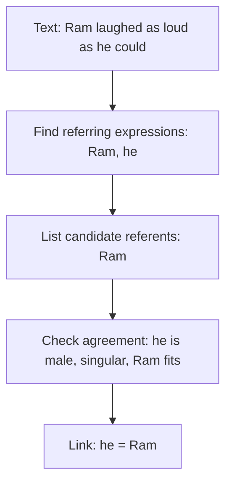
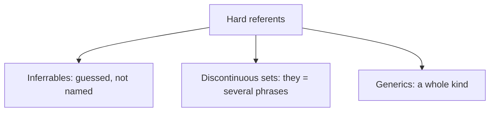

**In one line:** <mark>Reference resolution is the job of finding the referent (the thing or person in the world) that every referring expression such as he, it, the book or Ram points to</mark>, so that all mentions of the same thing are linked together. <Cite id="class-nlp-asol" loc="p. 5" />

<Box kind="key">

**Key points to write:**

- <mark>Referring expression: a word or phrase used to point to a person, object or idea. Referent: the thing it points to. Antecedent: the earlier phrase it points back to</mark>.
- <mark>Reference resolution: finding the referent or antecedent of every referring expression</mark>. "Ram laughed as loud as he could": *he* = Ram.
- Five types of referring expressions: **indefinite NP, definite NP, pronoun, demonstrative, name**.
- **Anaphora** points back; **cataphora** points forward.
- <mark>Hard cases: inferrables, discontinuous sets, generics</mark> (no single earlier noun fits).
- <mark>Constraints: agreement in number, person, case and gender between the pronoun and its antecedent</mark>.

</Box>

## Core answer (5 marks, fits every question here)

<Box kind="definition">

A **referring expression** is a word or phrase used to point to a person, object or idea. The thing it points to is its **referent**. When it points back to an earlier phrase, that phrase is the **antecedent**. **Reference resolution** is the job of finding the referent (or antecedent) of every referring expression. <Cite id="class-nlp-asol" loc="p. 5" /> <Cite id="web-nlp-2-referring" />

</Box>

**Example:** "Ram laughed as loud as he could." Resolving *he* gives *Ram*. "Taylor went to the store. She bought groceries." *She* = Taylor. <Cite id="class-nlp-asol" loc="p. 1" />

**Why it is needed:** a sentence alone does not say who *he* or *it* is; without resolution a computer cannot follow a text, translate pronouns or answer questions.

**Steps:**

1. Find the referring expressions (Ram, he).
2. List the candidate referents (Ram).
3. Check agreement: *he* is male and singular, *Ram* fits.
4. Link: he = Ram.

**Types of referring expressions** (class answer): indefinite noun phrase (*some food*), definite noun phrase (*The Times of India*), pronoun (*he*), demonstrative (*this, that*) and name (*Ram*). <Cite id="class-nlp-asol" loc="p. 4" />

**Conclusion:** reference resolution links every pronoun or phrase to the thing it stands for, so that the text is understood as one connected story.

## Extended answer (10 marks): add these

### 1. The five types of referring expressions

| Type | Meaning | Example |
|---|---|---|
| Indefinite NP | something new to the listener (a, an, some) | "bring him **some food**" |
| Definite NP | something already known (the) | "I used to read **The Times of India**" |
| Pronoun | replaces a noun to avoid repetition | "Ram laughed as loud as **he** could" |
| Demonstrative | points, shows distance (this, that) | "**This** is my book" |
| Name | direct, needs no context | "**Ram**", India, Microsoft |

<Cite id="class-nlp-asol" loc="p. 4" /> <Cite id="class-nlp-asol" loc="p. 5" /> <Cite id="web-nlp-2-slp3-coref" loc="§24.1.1" />

### 2. Anaphora, cataphora and coreference

- **Anaphora:** the expression points back: "Ram came. **He** sat."
- **Cataphora:** the expression points forward: "When **he** came, Ram sat." <Cite id="web-nlp-2-anaphora" /> <Cite id="web-nlp-2-cataphora" />
- **Coreference:** two expressions that point to the same real-world entity form a coreference chain (Ram, he, him). <Cite id="web-nlp-2-coreference" />

### 3. Three kinds of referents that complicate the problem

1. **Inferrables:** the referent was never named but can be guessed from something that was. "I went to a superb restaurant. **The chef** had just opened it": the chef belongs to the restaurant. <Cite id="web-nlp-2-slp3-coref" loc="§24.1.2" />
2. **Discontinuous sets:** one plural pronoun points to several separate phrases. "**Ram** met **Sita**. **They** went home."
3. **Generics:** the pronoun means a whole kind, not one thing. "I love mangos. **They** are very tasty." <Cite id="web-nlp-2-slp3-coref" loc="§24.1.3" />

Also hard: pleonastic *it* ("it is raining") does not refer to anything. <Cite id="web-nlp-2-slp3-coref" loc="§24.1.3" />

### 4. Clues that help the resolution

| Clue | Example |
|---|---|
| Number agreement | a plural antecedent such as *the chefs* cannot go with *she* |
| Person agreement | a third-person pronoun needs a third-person antecedent |
| Gender agreement | *he* needs a male antecedent: "Maryam has a theorem. **She** is exciting" means Maryam |
| Recency | entities from recent sentences are more likely |
| Grammatical role | a subject is more likely than an object: "Billy Bones went to the bar with Jim. **He** called for rum" means Billy |

<Cite id="web-nlp-2-slp3-coref" loc="§24.1.4" />

### 5. Methods

The Hobbs algorithm searches the syntactic tree and the Centering algorithm tracks the focus of the discourse; modern systems use trained models that rank the candidate antecedents. <Cite id="class-nlp-asol" loc="p. 3" /> <Cite id="web-nlp-2-slp3-coref" loc="§24.4" />

## Fit it to each question

- **"What is reference resolution?"** (5 marks) <PYQ id="2023-12-ce/q1e" />: definition, the *Ram* example and the four-step diagram.
- **"Explain reference resolution in detail"** (5 marks) <PYQ id="2024-12-ce/q1b" />: the core answer including the five types in one line.
- **"Discuss reference resolution problem in detail"** (5 marks) <PYQ id="2025-05/q1c" /> and (10 marks) <PYQ id="2024-12/q4a" />: the core answer; for 10 marks add sections 1, 3 and 4.
- **"Explain Discourse reference resolution in detail"** (10 marks) <PYQ id="2023-05-ce/q3b" />: core answer, then sections 1 to 5.
- **"Explain three types of referents that complicate the reference resolution problem."** (5 marks) <PYQ id="2023-05-ce/q1c" />: section 3 with its diagram, plus one line of definition.
- **"Illustrate the reference phenomena for solving the pronoun problem"** (10 marks) <PYQ id="2024-05-ce/q5a" />: section 1 (five types), section 2 (anaphora and cataphora), section 3 and the agreement clues of section 4.

## Exam tips

- **Define the three words** referring expression, referent and antecedent; examiners look for them.
- Give **one example per type** (indefinite, definite, pronoun, demonstrative, name).
- The three hard referents (**inferrables, discontinuous sets, generics**) each need an example sentence.
