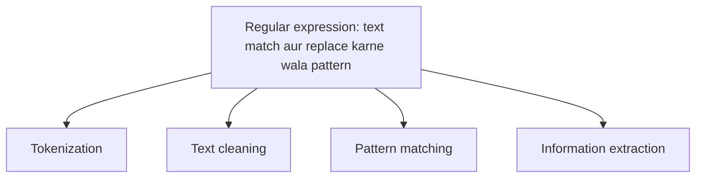
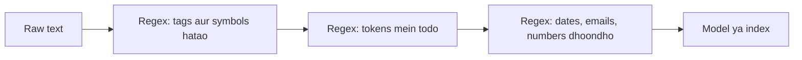

**Ek line mein:** <mark>Regular expression text ko match aur replace karne wala ek pattern hai</mark>; NLP mein ye <mark>tokenization, text cleaning, pattern matching aur information extraction</mark> ka pehla tool hai. <Cite id="class-nlp-m2" loc="p. 18" />

<Box kind="key">

**Ye points likho:**

- <mark>Regular expression: a pattern used to match and replace text</mark>.
- Uses: <mark>text clean karna; words, numbers, emails, dates dhoondhna; unwanted symbols hatana</mark>.
- Chaar jobs: <mark>tokenization, text cleaning, pattern matching, information extraction</mark>.
- Significance: **chhota, fast aur exact**, isliye kisi bhi model se pehle text taiyar hota hai.
- **Do example patterns** likho: numbers ke liye `[0-9]+`, words ke liye `\w+`.

</Box>

## Core answer (5 marks, yahan ke har question ke liye)

<Box kind="definition">

**Regular expression (regex):** a pattern used to match and replace text. <Cite id="class-nlp-m2" loc="p. 18" />

</Box>

**Uses:** clean the text; find words, numbers, emails, dates; remove unwanted symbols. <Cite id="class-nlp-m2" loc="p. 18" />

| Job | Matlab | Teacher ka example |
|---|---|---|
| Tokenization | Sentences ko words ya tokens mein todna | NLP is fun se "NLP", "is", "fun" |
| Text cleaning | Punctuation, html tags, hashtags jaise unwanted characters hatana | NLP@2026 is easy se NLP2026 is easy |
| Pattern matching | Text ke andar similar patterns, shapes aur rules dhoondhna | "my age is 20", "her age is 18": pattern hai age is Number |
| Information extraction | Bade data mein se useful information nikalna | Google search |

<Cite id="class-nlp-m2" loc="p. 18" /> <Cite id="class-nlp-m2" loc="p. 19" />

**Significance:** regular expressions chhote, fast aur exact hain, isliye kisi model se pehle text taiyar karte hain aur dates, emails, numbers nikalte hain.

**Conclusion:** regular expressions tokenizing, cleaning, matching aur extracting ke peeche ka pattern tool hain.

## Extended answer (10 marks): ye add karo

### 1. Basic regex symbols (standard)

Ye har regex tool mein common hain. <Cite id="web-nlp-1-slp3-ch2" /> <Cite id="web-nlp-1-wiki-regex" />

| Symbol | Matlab | Example |
|---|---|---|
| `.` | koi bhi ek character | `c.t` cat, cot match karta hai |
| `*` | pichhle ka zero ya zyada | `ab*` a, ab, abb match karta hai |
| `+` | pichhle ka ek ya zyada | `[0-9]+` 250 match karta hai |
| `?` | optional | `colou?r` color aur colour match karta hai |
| `[ ]` | set ka koi ek character | `[aeiou]` koi vowel |
| `\w`, `\d` | word character, digit | `\w+` ek word match karta hai |
| `^`, `$` | line ka start, end | `^The` The se shuru hone wali line |
| `\|` | ya | `cat\|dog` |

### 2. Patterns aur wo kya dhoondhte hain

Neeche har pattern sample text pe chalaya gaya aur dikhaya result mila.

| Job | Pattern | Text | Result |
|---|---|---|---|
| Numbers dhoondho | `[0-9]+` | I paid 250 rupees on 12 May 2026 | 250, 12, 2026 |
| Tokenize | `\w+` | NLP is fun! | NLP, is, fun |
| Clean | hatao `[^A-Za-z0-9 ]` | NLP@2026 is easy | NLP2026 is easy |
| HTML tags hatao | hatao `<[^>]+>` | `
Hello <b>world</b>
` | Hello world |
| Dates dhoondho | `\d{2}/\d{2}/\d{4}` | on 05/11/2026 | 05/11/2026 |
| Pattern "age is Number" | `age is (\d+)` | my age is 20 and her age is 18 | 20, 18 |

### 3. NLP pipeline mein regex kahan hai

### 4. Limit

Regex sirf text ki **shape** match karta hai, meaning nahi. Ye nahi bata sakta ki "bank" nadi ka kinara hai ya institution; uske liye NLP ke baad ke stages chahiye. <Cite id="web-nlp-1-wiki-regex" />

## Har question mein kaise fit karein

- **"Explain the significance of regular expression in NLP."** (10 marks) <PYQ id="2025-05-ce/q5b" />: core answer (definition, uses, chaar-job table, significance), phir section 1 aur 2 (symbol table aur patterns table) aur pipeline diagram.

## Exam tips

- **Chaar jobs teacher ke examples ke saath likho**; examiner tokenization, cleaning, pattern matching aur extraction dhoondhta hai.
- **Do real patterns results ke saath** (`[0-9]+`, `\w+`) likho; isse definition answer ban jaati hai.
- Diagram ke mark ke liye chhota "pipeline mein regex" flow draw karo.

Exam mein English mein likho.
