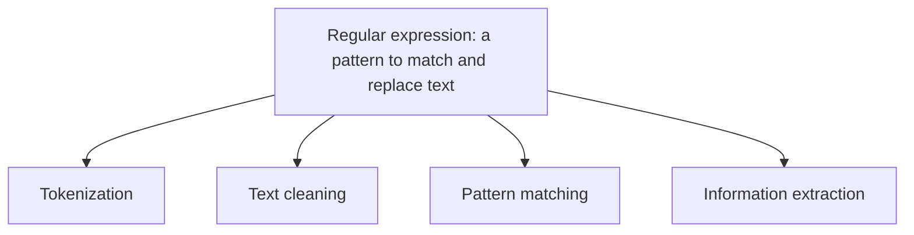
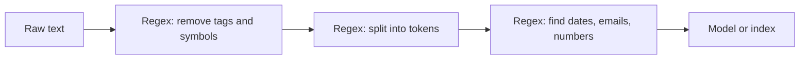

**In one line:** <mark>A regular expression is a pattern used to match and replace text</mark>; in NLP it is the first tool for <mark>tokenization, text cleaning, pattern matching and information extraction</mark>. <Cite id="class-nlp-m2" loc="p. 18" />

<Box kind="key">

**Key points to write:**

- <mark>Regular expression: a pattern used to match and replace text</mark>.
- Uses: <mark>clean the text; find words, numbers, emails, dates; remove unwanted symbols</mark>.
- Four jobs: <mark>tokenization, text cleaning, pattern matching, information extraction</mark>.
- Significance: **small, fast and exact**, so text is prepared before any model is used.
- Write **two example patterns**: `[0-9]+` for numbers, `\w+` for words.

</Box>

## Core answer (5 marks, fits every question here)

<Box kind="definition">

**Regular expression (regex):** a pattern used to match and replace text. <Cite id="class-nlp-m2" loc="p. 18" />

</Box>

**Uses:** clean the text; find words, numbers, emails, dates; remove unwanted symbols. <Cite id="class-nlp-m2" loc="p. 18" />

| Job | Meaning | Teacher's example |
|---|---|---|
| Tokenization | Splitting sentences into words or tokens | NLP is fun gives "NLP", "is", "fun" |
| Text cleaning | Removing unwanted characters like punctuation, html tags, hashtags | NLP@2026 is easy gives NLP2026 is easy |
| Pattern matching | Finding similar patterns, shapes and rules inside the text | "my age is 20", "her age is 18": the pattern is age is Number |
| Information extraction | Finding useful information from a large amount of data | Google search |

<Cite id="class-nlp-m2" loc="p. 18" /> <Cite id="class-nlp-m2" loc="p. 19" />

**Significance:** regular expressions are small, fast and exact, so they prepare text before any model is used and pull out dates, emails and numbers.

**Conclusion:** regular expressions are the pattern tool behind tokenizing, cleaning, matching and extracting.

## Extended answer (10 marks): add these

### 1. Basic regex symbols (standard)

These are common in every regex tool. <Cite id="web-nlp-1-slp3-ch2" /> <Cite id="web-nlp-1-wiki-regex" />

| Symbol | Meaning | Example |
|---|---|---|
| `.` | any one character | `c.t` matches cat, cot |
| `*` | zero or more of the previous | `ab*` matches a, ab, abb |
| `+` | one or more of the previous | `[0-9]+` matches 250 |
| `?` | optional | `colou?r` matches color and colour |
| `[ ]` | any one character of a set | `[aeiou]` matches a vowel |
| `\w`, `\d` | a word character, a digit | `\w+` matches a word |
| `^`, `$` | start, end of the line | `^The` matches a line that starts with The |
| `\|` | or | `cat\|dog` |

### 2. Patterns and what they find

Each pattern below was run on the sample text and gave the result shown.

| Job | Pattern | Text | Result |
|---|---|---|---|
| Find numbers | `[0-9]+` | I paid 250 rupees on 12 May 2026 | 250, 12, 2026 |
| Tokenize | `\w+` | NLP is fun! | NLP, is, fun |
| Clean | remove `[^A-Za-z0-9 ]` | NLP@2026 is easy | NLP2026 is easy |
| Remove HTML tags | remove `<[^>]+>` | `
Hello <b>world</b>
` | Hello world |
| Find dates | `\d{2}/\d{2}/\d{4}` | on 05/11/2026 | 05/11/2026 |
| Pattern "age is Number" | `age is (\d+)` | my age is 20 and her age is 18 | 20, 18 |

### 3. Where regex sits in the NLP pipeline

### 4. Limit

A regex matches only the **shape** of text, not its meaning. It cannot tell "bank" the river side from "bank" the institution; that needs the later stages of NLP. <Cite id="web-nlp-1-wiki-regex" />

## Fit it to each question

- **"Explain the significance of regular expression in NLP."** (10 marks) <PYQ id="2025-05-ce/q5b" />: core answer (definition, uses, four-job table, significance), then sections 1 and 2 (symbol table and the patterns table) and the pipeline diagram.

## Exam tips

- **Write the four jobs with the teacher's examples**; examiners look for tokenization, cleaning, pattern matching and extraction.
- Add **two real patterns with results** (`[0-9]+`, `\w+`); it turns a definition into an answer.
- Draw the small "regex in the pipeline" flow for the diagram mark.
