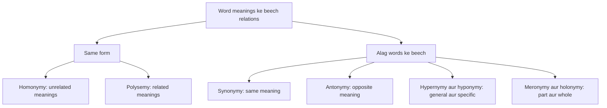
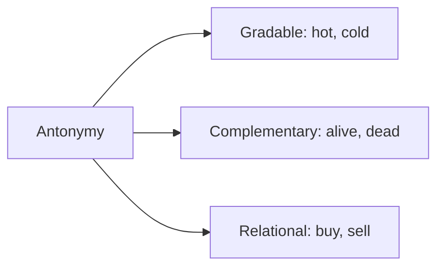
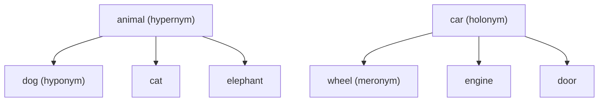

**Ek line mein:** <mark>Lexical relations words (lexemes) ke beech ke semantic connections hain: homonymy, polysemy, synonymy, antonymy, hypernymy, hyponymy aur meronymy</mark>. <Cite id="class-nlp-pyq4" loc="p. 10" />

<Box kind="key">

**Ye points likho:**

- <mark>Homonymy: ek word form ke bilkul unrelated meanings</mark> (bank: paisa, nadi ka kinara).
- <mark>Polysemy: ek lexeme ke related meanings</mark> (head: body part, in-charge person, page ka top).
- <mark>Synonymy: bahut milta-julta meaning</mark> (smart, intelligent); true absolute synonyms rare hote hain.
- <mark>Antonymy: opposite meaning</mark>: gradable (hot, cold), complementary (alive, dead), relational (buy, sell).
- <mark>Hyponymy: general word ke andar specific word</mark> (dog, animal ka hyponym hai); <mark>hypernymy</mark> ulta hai (animal hypernym hai).
- <mark>Meronymy: part-whole</mark> (wheel, car ka meronym hai); **holonymy** ulta hai (car, wheel ka holonym hai).

</Box>

## Core answer (5 marks, yahan ke har question ke liye)

<Box kind="definition">

A **lexeme** is a single word or phrase that has a specific meaning and can be used in a variety of contexts. A **lexicon** is the entire collection of lexemes in a language. **Lexical relations** are the connections between them. <Cite id="class-nlp-pyq4" loc="p. 9" /> <Cite id="class-nlp-pyq4" loc="p. 10" />

</Box>

1. **Homonymy:** ek word form (spelling, sound ya dono) ke do ya zyada bilkul unrelated meanings. *bank* (financial institution) aur *bank* (nadi ka kinara). <Cite id="class-nlp-pyq4" loc="p. 2" />
2. **Polysemy:** ek lexeme ke kai meanings jo logically ya historically related hain. *head*: body ka part, in-charge person, page ka top. <Cite id="class-nlp-pyq4" loc="p. 2" />
3. **Synonymy:** bahut milte-julte ya lagbhag same meaning wale lexemes. *smart* aur *intelligent*; *big* aur *large*. <Cite id="class-nlp-pyq4" loc="p. 1" /> <Cite id="web-nlp-2-synonym" />
4. **Antonymy:** opposite meaning wale lexemes: **gradable** (hot, cold), **complementary** (alive, dead), **relational** (buy, sell; teacher, student). <Cite id="class-nlp-pyq4" loc="p. 1" />
5. **Hypernymy:** upar wala general word. *animal*, *dog*, *cat*, *elephant* ka hypernym hai. <Cite id="class-nlp-pyq4" loc="p. 2" />
6. **Hyponymy:** general word ke andar specific word. *dog*, *animal* ka hyponym hai; *rose*, *flower* ka. <Cite id="class-nlp-pyq4" loc="p. 1" />
7. **Meronymy:** part-whole relation. *wheel*, *car* ka meronym hai; *page*, *book* ka. **Holonymy** ulta hai: *car*, *wheel* ka holonym hai. <Cite id="class-nlp-pyq4" loc="p. 1" />

| Relation | Idea | Example |
|---|---|---|
| Homonymy | Same form, unrelated meanings | bank (money) aur bank (river) |
| Polysemy | Ek word, related meanings | head (body, boss, page ka top) |
| Synonymy | Same ya bahut close meaning | smart aur intelligent |
| Antonymy | Opposite meaning | hot aur cold; buy aur sell |
| Hypernymy | Upar ka general word | animal, dog ke upar |
| Hyponymy | Neeche ka specific word | dog, animal ke neeche |
| Meronymy | Whole ka part | car ka wheel |

**Conclusion:** ye relations language ke words ko organize karte hain, jo lexicon record karta hai.

## Extended answer (10 marks): ye add karo

### 1. Homonymy vs polysemy

| Point | Homonymy | Polysemy |
|---|---|---|
| Meanings | Unrelated | Related (ek idea se doosre bante hain) |
| Origin | Alag words jo same dikhte ya sunai dete hain | Ek word jiska use failta gaya |
| Example | *bank* (money) aur *bank* (river) | *head* (body, boss, page ka top) |
| Dictionary | Alag entries | Ek entry, kai senses |

<Cite id="web-nlp-2-homonym" /> <Cite id="web-nlp-2-polysemy" />

### 2. Antonymy detail mein

- **Gradable:** beech ka middle ground hota hai, isliye comparison possible hai (warmer, cooler).
- **Complementary:** koi middle ground nahi; ek doosre ko exclude karta hai.
- **Relational:** wahi relationship do taraf se dekha gaya. <Cite id="class-nlp-pyq4" loc="p. 1" /> <Cite id="web-nlp-2-opposite" />

### 3. Hyponymy, hypernymy, meronymy aur holonymy trees ke roop mein

*Is-a* test hyponymy ke liye hai (dog ek animal hai). *Part-of* test meronymy ke liye (wheel car ka part hai). Hyponymy transitive hai: rose flower hai aur flower plant hai, to rose plant hai. <Cite id="web-nlp-2-hyponymy" /> <Cite id="web-nlp-2-meronymy" />

### 4. NLP ko ye relations kyun chahiye

WordNet ek bada lexical database hai jo bilkul yahi relations store karta hai: synonym sets, antonyms, hypernyms, hyponyms aur meronyms. Ye word sense disambiguation, search aur question answering mein use hota hai. <Cite id="web-nlp-2-wordnet" /> <Cite id="web-nlp-2-lexsem" />

## Har question mein kaise fit karein

- **"Explain with suitable example following relationships between word meanings: Homonymy, Polysemy, Synonymy, Antonymy"** (5 marks) <PYQ id="2022-12-ce/q1e" />: core points 1 se 4 antonym types ke saath.
- **"Explain with suitable example the following relationships between word meanings: Hyponymy, Hypernymy, Meronymy, Holynymy"** (5 marks) <PYQ id="2023-12-ce/q1d" />: core points 5 se 7 aur section 3 ka is-a / part-of tree.
- **"Explain with suitable example following relationships between word meanings: Homonymy, Polysemy, Synonymy, Antonymy, Hypernomy, Hyponomy, Meronomy"** (10 marks) <PYQ id="2024-12/q3a" /> <PYQ id="assignment-2/q4a" />: poora core answer table aur diagram ke saath, plus sections 1 se 3.
- **"Explain relations among lexemes and their senses with example."** (10 marks) <PYQ id="2026-05/q5a" />: lexeme aur lexicon ki definitions se shuru karo, phir saat relations, phir sections 1 aur 3.

## Exam tips

- Jo relations pucha ho unke **do examples** do; har ek ka kam se kam ek.
- **Is-a tree** (animal, dog, cat) aur **part-of tree** (car, wheel) draw karo.
- Sabse common galti **homonymy aur polysemy** mix karna hai: unrelated meanings vs related meanings.

Exam mein English mein likho.
