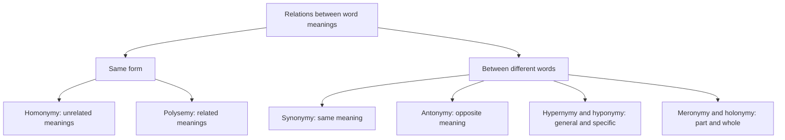
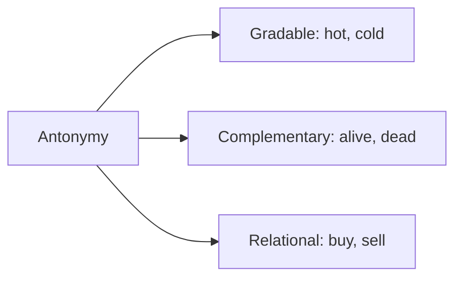
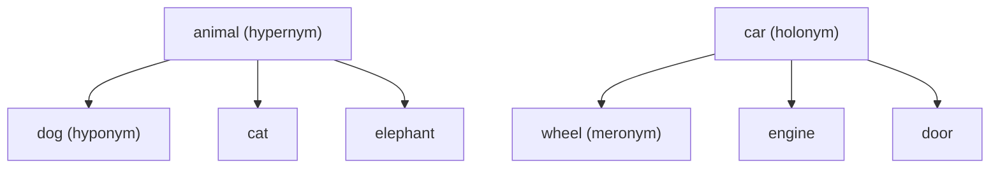

**In one line:** <mark>Lexical relations are the semantic connections between words (lexemes): homonymy, polysemy, synonymy, antonymy, hypernymy, hyponymy and meronymy</mark>. <Cite id="class-nlp-pyq4" loc="p. 10" />

<Box kind="key">

**Key points to write:**

- <mark>Homonymy: one word form with completely unrelated meanings</mark> (bank: money, river side).
- <mark>Polysemy: one lexeme with related meanings</mark> (head: body part, person in charge, top of a page).
- <mark>Synonymy: very similar meaning</mark> (smart, intelligent); true absolute synonyms are rare.
- <mark>Antonymy: opposite meaning</mark>: gradable (hot, cold), complementary (alive, dead), relational (buy, sell).
- <mark>Hyponymy: a specific word inside a general word</mark> (dog is a hyponym of animal); <mark>hypernymy</mark> is the reverse (animal is the hypernym).
- <mark>Meronymy: part-whole</mark> (wheel is a meronym of car); **holonymy** is the reverse (car is the holonym of wheel).

</Box>

## Core answer (5 marks, fits every question here)

<Box kind="definition">

A **lexeme** is a single word or phrase that has a specific meaning and can be used in a variety of contexts. A **lexicon** is the entire collection of lexemes in a language. **Lexical relations** are the connections between them. <Cite id="class-nlp-pyq4" loc="p. 9" /> <Cite id="class-nlp-pyq4" loc="p. 10" />

</Box>

1. **Homonymy:** one word form (spelling, sound or both) has two or more completely unrelated meanings. *bank* (financial institution) and *bank* (river side). <Cite id="class-nlp-pyq4" loc="p. 2" />
2. **Polysemy:** one lexeme has several meanings that are logically or historically related. *head*: part of the body, a person in charge, the top of a page. <Cite id="class-nlp-pyq4" loc="p. 2" />
3. **Synonymy:** lexemes with very similar or nearly identical meanings. *smart* and *intelligent*; *big* and *large*. <Cite id="class-nlp-pyq4" loc="p. 1" /> <Cite id="web-nlp-2-synonym" />
4. **Antonymy:** lexemes with opposite meanings: **gradable** (hot, cold), **complementary** (alive, dead), **relational** (buy, sell; teacher, student). <Cite id="class-nlp-pyq4" loc="p. 1" />
5. **Hypernymy:** the general word above. *animal* is the hypernym of *dog*, *cat*, *elephant*. <Cite id="class-nlp-pyq4" loc="p. 2" />
6. **Hyponymy:** the specific word inside a general word. *dog* is a hyponym of *animal*; *rose* of *flower*. <Cite id="class-nlp-pyq4" loc="p. 1" />
7. **Meronymy:** a part-whole relation. *wheel* is a meronym of *car*; *page* of *book*. **Holonymy** is the reverse: *car* is the holonym of *wheel*. <Cite id="class-nlp-pyq4" loc="p. 1" />

| Relation | Idea | Example |
|---|---|---|
| Homonymy | Same form, unrelated meanings | bank (money) and bank (river) |
| Polysemy | One word, related meanings | head (body, boss, top of page) |
| Synonymy | Same or very close meaning | smart and intelligent |
| Antonymy | Opposite meaning | hot and cold; buy and sell |
| Hypernymy | General word above | animal above dog |
| Hyponymy | Specific word below | dog below animal |
| Meronymy | Part of a whole | wheel of a car |

**Conclusion:** these relations organize the words of a language, which a lexicon records.

## Extended answer (10 marks): add these

### 1. Homonymy versus polysemy

| Point | Homonymy | Polysemy |
|---|---|---|
| Meanings | Unrelated | Related (one idea grows into others) |
| Origin | Different words that look or sound alike | One word whose use has spread |
| Example | *bank* (money) and *bank* (river) | *head* (body, boss, top of page) |
| Dictionary | Separate entries | One entry with several senses |

<Cite id="web-nlp-2-homonym" /> <Cite id="web-nlp-2-polysemy" />

### 2. Antonymy in detail

- **Gradable:** a scale with a middle ground, so comparison is possible (warmer, cooler).
- **Complementary:** no middle ground; one excludes the other.
- **Relational:** the same relationship seen from two sides. <Cite id="class-nlp-pyq4" loc="p. 1" /> <Cite id="web-nlp-2-opposite" />

### 3. Hyponymy, hypernymy, meronymy and holonymy as trees

*Is-a* tests hyponymy (a dog is an animal). *Part-of* tests meronymy (a wheel is part of a car). Hyponymy is transitive: a rose is a flower and a flower is a plant, so a rose is a plant. <Cite id="web-nlp-2-hyponymy" /> <Cite id="web-nlp-2-meronymy" />

### 4. Why NLP needs these relations

WordNet is a large lexical database that stores exactly these relations: synonym sets, antonyms, hypernyms, hyponyms and meronyms. It is used for word sense disambiguation, search and question answering. <Cite id="web-nlp-2-wordnet" /> <Cite id="web-nlp-2-lexsem" />

## Fit it to each question

- **"Explain with suitable example following relationships between word meanings: Homonymy, Polysemy, Synonymy, Antonymy"** (5 marks) <PYQ id="2022-12-ce/q1e" />: core points 1 to 4 with the antonym types.
- **"Explain with suitable example the following relationships between word meanings: Hyponymy, Hypernymy, Meronymy, Holynymy"** (5 marks) <PYQ id="2023-12-ce/q1d" />: core points 5 to 7 and the is-a / part-of tree from section 3.
- **"Explain with suitable example following relationships between word meanings: Homonymy, Polysemy, Synonymy, Antonymy, Hypernomy, Hyponomy, Meronomy"** (10 marks) <PYQ id="2024-12/q3a" /> <PYQ id="assignment-2/q4a" />: the full core answer with the table and diagram, plus sections 1 to 3.
- **"Explain relations among lexemes and their senses with example."** (10 marks) <PYQ id="2026-05/q5a" />: begin with the lexeme and lexicon definitions, then the seven relations, then sections 1 and 3.

## Exam tips

- **Give two examples** for the relations asked; one for each is the minimum.
- Draw the **is-a tree** (animal, dog, cat) and the **part-of tree** (car, wheel).
- The commonest mistake is mixing up **homonymy and polysemy**: unrelated meanings against related meanings.
