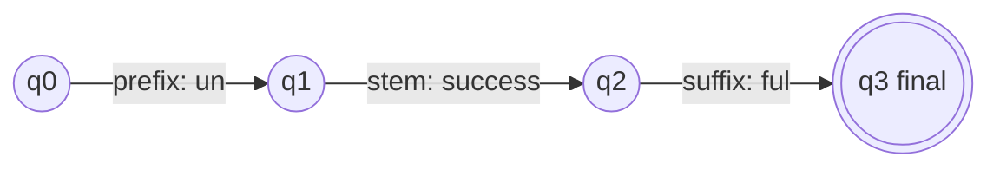
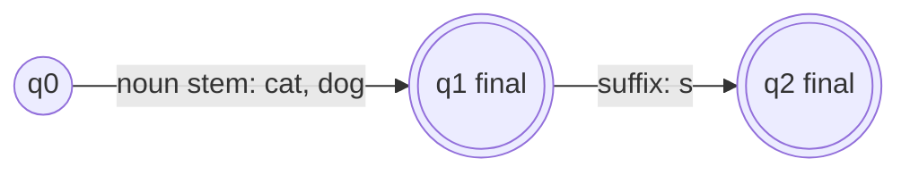
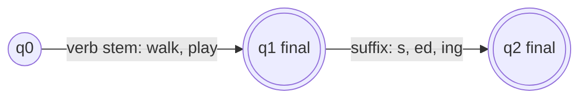
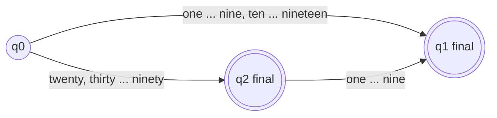

**Ek line mein:** <mark>Finite State Automaton (FSA) morphemes se valid words banane ke rules represent karta hai</mark>: states word formation ke stages hain, transitions stems aur affixes hain, aur FSA word accept karta hai agar morphemes valid order mein aayein. <Cite id="class-nlp-pyq2" loc="p. 6" />

<Box kind="key">

**FSA ke har question mein ye points likho:**

- <mark>FSA = finite set of states (Q) which accepts a finite set of inputs (Sigma)</mark>; parts: **Q, Sigma, delta, q0, F**.
- <mark>Role: represents valid morphological rules and word structures</mark>; ye check karta hai ki morphemes ka sequence valid word banata hai ya nahi.
- States = **word formation ke stages**; transitions = **stems, prefixes, suffixes, grammatical features**.
- Example: <mark>cats = cat + Noun + Plural</mark>.
- FSA sirf **accept ya reject** karta hai; analysis (cat + N + Pl) ke liye **FST** use hota hai.
- **Numbers 1 se 99** ke liye: units aur teens ek word; tens word ke baad ek unit aa sakta hai.

</Box>

## Core answer (5 marks, yahan ke har question ke liye)

<Box kind="definition">

**FSA:** a finite state automaton comprises a finite set of states (Q) which accepts a finite set of inputs (Sigma). Parts: Q (states), Sigma (inputs), delta (transition function Q x Sigma to Q), q0 (start state), F (final states). <Cite id="class-nlp-m2" loc="p. 4" />

</Box>

**Morphological analysis mein role:** FSA morphemes se valid words banane ke rules represent karta hai. States word formation ke stages hain; transitions possible stems, prefixes, suffixes aur grammatical features hain; aur automaton check karta hai ki morphemes ka sequence valid word banata hai ya nahi. <Cite id="class-nlp-pyq2" loc="p. 6" />

**Example:** cats ka structure cat + Noun + Plural hai. <Cite id="class-nlp-pyq2" loc="p. 6" />

**Roles** <Cite id="class-nlp-pyq2" loc="p. 6" />

- Valid morphological rules aur word structures represent karta hai.
- Stems, affixes aur grammatical features pehchanne mein madad karta hai.
- Check karta hai ki word valid morphological patterns follow karta hai.
- Analysis aur word generation support karta hai; efficient aur rule based, rich inflection ke liye achha.

**Conclusion:** FSA morphological analysis ka checking part hai.

## Extended answer (10 marks): ye add karo

### 1. Nouns ke liye FSA

Noun stem ek word hai, aur plural suffix -s lagane par bhi word banta hai. <Cite id="class-nlp-m2" loc="p. 5" />

### 2. Verbs ke liye FSA

Irregular forms (went, mice) lexicon mein store hote hain, kyunki ending rule unhe nahi bana sakta. <Cite id="class-nlp-pyq2" loc="p. 9" />

### 3. English numbers 1 se 99 ka FSA

Standard design (class files mein nahi hai). Units (one se nine) aur teens (ten se nineteen) single words hain; tens word (twenty se ninety) ke baad ek unit aa sakta hai.

| Input | Path | Result |
|---|---|---|
| seven | q0 to q1 | accepted |
| thirteen | q0 to q1 | accepted |
| twenty | q0 to q2 | accepted |
| forty two | q0 to q2 to q1 | accepted |
| twenty thirteen | q2 se thirteen pe koi arc nahi | rejected |

### 4. FSA ki limit

FSA sirf accept ya reject karta hai. Analysis (cats se cat + N + Pl) likhne ke liye finite state transducer use hota hai. <Cite id="web-nlp-1-wiki-fst" />

## Har question mein kaise fit karein

- **"Explain the role of FSA in morphological analysis?"** (10 marks) <PYQ id="2022-12-ce/q2a" />: definition parts ke saath, role, roles list, cats aur success diagrams; section 4 add karo.
- **"Explain the role of Finite State Automata (FSA) in morphological analysis."** (10 marks) <PYQ id="assignment-1/q2f" />: wahi answer.
- **"Explain FSA for nouns and verbs. Also Design a Finite State Automata (FSA) for the words of English numbers 1-99."** (10 marks) <PYQ id="2023-12-ce/q2a" />: FSA role pe ek line, phir section 1, 2 aur 3 diagrams aur test table ke saath.

## Exam tips

- **Har automaton draw karo**: circles, labelled arrows, start arrow aur final states ke liye double circle.
- Apne design ko **do accepted aur ek rejected input** se test karo (table jaisa).
- Role ek sentence mein likho: **FSA check karta hai ki morphemes ka sequence valid word banata hai**.

Exam mein English mein likho.
