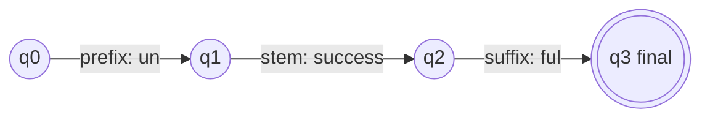
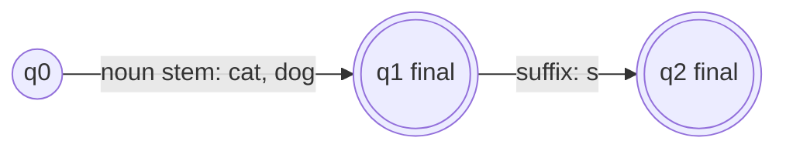
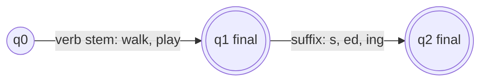
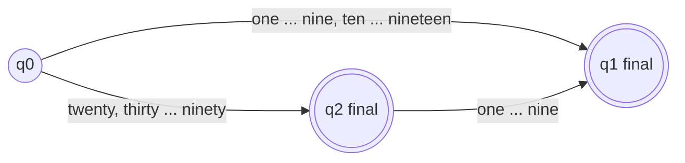

**In one line:** <mark>A Finite State Automaton (FSA) represents the rules for forming valid words from their morphemes</mark>: its states are the stages of word formation, its transitions are stems and affixes, and it accepts a word if the morphemes come in a valid order. <Cite id="class-nlp-pyq2" loc="p. 6" />

<Box kind="key">

**Key points to write (any FSA question):**

- <mark>FSA = finite set of states (Q) which accepts a finite set of inputs (Sigma)</mark>; parts: **Q, Sigma, delta, q0, F**.
- <mark>Role: represents valid morphological rules and word structures</mark>; it checks whether a morpheme sequence forms a valid word.
- States = **stages of word formation**; transitions = **stems, prefixes, suffixes, grammatical features**.
- Example: <mark>cats = cat + Noun + Plural</mark>.
- An FSA only **accepts or rejects**; to give the analysis (cat + N + Pl) use an **FST**.
- For **numbers 1 to 99**: units and teens are one word; a tens word may be followed by a unit.

</Box>

## Core answer (5 marks, fits every question here)

<Box kind="definition">

**FSA:** a finite state automaton comprises a finite set of states (Q) which accepts a finite set of inputs (Sigma). Parts: Q (states), Sigma (inputs), delta (transition function Q x Sigma to Q), q0 (start state), F (final states). <Cite id="class-nlp-m2" loc="p. 4" />

</Box>

**Role in morphological analysis:** FSA represents the rules for forming valid words from their morphemes. The states are the stages of word formation; the transitions are the possible stems, prefixes, suffixes and grammatical features; and the automaton checks whether a sequence of morphemes forms a valid word. <Cite id="class-nlp-pyq2" loc="p. 6" />

**Example:** cats has the structure cat + Noun + Plural. <Cite id="class-nlp-pyq2" loc="p. 6" />

**Roles** <Cite id="class-nlp-pyq2" loc="p. 6" />

- Represents valid morphological rules and word structures.
- Helps identify stems, affixes and grammatical features.
- Checks whether a word follows valid morphological patterns.
- Supports analysis and word generation; efficient and rule based, good for rich inflection.

**Conclusion:** the FSA is the checking part of morphological analysis.

## Extended answer (10 marks): add these

### 1. FSA for nouns

A noun stem is a word, and adding the plural suffix -s also gives a word. <Cite id="class-nlp-m2" loc="p. 5" />

### 2. FSA for verbs

Irregular forms (went, mice) are stored in the lexicon, because the ending rule cannot make them. <Cite id="class-nlp-pyq2" loc="p. 9" />

### 3. FSA for the English numbers 1 to 99

A standard design (the class files do not show it). Units (one to nine) and teens (ten to nineteen) are single words; a tens word (twenty to ninety) may be followed by a unit.

| Input | Path | Result |
|---|---|---|
| seven | q0 to q1 | accepted |
| thirteen | q0 to q1 | accepted |
| twenty | q0 to q2 | accepted |
| forty two | q0 to q2 to q1 | accepted |
| twenty thirteen | no arc from q2 on thirteen | rejected |

### 4. Limit of an FSA

An FSA only accepts or rejects. To write the analysis (cats gives cat + N + Pl) a finite state transducer is used. <Cite id="web-nlp-1-wiki-fst" />

## Fit it to each question

- **"Explain the role of FSA in morphological analysis?"** (10 marks) <PYQ id="2022-12-ce/q2a" />: definition with parts, role, roles list, cats and success diagrams; add section 4.
- **"Explain the role of Finite State Automata (FSA) in morphological analysis."** (10 marks) <PYQ id="assignment-1/q2f" />: the same answer.
- **"Explain FSA for nouns and verbs. Also Design a Finite State Automata (FSA) for the words of English numbers 1-99."** (10 marks) <PYQ id="2023-12-ce/q2a" />: one line on FSA role, then sections 1, 2 and 3 with the diagrams and the test table.

## Exam tips

- **Draw each automaton** with circles, labelled arrows, a start arrow and double circle for final states.
- Test your design with **two accepted and one rejected input** (as in the table).
- Say the role in one sentence: **FSA checks whether a morpheme sequence forms a valid word**.
