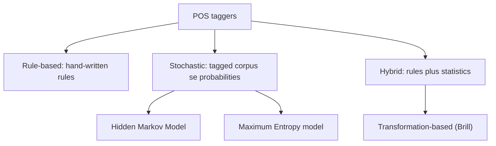
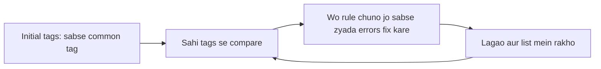

**Ek line mein:** <mark>Rule-based tagger hand-written rules use karta hai, stochastic tagger tagged corpus se seekhi probabilities, aur hybrid (transformation-based) tagger dono ko milata hai</mark>. <Cite id="class-nlp-pyq3" loc="p. 3" />

<Box kind="key">

**Ye points likho:**

- <mark>POS tagging: har word ko ek grammatical category di jaati hai</mark> (noun, verb, adjective, adverb).
- <mark>Rule-based: tags predefined grammatical rules se assign hote hain jo word endings aur context se bane hain</mark>; interpretable aur transparent. Rule: "-tion ya -ment pe end hone wala word noun hai".
- <mark>Stochastic: tagged corpus ki counts se sabse probable tag ya tag sequence chunta hai</mark> (HMM, MaxEnt).
- <mark>Hybrid: statistics pehla tag dete hain, rules galtiyan sudharte hain</mark> (ya rules impossible tags hatate hain, statistics baaki mein se chunte hain).
- <mark>Transformation-based (Brill): sabse common tag se shuru, phir seekhe hue "tag A ko B karo agar ..." rules order mein lagao</mark>.
- Example: to/TO race/VB, rule "previous tag TO ho to NN ko VB karo".

</Box>

## Core answer (5 marks, yahan ke har question ke liye)

<Box kind="definition">

**POS tagging** is a fundamental task in NLP where each word in a sentence is assigned a grammatical category such as noun, verb, adjective or adverb. <Cite id="class-nlp-pyq3" loc="p. 4" />

</Box>

**1. Rule-based tagging** predefined grammatical rules se POS tags assign karta hai. Rules morphological features (word endings) aur syntactic context se bante hain, isliye method bahut interpretable aur transparent hai. <Cite id="class-nlp-pyq3" loc="p. 3" />

*Example:* rule "-tion ya -ment pe end hone wale words ko Noun do". "The presentation highlighted the key achievements of the project's development" mein *presentation*, *achievements* aur *development* noun ban jaate hain. *Highlighted* ke liye doosra rule chahiye: "-ed pe end hone wala word verb hai". <Cite id="class-nlp-pyq3" loc="p. 3" /> <Cite id="class-nlp-pyq3" loc="p. 4" />

**2. Stochastic tagging** tagged corpus se seekhi probabilities se sabse probable tag ya tag sequence chunta hai. HMM transition aur emission probabilities use karta hai; MaxEnt weighted features. <Cite id="class-nlp-pyq3" loc="p. 2" /> <Cite id="class-nlp-pyq3" loc="p. 8" />

**3. Hybrid tagging** dono ko milata hai: statistical tagger pehla tag deta hai aur rules uski galtiyan sudharte hain. Transformation-based tagging sabse famous hybrid hai. <Cite id="web-nlp-2-brill-tagger" />

| Point | Rule-based | Stochastic | Hybrid |
|---|---|---|---|
| Knowledge kahan se | Hand-written rules | Tagged corpus ki counts | Dono |
| Samajhna aasan | Haan, bahut | Kam | Haan (chhote rules) |
| Effort | Experts rules likhte hain | Bada tagged corpus chahiye | Tagged corpus |
| Example | Suffix rule (-tion noun hai) | HMM, MaxEnt | Brill tagger |

**Conclusion:** rule-based padhne mein aasan hai par experts chahiye, stochastic data se seekhta hai par kam readable hai, aur hybrid dono ke achhe points rakhta hai.

## Extended answer (10 marks): ye add karo

### 1. Rule-based tagging detail mein

Rule-based taggers sabse pehle ke taggers the. English Constraint Grammar system do stages mein kaam karta hai: dictionary har word ke **saare possible tags** deti hai, phir hazaaron **constraints** wo tags hata dete hain jo context se match nahi karte. <Cite id="web-nlp-1-slp3-seqlabel" loc="§18.7.1" />

- *Advantages:* padhna aur sudharna aasan, training corpus nahi chahiye. <Cite id="class-nlp-pyq3" loc="p. 3" />
- *Disadvantages:* experts ko bahut rules likhne aur update karne padte hain, aur naye words aur exceptions cover nahi hote.

### 2. Stochastic tagging detail mein

1. **Word frequency approach:** har word ko corpus ka uska sabse frequent tag do (baseline ke roop mein lagbhag 92 percent accuracy). <Cite id="web-nlp-1-slp3-seqlabel" loc="§18.2" />
2. **Tag sequence approach:** $P(t_j \mid t_i)$ aur $P(\text{word} \mid \text{tag})$ se sabse high probability wali poori tag sequence chuno, Viterbi decoding ke saath (HMM). <Cite id="class-nlp-pyq3" loc="p. 7" /> <Cite id="web-nlp-1-wiki-hmm" /> <Cite id="web-nlp-1-wiki-pos" />

### 3. Transformation-based (Brill) tagging

<Box kind="definition">

**Transformation-based tagging** gives each word a first tag and then changes tags with ordered rules of the form "change tag A to tag B if the condition holds". The rules are learned from a tagged corpus. <Cite id="web-nlp-2-brill-1995" /> <Cite id="web-nlp-2-brill-tagger" />

</Box>

1. **Initial tagging:** har word ko uska sabse frequent tag do; unknown word ko tag noun do.
2. Training corpus ke sahi tags se **compare** karo aur errors dhoondho.
3. Ek **rule seekho** (template jaise "previous tag TO ho to NN ko VB karo") jo sabse zyada errors fix kare, aur use apply karo.
4. **Repeat** karo jab tak koi rule zyada help na kare. Ordered list (aam taur pe kuch sau rules) hi tagger hai.
5. **Naya text tag karo:** initial tags, phir seekhe hue rules order mein.

<Sum>

<Given>

Phrase "to race". *race* ka most common tag NN hai. Learned rule: previous tag TO ho to NN ko VB karo.

</Given>

<Find>

final tags.

</Find>

<Steps>

1. Initial tags: to/TO race/NN.
2. Rule check karo: *race* NN hai aur previous tag TO hai, to condition true hai.
3. Rule lagao: NN ban jaata hai VB.

</Steps>

<Answer>

to/TO race/VB

</Answer>

<Box kind="verify">

*to* ke baad *race* verb hai ("to race" yaani tez bhaagna), isliye VB sahi hai.

</Box>

</Sum>

### 4. Rule-based aur transformation-based ka comparison

| Point | Rule-based | Transformation-based |
|---|---|---|
| Rules kahan se | Experts likhte hain | Tagged corpus se seekhe jaate hain |
| Shuruaat | Seedha rules | Most-common-tag guess, phir corrections |
| Padhna aasan | Haan | Haan (chhote rules) |
| Kya chahiye | Language experts | Tagged corpus |

## Har question mein kaise fit karein

- **"What is the rule-based and stochastic part of speech taggers?"** (5 marks) <PYQ id="2023-12-ce/q1a" />: definition line, phir core answer ke part 1 aur 2 table ke saath.
- **"What is hybrid POS tagging?"** (5 marks) <PYQ id="2024-12-ce/q1d" />: core answer ka part 3, family diagram, aur Brill idea do lines mein.
- **"Define POS tagging. Explain Rule based POS tagging and Transformation based tagging with example."** (10 marks) <PYQ id="2026-05/q3a" />: definition, core part 1 -tion example ke saath, phir extended sections 3 aur 4 "to race" example ke saath.

## Exam tips

- **Draw karo:** taggers ka family tree, aur 10-marker ke liye Brill loop.
- Hamesha **ek example rule** likho ("-tion ya -ment noun hai"; "TO ke baad NN ko VB").
- Confuse mat ho: rule-based ke rules **likhe jaate hain**, transformation ke rules **seekhe jaate hain**.

Exam mein English mein likho.
