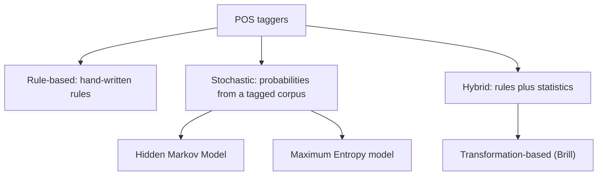
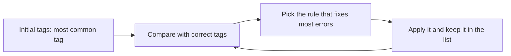

**In one line:** <mark>A rule-based tagger uses hand-written rules, a stochastic tagger uses probabilities learned from a tagged corpus, and a hybrid (transformation-based) tagger combines both</mark>. <Cite id="class-nlp-pyq3" loc="p. 3" />

<Box kind="key">

**Key points to write:**

- <mark>POS tagging: each word is assigned a grammatical category</mark> (noun, verb, adjective, adverb).
- <mark>Rule-based: tags assigned by predefined grammatical rules built from word endings and context</mark>; interpretable and transparent. Rule: "word ending in -tion or -ment is a noun".
- <mark>Stochastic: chooses the most probable tag or tag sequence using counts from a tagged corpus</mark> (HMM, MaxEnt).
- <mark>Hybrid: statistics give a first tag, rules correct the mistakes</mark> (or rules remove impossible tags, statistics choose the rest).
- <mark>Transformation-based (Brill): start with the most common tag, then apply learned "change tag A to B if ..." rules in order</mark>.
- Example: to/TO race/VB, rule "change NN to VB when the previous tag is TO".

</Box>

## Core answer (5 marks, fits every question here)

<Box kind="definition">

**POS tagging** is a fundamental task in NLP where each word in a sentence is assigned a grammatical category such as noun, verb, adjective or adverb. <Cite id="class-nlp-pyq3" loc="p. 4" />

</Box>

**1. Rule-based tagging** assigns POS tags using predefined grammatical rules. The rules are built from morphological features (word endings) and syntactic context, so the method is highly interpretable and transparent. <Cite id="class-nlp-pyq3" loc="p. 3" />

*Example:* the rule "assign Noun to words ending in -tion or -ment". In "The presentation highlighted the key achievements of the project's development", *presentation*, *achievements* and *development* become nouns. *Highlighted* needs a second rule: "a word ending in -ed is a verb". <Cite id="class-nlp-pyq3" loc="p. 3" /> <Cite id="class-nlp-pyq3" loc="p. 4" />

**2. Stochastic tagging** picks the most probable tag, or tag sequence, using probabilities learned from a tagged corpus. The HMM uses transition and emission probabilities; the MaxEnt model uses weighted features. <Cite id="class-nlp-pyq3" loc="p. 2" /> <Cite id="class-nlp-pyq3" loc="p. 8" />

**3. Hybrid tagging** combines the two: a statistical tagger gives a first tag and rules correct its mistakes. Transformation-based tagging is the best-known hybrid. <Cite id="web-nlp-2-brill-tagger" />

| Point | Rule-based | Stochastic | Hybrid |
|---|---|---|---|
| Knowledge from | Hand-written rules | Counts in a tagged corpus | Both |
| Easy to understand | Yes, very | Less | Yes (short rules) |
| Effort | Experts write rules | Needs a large tagged corpus | A tagged corpus |
| Example | Suffix rule (-tion is a noun) | HMM, MaxEnt | Brill tagger |

**Conclusion:** rule-based is readable but needs experts, stochastic learns from data but is less readable, and hybrid keeps the good points of both.

## Extended answer (10 marks): add these

### 1. Rule-based tagging in more detail

Rule-based taggers were the earliest taggers. The English Constraint Grammar system works in two stages: a dictionary returns **all possible tags** of every word, then thousands of **constraints** remove the tags that do not fit the context. <Cite id="web-nlp-1-slp3-seqlabel" loc="§18.7.1" />

- *Advantages:* easy to read and correct, no training corpus needed. <Cite id="class-nlp-pyq3" loc="p. 3" />
- *Disadvantages:* experts must write and update many rules, and the rules do not cover new words and exceptions.

### 2. Stochastic tagging in more detail

1. **Word frequency approach:** give every word its most frequent tag from the corpus (about 92 percent accuracy as a baseline). <Cite id="web-nlp-1-slp3-seqlabel" loc="§18.2" />
2. **Tag sequence approach:** pick the whole tag sequence with the highest probability, using $P(t_j \mid t_i)$ and $P(\text{word} \mid \text{tag})$ with Viterbi decoding (HMM). <Cite id="class-nlp-pyq3" loc="p. 7" /> <Cite id="web-nlp-1-wiki-hmm" /> <Cite id="web-nlp-1-wiki-pos" />

### 3. Transformation-based (Brill) tagging

<Box kind="definition">

**Transformation-based tagging** gives each word a first tag and then changes tags with ordered rules of the form "change tag A to tag B if the condition holds". The rules are learned from a tagged corpus. <Cite id="web-nlp-2-brill-1995" /> <Cite id="web-nlp-2-brill-tagger" />

</Box>

1. **Initial tagging:** give every word its most frequent tag; an unknown word gets the tag noun.
2. **Compare** with the correct tags of the training corpus and find the errors.
3. **Learn a rule** (a template such as "change NN to VB when the previous tag is TO") that fixes the most errors, and apply it.
4. **Repeat** until no rule helps enough. The ordered list (usually a few hundred rules) is the tagger.
5. **Tag new text:** initial tags, then the learned rules in order.

<Sum>

<Given>

Phrase "to race". Most common tag of *race* is NN. Learned rule: change NN to VB if the previous tag is TO.

</Given>

<Find>

the final tags.

</Find>

<Steps>

1. Initial tags: to/TO race/NN.
2. Check the rule: *race* is tagged NN and the previous tag is TO, so the condition is true.
3. Apply the rule: NN becomes VB.

</Steps>

<Answer>

to/TO race/VB

</Answer>

<Box kind="verify">

*Race* after *to* is the verb "to race" (to run fast), so VB is right.

</Box>

</Sum>

### 4. Comparison of rule-based and transformation-based tagging

| Point | Rule-based | Transformation-based |
|---|---|---|
| Rules come from | Written by experts | Learned from a tagged corpus |
| Starts with | The rules directly | A most-common-tag guess, then corrections |
| Easy to read | Yes | Yes (short rules) |
| Needs | Language experts | A tagged corpus |

## Fit it to each question

- **"What is the rule-based and stochastic part of speech taggers?"** (5 marks) <PYQ id="2023-12-ce/q1a" />: definition line, then parts 1 and 2 of the core answer with the table.
- **"What is hybrid POS tagging?"** (5 marks) <PYQ id="2024-12-ce/q1d" />: part 3 of the core answer, the family diagram, and the Brill idea in two lines.
- **"Define POS tagging. Explain Rule based POS tagging and Transformation based tagging with example."** (10 marks) <PYQ id="2026-05/q3a" />: definition, core part 1 with the -tion example, then extended sections 3 and 4 with the "to race" example.

## Exam tips

- **Draw** the taggers family tree, and the Brill loop for the 10-marker.
- Always write **one example rule** ("-tion or -ment is a noun"; "NN to VB after TO").
- Do not mix up: rule-based rules are **written**, transformation rules are **learned**.
