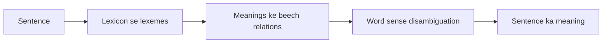
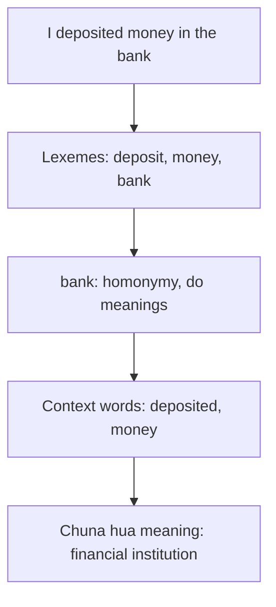

**Ek line mein:** <mark>Semantic analysis words aur sentences ka meaning nikalta hai, sirf grammar nahi</mark>; iska word-level part, <mark>lexical semantic analysis, har word (lexeme) ka meaning nikalta hai aur context se sahi sense chunta hai</mark>. <Cite id="class-nlp-pyq4" loc="p. 9" />

<Box kind="key">

**Ye points likho:**

- <mark>Semantic analysis: NLP ka wo step jo text ka meaning nikalta hai</mark>; syntax sirf form (grammar) hai.
- <mark>Lexeme: ek word ya phrase jiska specific meaning ho. Lexicon: ek language ke saare lexemes ka collection</mark>.
- Lexical semantic analysis **lexicon** aur **lexical relations** (homonymy, polysemy, synonymy, antonymy, hyponymy, meronymy) use karta hai.
- <mark>Ambiguous words ko word sense disambiguation (WSD) se context dekh ke resolve karte hain</mark>.
- Last step: word meanings ko **combine** karke sentence ka meaning banao.
- Example: "I deposited money in the bank": *bank* = financial institution.

</Box>

## Core answer (5 marks, yahan ke har question ke liye)

<Box kind="definition">

**Semantic analysis** is the step of NLP that finds the meaning of words and sentences. Its word-level part is **lexical semantics**: the meaning of individual words (lexemes) and the relations between them. A **lexeme** is a single word or phrase that has a specific meaning; a **lexicon** is the entire collection of lexemes in a language. <Cite id="class-nlp-pyq4" loc="p. 9" /> <Cite id="web-nlp-2-semantic-analysis" />

</Box>

**Kyun chahiye:** sentence grammatically bilkul sahi ho phir bhi galat samjha ja sakta hai. *Bank* ka matlab paise ki institution bhi ho sakta hai aur nadi ka kinara bhi, aur chunna sirf meaning analysis kar sakta hai. <Cite id="class-nlp-pyq4" loc="p. 2" />

**Steps:**

1. Lexicon se lexemes aur unke meanings dhoondho.
2. Meanings ke beech ke relations use karo (synonymy, antonymy, hyponymy, meronymy, polysemy, homonymy). <Cite id="class-nlp-pyq4" loc="p. 10" />
3. Ambiguous word ka sahi meaning context se chuno (word sense disambiguation). <Cite id="class-nlp-pyq4" loc="p. 5" />
4. Word meanings ko jodkar sentence ka meaning banao.

**NLP mein position:** semantic analysis lexical aur syntactic analysis ke baad aur discourse aur pragmatic analysis se pehle aata hai. <Cite id="class-nlp-m1" loc="p. 1" />

**Conclusion:** semantic analysis lexicon, lexical relations aur disambiguation se words se meaning tak jaata hai.

## Extended answer (10 marks): ye add karo

### 1. Example ka lexical semantic analysis

**Example:** "I deposited money in the bank."

1. **Lexemes dhoondho:** I, deposited (deposit), money, in, the, bank. *Money* aur *bank* content words hain; *in* aur *the* function words. <Cite id="class-nlp-pyq4" loc="p. 9" />
2. **Lexicon mein meanings dekho:** *bank* ke do unrelated meanings hain (financial institution, river side), isliye ye **homonymy** hai. <Cite id="class-nlp-pyq4" loc="p. 2" />
3. **Context use karo:** *deposited* aur *money* financial institution ki taraf point karte hain. Ye word sense disambiguation hai, jo Lesk's algorithm dictionary overlap se karta hai. <Cite id="class-nlp-pyq4" loc="p. 4" />
4. **Result:** *bank* = financial institution.

Context badlo to result badal jaata hai: "The fisherman sat on the river bank" mein *fisherman* aur *river* "nadi ke kinare ki zameen" wala meaning chunte hain. <Cite id="class-nlp-pyq4" loc="p. 5" />

### 2. Semantic analysis ke do parts

| Part | Kya padhta hai | Example |
|---|---|---|
| Lexical semantics | single words ka meaning aur words ke beech relations | *dog*, *animal* ka ek type hai |
| Compositional semantics | word meanings milkar phrase ya sentence ka meaning kaise banate hain | "dog bites man" aur "man bites dog" ke meanings alag hain |

<Cite id="web-nlp-2-lexsem" /> <Cite id="web-nlp-2-semantic-analysis" />

### 3. Resources aur tasks

- **Lexicon aur WordNet:** lexemes, senses aur relations ka database jisse meanings dekhte hain. <Cite id="web-nlp-2-wordnet" />
- **Word sense disambiguation:** context se word ka ek sense chunna. <Cite id="web-nlp-1-wiki-wsd" />
- **Uses:** machine translation, question answering, search engines, chatbots aur sentiment analysis.

### 4. Difficulties

- Ek word ke bahut senses ho sakte hain, isliye sirf lexicon kaafi nahi.
- Idioms aur figurative use ("kick the bucket") word meanings follow nahi karte.
- Asli meaning situation pe bhi depend karta hai, jo pragmatic analysis ka kaam hai.

## Har question mein kaise fit karein

- **"Describe the semantic analysis in Natural Language processing."** (5 marks) <PYQ id="2024-05-ce/q1d" />: core answer (definition, chaar steps, flow diagram, conclusion).
- **"Demonstrate lexical semantic analysis using an example"** (10 marks) <PYQ id="2024-05-ce/q4b" />: chhoti core definition, phir section 1 ("bank" example diagram ke saath), phir sections 2 aur 3.

## Exam tips

- **Draw karo:** flow diagram aur "bank" example diagram.
- **Lexicon, lexeme, lexical relations aur WSD** likho: ye chaar keywords marks dilate hain.
- Example word ke **do meanings** do, warna ambiguity dikhti nahi.

Exam mein English mein likho.
