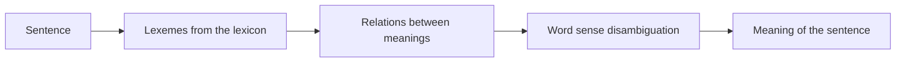
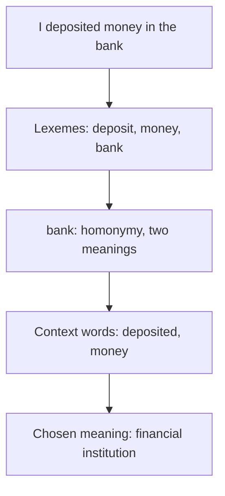

**In one line:** <mark>Semantic analysis finds the meaning of words and sentences, not only their grammar</mark>; its word-level part, <mark>lexical semantic analysis, finds the meaning of each word (lexeme) and picks the right sense from the context</mark>. <Cite id="class-nlp-pyq4" loc="p. 9" />

<Box kind="key">

**Key points to write:**

- <mark>Semantic analysis: the step of NLP that finds the meaning of text</mark>; syntax is only the form (grammar).
- <mark>Lexeme: a single word or phrase with a specific meaning. Lexicon: the entire collection of lexemes in a language</mark>.
- Lexical semantic analysis uses the **lexicon** and the **lexical relations** (homonymy, polysemy, synonymy, antonymy, hyponymy, meronymy).
- <mark>Ambiguous words are resolved with word sense disambiguation (WSD)</mark> from the context.
- Last step: **combine** the word meanings into the meaning of the sentence.
- Example: "I deposited money in the bank": *bank* = financial institution.

</Box>

## Core answer (5 marks, fits every question here)

<Box kind="definition">

**Semantic analysis** is the step of NLP that finds the meaning of words and sentences. Its word-level part is **lexical semantics**: the meaning of individual words (lexemes) and the relations between them. A **lexeme** is a single word or phrase that has a specific meaning; a **lexicon** is the entire collection of lexemes in a language. <Cite id="class-nlp-pyq4" loc="p. 9" /> <Cite id="web-nlp-2-semantic-analysis" />

</Box>

**Why it is needed:** a sentence can be grammatically perfect and still be misunderstood. The word *bank* may mean a money institution or a river side, and only meaning analysis can choose. <Cite id="class-nlp-pyq4" loc="p. 2" />

**Steps:**

1. Find the lexemes and their meanings from the lexicon.
2. Use the relations between meanings (synonymy, antonymy, hyponymy, meronymy, polysemy, homonymy). <Cite id="class-nlp-pyq4" loc="p. 10" />
3. Choose the right meaning of an ambiguous word from its context (word sense disambiguation). <Cite id="class-nlp-pyq4" loc="p. 5" />
4. Combine the word meanings into the meaning of the sentence.

**Position in NLP:** semantic analysis comes after lexical and syntactic analysis and before discourse and pragmatic analysis. <Cite id="class-nlp-m1" loc="p. 1" />

**Conclusion:** semantic analysis moves from words to meaning using the lexicon, lexical relations and disambiguation.

## Extended answer (10 marks): add these

### 1. Lexical semantic analysis of an example

**Example:** "I deposited money in the bank."

1. **Find the lexemes:** I, deposited (deposit), money, in, the, bank. *Money* and *bank* are content words; *in* and *the* are function words. <Cite id="class-nlp-pyq4" loc="p. 9" />
2. **Look up the meanings in the lexicon:** *bank* has two unrelated meanings (financial institution, river side), so it is **homonymy**. <Cite id="class-nlp-pyq4" loc="p. 2" />
3. **Use the context:** *deposited* and *money* point to the financial institution. This is word sense disambiguation, which Lesk's algorithm does by dictionary overlap. <Cite id="class-nlp-pyq4" loc="p. 4" />
4. **Result:** *bank* = financial institution.

Change the context and the result changes: in "The fisherman sat on the river bank", the words *fisherman* and *river* select the meaning "land beside a river". <Cite id="class-nlp-pyq4" loc="p. 5" />

### 2. Two parts of semantic analysis

| Part | What it studies | Example |
|---|---|---|
| Lexical semantics | meaning of single words and relations between words | *dog* is a kind of *animal* |
| Compositional semantics | how word meanings combine into the meaning of a phrase or sentence | "dog bites man" and "man bites dog" have different meanings |

<Cite id="web-nlp-2-lexsem" /> <Cite id="web-nlp-2-semantic-analysis" />

### 3. Resources and tasks

- **Lexicon and WordNet:** a database of lexemes, senses and relations used to look up meanings. <Cite id="web-nlp-2-wordnet" />
- **Word sense disambiguation:** choose one sense of a word from the context. <Cite id="web-nlp-1-wiki-wsd" />
- **Uses:** machine translation, question answering, search engines, chatbots and sentiment analysis.

### 4. Difficulties

- A word may have many senses, so the lexicon alone is not enough.
- Idioms and figurative use ("kick the bucket") do not follow word meanings.
- Real meaning also depends on the situation, which is the job of pragmatic analysis.

## Fit it to each question

- **"Describe the semantic analysis in Natural Language processing."** (5 marks) <PYQ id="2024-05-ce/q1d" />: the core answer (definition, four steps, flow diagram, conclusion).
- **"Demonstrate lexical semantic analysis using an example"** (10 marks) <PYQ id="2024-05-ce/q4b" />: short core definition, then section 1 (the "bank" example with the diagram), then sections 2 and 3.

## Exam tips

- **Draw** the flow diagram and the "bank" example diagram.
- Name the **lexicon, lexeme, lexical relations and WSD**: these four keywords carry the marks.
- Give **two meanings** for the example word, otherwise the ambiguity is not shown.
