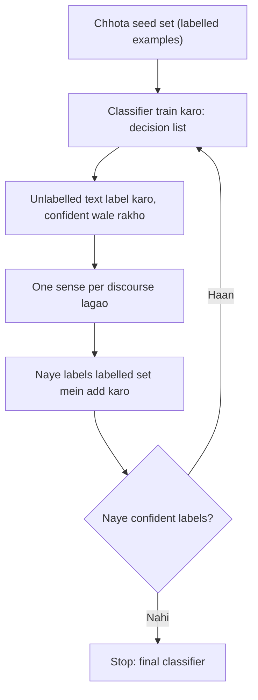
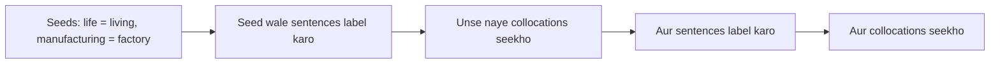
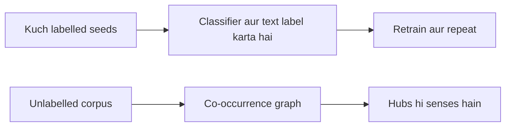

**Ek line mein:** <mark>Yarowsky algorithm ek semi-supervised, iterative bootstrapping method hai jo chhote labelled seed examples se bade unlabelled data ko classify karta hai</mark>; <mark>Hyperlex unsupervised hai: ye word graph se senses dhoondhta hai, labelled data ke bina</mark>. <Cite id="class-nlp-pyq4" loc="p. 7" />

<Box kind="key">

**Ye points likho:**

- <mark>Yarowsky: semi-supervised, iterative, bootstrapping; kuch seed examples bade unlabelled corpus ko label karte hain</mark>.
- Do principles: <mark>one sense per collocation</mark> (kisi nearby word ke saath aaya word wahi sense rakhta hai) aur <mark>one sense per discourse</mark> (ek document mein word ek hi sense rakhta hai).
- Steps: **seed, decision list train karo, confident labels do, one sense per discourse lagao, add karke retrain karo, jab kuch naya na mile to ruk jao**.
- Example: *plant*: "plant life" = sense A (living), "manufacturing plant" = sense B (factory).
- <mark>Advantages: kam labelling, coarse senses pe 95 percent se zyada accuracy. Disadvantages: seeds aur domain pe depend</mark>.
- <mark>Hyperlex (unsupervised): co-occurrence graph, hubs hi senses hain</mark>; labelled data nahi chahiye.

</Box>

## Core answer (5 marks, yahan ke har question ke liye)

<Box kind="definition">

The **Yarowsky algorithm** is a semi-supervised learning approach used mainly for word sense disambiguation. It is an iterative, bootstrapping method that uses a small set of labelled data (seed examples) to classify a large amount of unlabelled data. <Cite id="class-nlp-pyq4" loc="p. 7" />

</Box>

**Do principles jin pe ye chalta hai:** <Cite id="class-nlp-pyq4" loc="p. 7" /> <Cite id="web-nlp-2-yarowsky-1995" />

1. **One sense per collocation:** jo word kisi specific nearby word ke saath aata hai uska meaning har baar wahi rehta hai ("financial" ke saath "bank" ka matlab money wala).
2. **One sense per discourse:** ek document ke andar word ka sirf ek meaning hota hai.

**Bootstrapping process:** <Cite id="class-nlp-pyq4" loc="p. 7" /> <Cite id="class-nlp-pyq4" loc="p. 8" />

1. **Seeds:** har sense ke kuch hand-labelled examples (*plant* ke liye: "manufacturing plant" = A, "plant life" = B).
2. **Initial classifier:** seeds pe decision list train karo. Ye collocation features ko rank karti hai ki wo senses ko kitna alag karte hain.
3. **Bootstrap labelling:** unlabelled text ko label karo, sirf confident predictions rakho.
4. **Consistency lagao:** "one sense per discourse" apply karo.
5. **Iterate:** naye labels training set mein add karo, retrain karo, repeat karo.
6. **Convergence:** jab koi naya example confident label na ho to ruk jao.

**Conclusion:** Yarowsky language ki do properties se chhote labelled set ko bade set mein badal deta hai.

## Extended answer (10 marks): ye add karo

### 1. "plant" word pe Yarowsky ka method

Yarowsky ka paper method ko word *plant* (living plant ya factory) pe samjhata hai. <Cite id="web-nlp-2-yarowsky-1995" /> Labelled set kaise badhta hai, ek chhota illustration:

| Round | Ab tak labelled | Classifier kya seekhta hai |
|---|---|---|
| 0 (seeds) | "plant life" = living; "manufacturing plant" = factory | seed words *life* aur *manufacturing* |
| 1 | wo sentences jinke paas *animal*, *species*, *equipment*, *workers* hain | naye collocations: *animal* aur *species* living ki taraf, *equipment* aur *workers* factory ki taraf |
| 2 | naye collocations wale sentences | aur collocations, aur labels |
| Last | lagbhag saare instances | final decision list |

(Round 1 aur 2 ke collocation words illustration ke liye hain.)

### 2. Decision list

Decision list rules ki ranked list hai "agar collocation X present hai, to sense S". Rules do senses ke log-likelihood ratio se rank hote hain, aur naye case ka decision sabse strong matching rule leta hai. <Cite id="web-nlp-2-yarowsky-1995" />

### 3. Yarowsky ke advantages aur disadvantages

| Advantages | Disadvantages |
|---|---|
| Sirf chhota hand-labelled seed set chahiye | Domain dependent: topic badle to problem |
| plant (factory) aur plant (life) jaise coarse senses pe high accuracy; paper 96 percent se zyada batata hai | Seeds pe sensitive: kharab seeds errors failate hain |
| Knowledge acquisition bottleneck kam karta hai (hand labelling mehngi hai) | Fine, subtle senses pe kam effective |
| Decision list ki jagah doosra learner use ho sakta hai | Bahut time tak mathematically achhe se samjha nahi gaya |

<Cite id="class-nlp-pyq4" loc="p. 8" /> <Cite id="class-nlp-pyq4" loc="p. 9" /> <Cite id="web-nlp-2-yarowsky" />

### 4. Unsupervised WSD: Hyperlex

*(Class files mein Hyperlex nahi hai, isliye ye standard chhota idea hai.)* Hyperlex ko labelled data ya senses ki dictionary nahi chahiye.

1. Target word ke paas aane wale words lo; har word graph ka ek node hai.
2. Do nodes ko jodo agar wo aksar saath aate hain (co-occurrence graph).
3. **Hubs** dhoondho: sabse zyada connected nodes. Har hub target word ke ek sense ko represent karta hai.
4. Naye sentence ke liye dekho uske context words kis hub ke sabse paas hain aur wahi sense do.

| Point | Yarowsky | Hyperlex |
|---|---|---|
| Labelled data | Chhota seed set | Koi nahi |
| Idea | Do principles ke saath bootstrapping | Word graph ke hubs |
| Output | Known sense list ke sense labels | Text se hi mile senses |
| Weakness | Kharab seeds errors failate hain | Mile hue senses dictionary se match na karein |

<Cite id="web-nlp-1-wiki-wsd" />

## Har question mein kaise fit karein

- **"Explain Yarowsky bootstrapping approach of semi supervised learning"** (5 marks) <PYQ id="2022-12-ce/q3b" />: sirf core answer (definition, do principles, chhe steps, loop diagram).
- **"Explain Yarowsky bootstrapping approach of semi-supervised learning."** (10 marks) <PYQ id="assignment-2/q4d" />: core answer, phir sections 1 se 3 (*plant* example, advantages aur disadvantages).
- **"Explain Semi-supervised method (Yarowsky) Unsupervised (Hyperlex)"** (10 marks) <PYQ id="2025-05-ce/q6a" />: core definition aur steps short mein, loop diagram, section 4 (Hyperlex) aur comparison table.

## Exam tips

- **Dono principles ke naam likho** (one sense per collocation, one sense per discourse); ye marking keywords hain.
- "naye confident labels?" decision ke saath loop **draw karo**.
- Combined question mein Hyperlex ko aadhi jagah do aur end mein comparison table likho.

Exam mein English mein likho.
