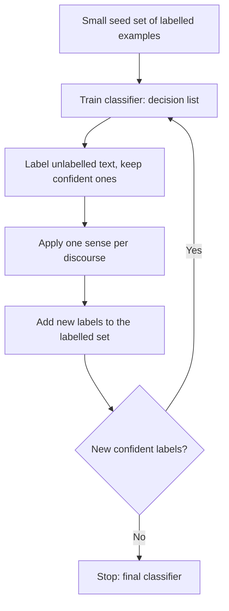
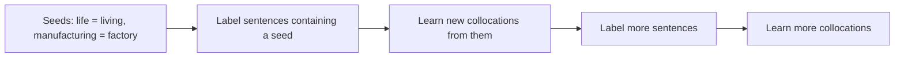
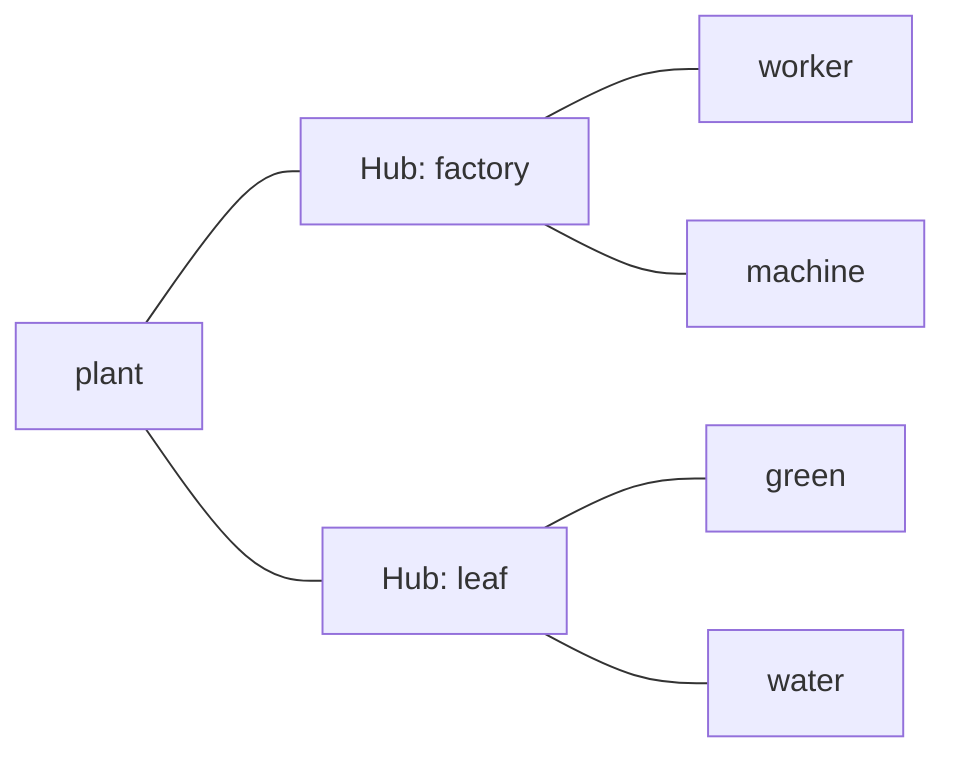
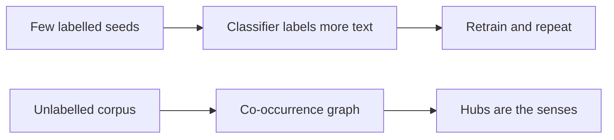

**In one line:** <mark>The Yarowsky algorithm is a semi-supervised, iterative bootstrapping method that uses a small set of labelled seed examples to classify a large amount of unlabelled data</mark>; <mark>Hyperlex is unsupervised: it finds senses from a word graph with no labelled data</mark>. <Cite id="class-nlp-pyq4" loc="p. 7" />

<Box kind="key">

**Key points to write:**

- <mark>Yarowsky: semi-supervised, iterative, bootstrapping; a few seed examples label a large unlabelled corpus</mark>.
- Two principles: <mark>one sense per collocation</mark> (a word with a given nearby word keeps its sense) and <mark>one sense per discourse</mark> (a word keeps one sense in a document).
- Steps: **seed, train a decision list, label confidently, apply one sense per discourse, add and retrain, stop when nothing new**.
- Example: *plant*: "plant life" = sense A (living), "manufacturing plant" = sense B (factory).
- <mark>Advantages: little labelling, accuracy above 95 percent on coarse senses. Disadvantages: depends on the seeds and the domain</mark>.
- <mark>Hyperlex (unsupervised): co-occurrence graph, hubs are the senses</mark>; needs no labelled data.

</Box>

## Core answer (5 marks, fits every question here)

<Box kind="definition">

The **Yarowsky algorithm** is a semi-supervised learning approach used mainly for word sense disambiguation. It is an iterative, bootstrapping method that uses a small set of labelled data (seed examples) to classify a large amount of unlabelled data. <Cite id="class-nlp-pyq4" loc="p. 7" />

</Box>

**Two principles it relies on:** <Cite id="class-nlp-pyq4" loc="p. 7" /> <Cite id="web-nlp-2-yarowsky-1995" />

1. **One sense per collocation:** a word that appears with a specific nearby word tends to have the same meaning every time ("financial" with "bank" suggests the money sense).
2. **One sense per discourse:** a word tends to have only one meaning within a single document.

**The bootstrapping process:** <Cite id="class-nlp-pyq4" loc="p. 7" /> <Cite id="class-nlp-pyq4" loc="p. 8" />

1. **Seeds:** a few hand-labelled examples per sense (for *plant*: "manufacturing plant" = A, "plant life" = B).
2. **Initial classifier:** train a decision list on the seeds. It ranks collocation features by how well they separate the senses.
3. **Bootstrap labelling:** label the unlabelled text, keeping only confident predictions.
4. **Enforce consistency:** apply "one sense per discourse".
5. **Iterate:** add the new labels to the training set, retrain and repeat.
6. **Convergence:** stop when no new example is labelled confidently.

**Conclusion:** Yarowsky grows a small labelled set into a large one by using two properties of language.

## Extended answer (10 marks): add these

### 1. Yarowsky's method on the word "plant"

Yarowsky's paper illustrates the method on the word *plant* (living plant or factory). <Cite id="web-nlp-2-yarowsky-1995" /> A small illustration of how the labelled set grows:

| Round | Labelled so far | What the classifier learns |
|---|---|---|
| 0 (seeds) | "plant life" = living; "manufacturing plant" = factory | the seed words *life* and *manufacturing* |
| 1 | sentences with *animal*, *species*, *equipment*, *workers* nearby | new collocations: *animal* and *species* point to living, *equipment* and *workers* point to factory |
| 2 | sentences with the new collocations | more collocations, more labels |
| Last | nearly all instances | final decision list |

(The collocation words in rounds 1 and 2 are illustrative.)

### 2. Decision list

The decision list is a ranked list of rules "if collocation X is present, sense S". Rules are ranked by the log-likelihood ratio of the two senses, and a new case is decided by the single strongest rule that matches. <Cite id="web-nlp-2-yarowsky-1995" />

### 3. Advantages and disadvantages of Yarowsky

| Advantages | Disadvantages |
|---|---|
| Needs only a small hand-labelled seed set | Domain dependent: may suffer when topics change |
| High accuracy on coarse senses such as plant (factory) and plant (life); the paper reports above 96 percent | Sensitive to the seeds: poor seeds spread errors |
| Reduces the knowledge acquisition bottleneck (hand labelling is costly) | Less effective for fine, subtle senses |
| Another learner can replace the decision list | Not mathematically well understood for a long time |

<Cite id="class-nlp-pyq4" loc="p. 8" /> <Cite id="class-nlp-pyq4" loc="p. 9" /> <Cite id="web-nlp-2-yarowsky" />

### 4. Unsupervised WSD: Hyperlex

*(The class files do not cover Hyperlex, so this is the standard short idea.)* Hyperlex needs no labelled data and no dictionary of senses.

1. Take the words that appear near the target word; each is a node of a graph.
2. Join two nodes if they occur together often (a co-occurrence graph).
3. Find the **hubs**: the most highly connected nodes. Each hub stands for one sense of the target word.
4. For a new sentence, see which hub its context words are closest to and give that sense.

| Point | Yarowsky | Hyperlex |
|---|---|---|
| Labelled data | Small seed set | None |
| Idea | Bootstrapping with two principles | Hubs in a word graph |
| Output | Sense labels from a known sense list | Senses found from the text itself |
| Weakness | Poor seeds spread errors | Senses found may not match a dictionary |

<Cite id="web-nlp-1-wiki-wsd" />

## Fit it to each question

- **"Explain Yarowsky bootstrapping approach of semi supervised learning"** (5 marks) <PYQ id="2022-12-ce/q3b" />: the core answer only (definition, two principles, six steps, loop diagram).
- **"Explain Yarowsky bootstrapping approach of semi-supervised learning."** (10 marks) <PYQ id="assignment-2/q4d" />: core answer, then sections 1 to 3 (the *plant* example, advantages and disadvantages).
- **"Explain Semi-supervised method (Yarowsky) Unsupervised (Hyperlex)"** (10 marks) <PYQ id="2025-05-ce/q6a" />: core definition and steps in short, the loop diagram, section 4 (Hyperlex) and the comparison table.

## Exam tips

- **Name both principles** (one sense per collocation, one sense per discourse); they are the marking keywords.
- **Draw** the loop with the "new confident labels?" decision.
- For the combined question give Hyperlex half the space and end with the comparison table.
