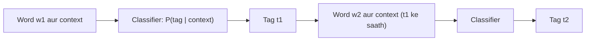
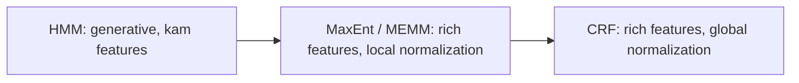

**Ek line mein:** <mark>Sequence labelling sequence ke har item ko ek label deta hai (jaise har word ko ek POS tag)</mark>, aur classification method ye kaam karta hai <mark>har word ke context se best label chun ke</mark>, Maximum Entropy jaise classifier se. <Cite id="class-nlp-pyq3" loc="p. 8" />

<Box kind="key">

**Ye points likho:**

- <mark>Sequence labelling: input words W = (w1 ... wn), output tags T = (t1 ... tn), har word ka ek tag</mark>. Uses: POS tagging, named entity recognition.
- Word ka label uske **neighbours** pe depend karta hai, isliye order matter karta hai.
- <mark>Classification method (MaxEnt): discriminative model jo P(tag | context) seedha nikalta hai</mark>.
- <mark>Binary feature functions</mark> (word, previous tag, suffix, capital letter) ko weight dekar score karte hain: $P(y \mid x) = \frac{1}{Z(x)} \exp\big(\sum_i \lambda_i f_i(x, y)\big)$.
- Poore sentence ke liye **MEMM**: word by word tag karo, pehle ke tags ko context banao, **Viterbi** se decode karo.
- Weakness: <mark>label bias</mark> (local normalization); CRF ise fix karta hai.

</Box>

## Core answer (5 marks, yahan ke har question ke liye)

<Box kind="definition">

**Sequence labelling** assigns a label to every item in an input sequence. In POS tagging the input is a sequence of words and the output is a sequence of tags, one tag per word. <Cite id="class-nlp-pyq3" loc="p. 8" /> <Cite id="web-nlp-2-seqlabel" />

</Box>

**Ye simple classification kyun nahi hai:** word ka tag uske aas-paas ke words aur tags pe depend karta hai, isliye poori sequence matter karti hai. "Janet will back the bill" mein *back* verb hai, lekin "the back of the bill" mein noun. <Cite id="web-nlp-1-slp3-seqlabel" loc="§18.2" />

**Classification method (steps):** <Cite id="class-nlp-pyq3" loc="p. 9" /> <Cite id="class-nlp-pyq3" loc="p. 10" />

1. Ek word lo aur uska context $x$ banao: word, uske neighbours aur pehle chune hue tags.
2. Binary **feature functions** $f_i(x, y)$ nikalo (condition true to 1, warna 0).
3. Weighted features se har tag ko score do aur scores ko probabilities mein badlo.
4. Sabse high probability wala tag chuno, phir next word pe jao.

**Example:** Janet/NNP will/MD back/VB the/DT bill/NN. Har word ko baari-baari classify karte hain, aur *back* ko VB milta hai kyunki previous tag MD hai.

**Conclusion:** sequence labelling sequence ke har item ko tag deta hai, aur classification method har tag context ke weighted features se chunta hai.

## Extended answer (10 marks): ye add karo

### 1. Sequence labelling kahan use hota hai

| Task | Input | Output labels |
|---|---|---|
| POS tagging | words | NN, VB, DT, JJ ... |
| Named entity recognition | words | PER, ORG, LOC, ya O (entity nahi) |

Named entity ke tags aksar **B** (begin) aur **I** (inside) se likhte hain, jaise B-PER I-PER O. <Cite id="web-nlp-1-slp3-seqlabel" loc="§18.3" />

### 2. Maximum Entropy classifier detail mein

MaxEnt (multinomial logistic regression) **discriminative** hai: ye $P(y \mid x)$ seedha model karta hai. Formula:

$$
P(y \mid x) = \frac{1}{Z(x)} \exp\Big(\sum_{i=1}^{N} \lambda_i f_i(x, y)\Big)
$$

$\lambda_i$ feature $f_i$ ka learned weight hai aur $Z(x)$ saari tag probabilities ka sum 1 banata hai. <Cite id="class-nlp-pyq3" loc="p. 9" />

| Feature type | Example (true hone pe 1) |
|---|---|
| Current word | word "bank" hai aur tag NN hai |
| Previous tag | previous tag DT hai aur tag NN hai |
| Suffix | word "-ing" pe end hota hai aur tag VBG hai |
| Capitalization | word capital se shuru hai aur tag NNP hai |

<Sum>

<Given>

Word *run*, tag TO ke baad. Weights: "word is run and tag is VB" ke liye 2, "previous tag is TO and tag is VB" ke liye 1.5, "word is run and tag is NN" ke liye 1. (Formula samjhane ke liye banaye hue weights.)

</Given>

<Find>

$P(\text{VB})$ aur $P(\text{NN})$.

</Find>

<Steps>

1. Score(VB) $= 2 + 1.5 = 3.5$. Score(NN) $= 1$.
2. $e^{3.5} = 33.115$ aur $e^{1} = 2.718$, to $Z = 35.833$.
3. $P(\text{VB}) = 33.115 / 35.833 = 0.924$ aur $P(\text{NN}) = 2.718 / 35.833 = 0.076$.

</Steps>

<Answer>

*run* ko VB tag milta hai (to/TO run/VB).

</Answer>

<Box kind="verify">

$0.924 + 0.076 = 1$, matlab probabilities valid hain.

</Box>

</Sum>

### 3. Ek word se poore sentence tak: MEMM

Sentence ke liye model word by word lagta hai, pehle ke tags context mein hote hain. Ye **Maximum Entropy Markov Model** hai: $P(T \mid W) = \prod_{i=1}^{n} P(t_i \mid x_i)$, aur Viterbi decoding best tag sequence nikalti hai. <Cite id="class-nlp-pyq3" loc="p. 10" />

| Point | HMM | MaxEnt (MEMM) | CRF |
|---|---|---|---|
| Type | Generative, $P(x, y)$ | Discriminative, $P(y \mid x)$ | Discriminative |
| Rich features | Nahi | Haan | Haan |
| Normalization | Joint model | Local (har step) | Global (poora sentence) |
| Label bias | Nahi | Haan | Nahi |

<Cite id="web-nlp-1-wiki-hmm" /> <Cite id="web-nlp-1-sutton-crf" />

### 4. Limitations

1. **Label bias:** probabilities har step pe normalize hoti hain, isliye kam choices wala state dominate kar sakta hai, chahe poori sequence unlikely ho. <Cite id="class-nlp-pyq3" loc="p. 10" />
2. **Heavy training:** iterative optimization chahiye, jo HMM ki counting se slow hai.

## Har question mein kaise fit karein

- **"What is Sequential Labelling? Explain classification method with example"** (10 marks) <PYQ id="2026-05/q5b" />: sequence labelling ki definition, chaar classification steps flow diagram ke saath, phir feature table, Sum block ka *run* example aur MEMM wali line.

## Exam tips

- **Draw karo:** word-by-word classification flow, aur MaxEnt formula $\lambda$ aur $Z(x)$ ke matlab ke saath.
- Hamesha **tagged example** do (Janet/NNP will/MD back/VB the/DT bill/NN).
- Ye bolna mat bhoolo ki classification method **context features** use karta hai, sirf word nahi.

Exam mein English mein likho.
