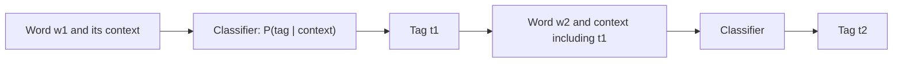
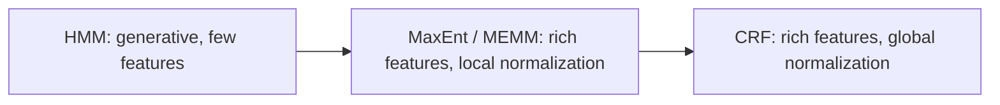

**In one line:** <mark>Sequence labelling gives one label to every item of a sequence (for example one POS tag to every word)</mark>, and the classification method does it by <mark>choosing the best label for each word from its context</mark>, using a classifier such as Maximum Entropy. <Cite id="class-nlp-pyq3" loc="p. 8" />

<Box kind="key">

**Key points to write:**

- <mark>Sequence labelling: input words W = (w1 ... wn), output tags T = (t1 ... tn), one tag per word</mark>. Uses: POS tagging, named entity recognition.
- The label of a word depends on its **neighbours**, so order matters.
- <mark>Classification method (MaxEnt): a discriminative model that finds P(tag | context) directly</mark>.
- <mark>Binary feature functions</mark> (word, previous tag, suffix, capital letter) are weighted and scored: $P(y \mid x) = \frac{1}{Z(x)} \exp\big(\sum_i \lambda_i f_i(x, y)\big)$.
- For a whole sentence use the **MEMM**: tag word by word, use the earlier tags as context, decode with **Viterbi**.
- Weakness: <mark>label bias</mark> (local normalization); the CRF fixes it.

</Box>

## Core answer (5 marks, fits every question here)

<Box kind="definition">

**Sequence labelling** assigns a label to every item in an input sequence. In POS tagging the input is a sequence of words and the output is a sequence of tags, one tag per word. <Cite id="class-nlp-pyq3" loc="p. 8" /> <Cite id="web-nlp-2-seqlabel" />

</Box>

**Why it is not plain classification:** the tag of a word depends on the words and tags around it, so the whole sequence matters. In "Janet will back the bill" the word *back* is a verb, but in "the back of the bill" it is a noun. <Cite id="web-nlp-1-slp3-seqlabel" loc="§18.2" />

**Classification method (steps):** <Cite id="class-nlp-pyq3" loc="p. 9" /> <Cite id="class-nlp-pyq3" loc="p. 10" />

1. Take one word and build its context $x$: the word, its neighbours and the tags already chosen.
2. Compute binary **feature functions** $f_i(x, y)$ (1 if a condition is true, else 0).
3. Score every tag with the weighted features and convert the scores to probabilities.
4. Choose the tag with the highest probability, then move to the next word.

**Example:** Janet/NNP will/MD back/VB the/DT bill/NN. Each word is classified in turn, and *back* gets VB because the previous tag is MD.

**Conclusion:** sequence labelling tags every item of a sequence, and the classification method picks each tag from weighted features of the context.

## Extended answer (10 marks): add these

### 1. Where sequence labelling is used

| Task | Input | Output labels |
|---|---|---|
| POS tagging | words | NN, VB, DT, JJ ... |
| Named entity recognition | words | PER, ORG, LOC, or O (not an entity) |

The tags of a named entity are often written with a **B** (begin) and **I** (inside) mark, such as B-PER I-PER O. <Cite id="web-nlp-1-slp3-seqlabel" loc="§18.3" />

### 2. The Maximum Entropy classifier in detail

MaxEnt (multinomial logistic regression) is **discriminative**: it models $P(y \mid x)$ directly. Its formula is

$$
P(y \mid x) = \frac{1}{Z(x)} \exp\Big(\sum_{i=1}^{N} \lambda_i f_i(x, y)\Big)
$$

$\lambda_i$ is the learned weight of feature $f_i$ and $Z(x)$ makes all tag probabilities add to 1. <Cite id="class-nlp-pyq3" loc="p. 9" />

| Feature type | Example (equals 1 when true) |
|---|---|
| Current word | word is "bank" and tag is NN |
| Previous tag | previous tag is DT and tag is NN |
| Suffix | word ends with "-ing" and tag is VBG |
| Capitalization | word is capitalized and tag is NNP |

<Sum>

<Given>

Word *run* after the tag TO. Weights: 2 for "word is run and tag is VB", 1.5 for "previous tag is TO and tag is VB", 1 for "word is run and tag is NN". (Made-up weights to show the formula.)

</Given>

<Find>

$P(\text{VB})$ and $P(\text{NN})$.

</Find>

<Steps>

1. Score(VB) $= 2 + 1.5 = 3.5$. Score(NN) $= 1$.
2. $e^{3.5} = 33.115$ and $e^{1} = 2.718$, so $Z = 35.833$.
3. $P(\text{VB}) = 33.115 / 35.833 = 0.924$ and $P(\text{NN}) = 2.718 / 35.833 = 0.076$.

</Steps>

<Answer>

*run* is tagged VB (to/TO run/VB).

</Answer>

<Box kind="verify">

$0.924 + 0.076 = 1$, so the probabilities are valid.

</Box>

</Sum>

### 3. From one word to a whole sentence: MEMM

For a sentence the model is applied word by word, with the earlier tags in the context. This is the **Maximum Entropy Markov Model**: $P(T \mid W) = \prod_{i=1}^{n} P(t_i \mid x_i)$, and Viterbi decoding finds the best tag sequence. <Cite id="class-nlp-pyq3" loc="p. 10" />

| Point | HMM | MaxEnt (MEMM) | CRF |
|---|---|---|---|
| Type | Generative, $P(x, y)$ | Discriminative, $P(y \mid x)$ | Discriminative |
| Rich features | No | Yes | Yes |
| Normalization | Joint model | Local (each step) | Global (whole sentence) |
| Label bias | No | Yes | No |

<Cite id="web-nlp-1-wiki-hmm" /> <Cite id="web-nlp-1-sutton-crf" />

### 4. Limitations

1. **Label bias:** probabilities are normalized at each step, so a state with few choices can dominate even when the whole sequence is unlikely. <Cite id="class-nlp-pyq3" loc="p. 10" />
2. **Heavy training:** iterative optimization is needed, which is slower than the counting of an HMM.

## Fit it to each question

- **"What is Sequential Labelling? Explain classification method with example"** (10 marks) <PYQ id="2026-05/q5b" />: definition of sequence labelling, the four classification steps with the flow diagram, then the feature table, the *run* example in the Sum block and the MEMM line.

## Exam tips

- **Draw** the word-by-word classification flow, and write the MaxEnt formula with the meaning of $\lambda$ and $Z(x)$.
- Always give a **tagged example** (Janet/NNP will/MD back/VB the/DT bill/NN).
- Do not forget to say that the classification method uses **context features**, not only the word.
