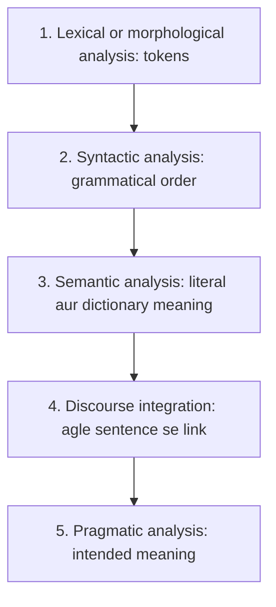
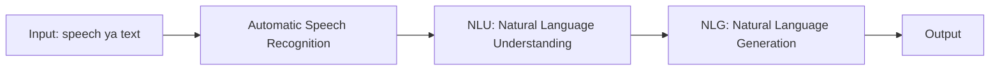
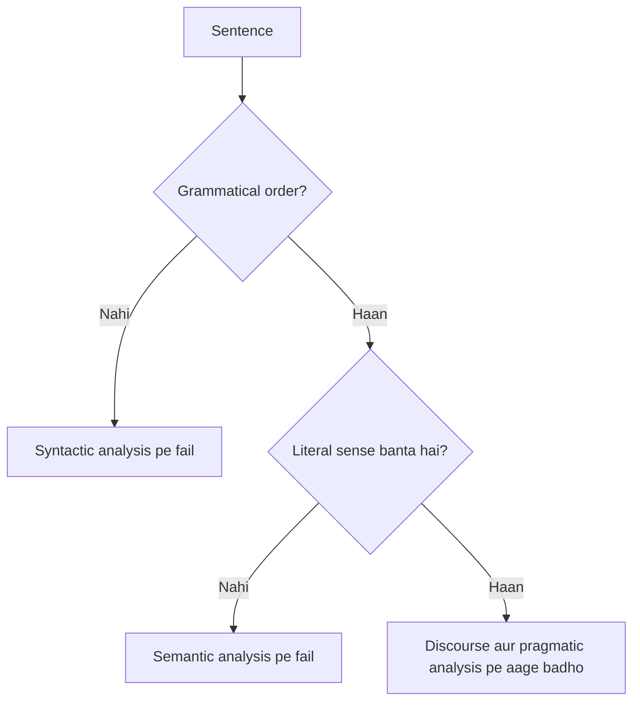

**Ek line mein:** <mark>NLP ek sentence ko paanch stages se guzaarta hai: lexical ya morphological, syntactic, semantic, discourse integration aur pragmatic analysis</mark>, words se speaker ke asli intention tak. <Cite id="class-nlp-m1" loc="p. 1" />

<Box kind="key">

**Stages ke har question mein ye points likho:**

- <mark>NLP is a branch of AI that focuses on interaction between computers and humans</mark> (Alexa, Siri, ChatGPT).
- Paanch stages, **order mein**: <mark>lexical or morphological, syntactic, semantic, discourse integration, pragmatic</mark>.
- Lexical **sentence ko tokens mein todta hai**; syntactic **grammatical order** check karta hai; semantic **literal aur dictionary meaning** check karta hai.
- Discourse integration sentence ko **agle sentence** se jodta hai; pragmatic **intended meaning** dhoondhta hai.
- Generic NLP system: <mark>input, Automatic Speech Recognition, NLU, NLG, output</mark>.
- **Har stage ka ek example** likho.

</Box>

## Core answer (5 marks, yahan ke har question ke liye)

<Box kind="definition">

**Natural Language Processing (NLP)** is a branch of AI that focuses on interaction between computers and humans. Examples: Alexa, Siri, ChatGPT. <Cite id="class-nlp-m1" loc="p. 1" />

</Box>

**Stages kyun:** sentence step by step samjha jaata hai, har stage pichhle stage ka result use karta hai.

| Stage | Kya karta hai | Teacher ka example |
|---|---|---|
| 1. Lexical or morphological | Sentence ko chunks ya tokens mein todta hai | The cat is running becomes The, cat, is, running |
| 2. Syntactic | Grammar aur structure check karta hai (grammatically proper order) | The dog chased the ball sahi; The chased ball the dog galat |
| 3. Semantic | Literal aur dictionary meaning check karta hai | The apple ate the boy galat hai |
| 4. Discourse integration | Sentence ka agle sentence se relation | John wants to read a book. He picked it up. |
| 5. Pragmatic | Intended meaning dhoondhta hai | I want to buy apple (fruit ya phone?) |

<Cite id="class-nlp-m1" loc="p. 1" /> <Cite id="class-nlp-m1" loc="p. 2" />

**Conclusion:** stages words se intention tak jaate hain, aur har stage pichhle stage ka result use karta hai.

## Extended answer (10 marks): ye add karo

### 1. Generic NLP system (process)

Input se Automatic Speech Recognition, phir NLU, phir NLG, phir output. <Cite id="class-nlp-m1" loc="p. 1" />

- **ASR** bole gaye words ko text banata hai. **NLU** text ka matlab nikalta hai (paanch stages yahin hote hain). **NLG** jawab human language mein likhta hai.
- Example: aap Alexa se poochte ho "what is the weather?"; wo sunti hai (ASR), samajhti hai ki weather chahiye (NLU) aur jawab bolti hai (NLG).

### 2. Har stage detail mein

1. **Lexical or morphological:** text ko tokens mein todta hai aur word ko parts mein (running = run + ing). <Cite id="web-nlp-1-wiki-lexanalysis" />
2. **Syntactic:** subject, verb, object ka order check karta hai. "The dog chased the ball" pass; "The chased ball the dog" fail.
3. **Semantic:** "The apple ate the boy" grammar mein perfect hai par yahan fail hota hai, kyunki apple kha nahi sakta. Isliye ek stage kaafi nahi.
4. **Discourse integration:** "John wants to read a book. He picked it up." mein he = John aur it = book. Main kaam **anaphora resolution** hai. <Cite id="class-nlp-asol" loc="p. 1" />
5. **Pragmatic:** "It's freezing out here" ka asli matlab "please heater on karo" ho sakta hai.

### 3. Ek sentence saare stages se

<Cite id="web-nlp-1-wiki-nlp" />

## Har question mein kaise fit karein

- **"Explain Different stage involved in NLP process with suitable example."** (10 marks) <PYQ id="2022-12-ce/q2b" /> <PYQ id="2026-05/q2a" />: definition, five-stage flow, table, phir section 2 aur 3.
- **"Explain the various stages of Natural Language processing."** (5 marks) <PYQ id="2023-05-ce/q1e" />: sirf core answer: flow aur table.
- **"What is Natural language processing (NLP)? Discuss various stages involved in NLP process with suitable example."** (10 marks) <PYQ id="2024-12/q3b" /> <PYQ id="assignment-1/q1a" />: definition box se shuru karo (NLP kya hai), phir flow, table aur section 2.
- **"Explain different stages of NLP. Also explain generic NLP system."** (10 marks) <PYQ id="2025-05-ce/q2b" />: core answer plus section 1 (generic system diagram ke saath) aur har stage pe ek line.

## Exam tips

- **Draw karo** paanch-box vertical flow aur input se output line (ASR, NLU, NLG).
- **Stage order** fix rakho; galat order mein marks kat jaate hain.
- **Teacher ke examples** use karo (cat is running, apple ate the boy, John aur book); examiner inhe jaante hain.

Exam mein English mein likho.
