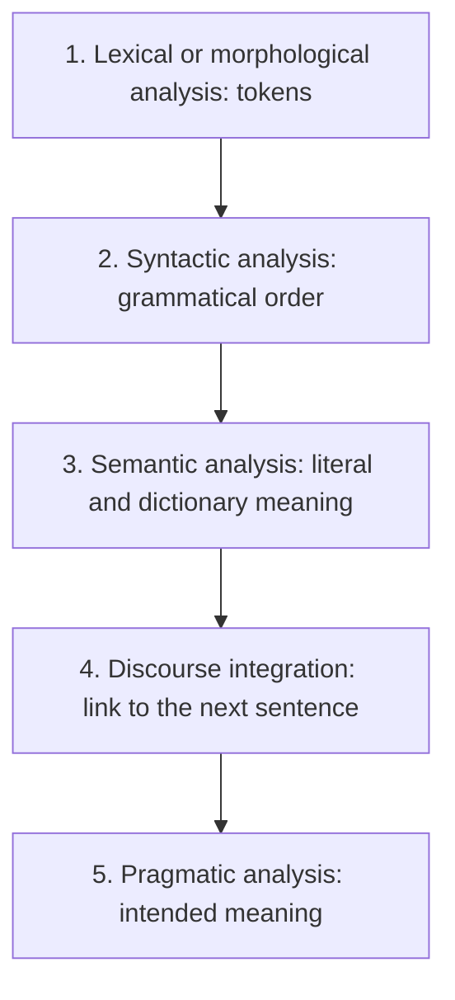
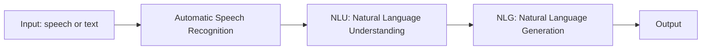
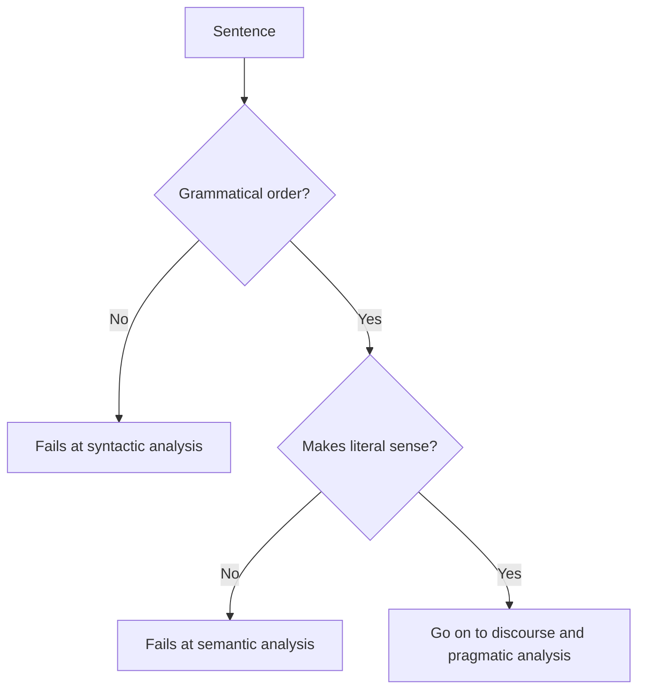

**In one line:** <mark>NLP passes a sentence through five stages: lexical or morphological, syntactic, semantic, discourse integration and pragmatic analysis</mark>, from its words to the speaker's real intention. <Cite id="class-nlp-m1" loc="p. 1" />

<Box kind="key">

**Key points to write (any stages question):**

- <mark>NLP is a branch of AI that focuses on interaction between computers and humans</mark> (Alexa, Siri, ChatGPT).
- The five stages, **in order**: <mark>lexical or morphological, syntactic, semantic, discourse integration, pragmatic</mark>.
- Lexical **divides the sentence into tokens**; syntactic checks **grammatical order**; semantic checks **literal and dictionary meaning**.
- Discourse integration links a sentence to **the next sentence**; pragmatic finds the **intended meaning**.
- Generic NLP system: <mark>input, Automatic Speech Recognition, NLU, NLG, output</mark>.
- Write **one example for every stage**.

</Box>

## Core answer (5 marks, fits every question here)

<Box kind="definition">

**Natural Language Processing (NLP)** is a branch of AI that focuses on interaction between computers and humans. Examples: Alexa, Siri, ChatGPT. <Cite id="class-nlp-m1" loc="p. 1" />

</Box>

**Why stages:** a sentence is understood step by step, each stage using the result of the one before it.

| Stage | What it does | Teacher's example |
|---|---|---|
| 1. Lexical or morphological | Divides the sentence into chunks or tokens | The cat is running becomes The, cat, is, running |
| 2. Syntactic | Checks grammar and structure (grammatically proper order) | The dog chased the ball is right; The chased ball the dog is wrong |
| 3. Semantic | Checks literal and dictionary meaning | The apple ate the boy is wrong |
| 4. Discourse integration | How a sentence relates to the immediately next sentence | John wants to read a book. He picked it up. |
| 5. Pragmatic | Finds the intended meaning | I want to buy apple (fruit or phone?) |

<Cite id="class-nlp-m1" loc="p. 1" /> <Cite id="class-nlp-m1" loc="p. 2" />

**Conclusion:** the stages go from words to intention, and each one uses the result of the one before it.

## Extended answer (10 marks): add these

### 1. Generic NLP system (the process)

Input goes to Automatic Speech Recognition, then NLU, then NLG, then output. <Cite id="class-nlp-m1" loc="p. 1" />

- **ASR** turns spoken words into text. **NLU** works out what the text means (the five stages live here). **NLG** writes the answer in human language.
- Example: you ask Alexa "what is the weather?"; it hears you (ASR), understands you want the weather (NLU) and says the answer (NLG).

### 2. Each stage in detail

1. **Lexical or morphological:** splits text into tokens and splits a word into parts (running = run + ing). <Cite id="web-nlp-1-wiki-lexanalysis" />
2. **Syntactic:** checks the order subject, verb, object. "The dog chased the ball" passes; "The chased ball the dog" fails.
3. **Semantic:** "The apple ate the boy" is grammatically perfect but fails here, because an apple cannot eat. That is why one stage is not enough.
4. **Discourse integration:** in "John wants to read a book. He picked it up." he is John and it is the book. The key job is **anaphora resolution**. <Cite id="class-nlp-asol" loc="p. 1" />
5. **Pragmatic:** "It's freezing out here" may really mean "please turn on the heater".

### 3. One sentence through all stages

<Cite id="web-nlp-1-wiki-nlp" />

## Fit it to each question

- **"Explain Different stage involved in NLP process with suitable example."** (10 marks) <PYQ id="2022-12-ce/q2b" /> <PYQ id="2026-05/q2a" />: definition, five-stage flow, table, then sections 2 and 3.
- **"Explain the various stages of Natural Language processing."** (5 marks) <PYQ id="2023-05-ce/q1e" />: core answer only: flow plus table.
- **"What is Natural language processing (NLP)? Discuss various stages involved in NLP process with suitable example."** (10 marks) <PYQ id="2024-12/q3b" /> <PYQ id="assignment-1/q1a" />: start with the definition box (what is NLP), then flow, table and section 2.
- **"Explain different stages of NLP. Also explain generic NLP system."** (10 marks) <PYQ id="2025-05-ce/q2b" />: core answer plus section 1 (the generic system with its diagram) and a line on each stage.

## Exam tips

- **Draw** the five-box vertical flow and the input to output line (ASR, NLU, NLG).
- Keep the **stage order** fixed; a wrong order loses marks.
- Use the **teacher's examples** (cat is running, apple ate the boy, John and the book); examiners know them.
