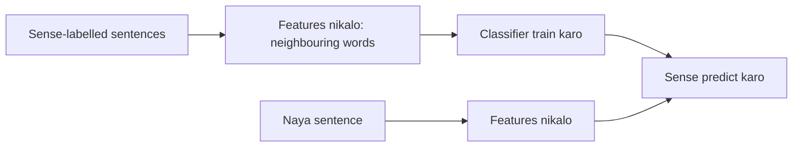
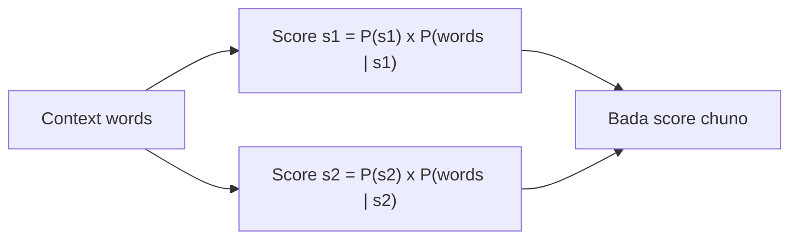
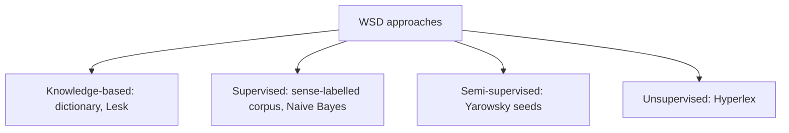

**Ek line mein:** <mark>Supervised WSD word sense disambiguation ko classification maanta hai: aise text pe classifier train karo jahan har target word ka sahi sense marked ho, phir naye sentences mein sense predict karo</mark>; Naive Bayes <mark>wo sense chunta hai jiska P(sense) guna P(context word | sense) ka product maximum ho</mark>. <Cite id="web-nlp-1-wiki-wsd" />

<Box kind="key">

**Ye points likho:**

- <mark>WSD isliye chahiye kyunki ek word ke kai meanings hote hain aur meaning context ke saath badalta hai</mark> (machine translation, search, question answering).
- <mark>Supervised WSD sense-labelled corpus se seekhta hai</mark>: har target word uske sense ke saath tagged hota hai.
- Steps: **labelled data collect karo, features nikalo (neighbouring words), classifier train karo, naye sentences ka sense predict karo**.
- <mark>Naive Bayes: $\hat{s} = \arg\max_s P(s) \prod_j P(c_j \mid s)$</mark>; "naive" matlab context words ko independent maante hain.
- Probabilities labelled corpus mein **counting** se nikalti hain.
- <mark>Disadvantage: bada sense-labelled corpus banana mehnga hai</mark> (knowledge acquisition bottleneck).

</Box>

## Core answer (5 marks, yahan ke har question ke liye)

<Box kind="definition">

**Supervised WSD** learns from sentences in which the sense of the target word is already marked, and uses what it learns to choose the sense in new sentences. <Cite id="web-nlp-1-wiki-wsd" />

</Box>

**WSD ki need:** bahut se words ambiguous hote hain, isliye unka meaning context ke saath badalta hai ("deposited money in the bank" aur "the river bank"). WSD NLP system ko aas-paas ke words analyze karke intended sense dhoondhne deta hai, jisse language understanding better hoti hai aur ambiguity kam hoti hai. <Cite id="class-nlp-pyq4" loc="p. 5" /> Iske bina translator *bank* ko galat word se translate kar sakta hai, aur search engine money query pe nadi ke pages dikha sakta hai.

**Supervised approach ke steps:**

1. **Sense-labelled corpus collect karo:** target word ke har occurrence pe uska sense marked ho.
2. **Features nikalo:** target ke aas-paas ke words (nearby words ki window), uske just pehle aur baad ke words, aur part of speech.
3. In features pe **classifier train karo** (Naive Bayes, decision list, SVM ya neural network).
4. **Predict karo:** naye sentence ke liye wahi features nikalo aur sabse probable sense chuno.

**Conclusion:** supervised WSD tab accurate hota hai jab kaafi labelled data ho, lekin wo data banana mehnga hai.

## Extended answer (10 marks): ye add karo

### 1. Naive Bayes algorithm

Senses $s_1, s_2, \ldots$ aur context words $c_1, c_2, \ldots, c_n$ wale word ke liye ye wo sense chunta hai:

$$
\hat{s} = \arg\max_{s} \; P(s) \prod_{j=1}^{n} P(c_j \mid s)
$$

$P(s)$ batata hai training data mein sense kitni baar aata hai; $P(c_j \mid s)$ batata hai context word $c_j$ us sense ke saath kitni baar aata hai. Dono counting se nikalte hain. "Naive" matlab context words ek doosre se independent maane jaate hain, jo strictly sach nahi lekin practice mein achha chalta hai. <Cite id="web-nlp-2-naive-bayes" />

### 2. Worked example

<Sum>

<Given>

Word *bank*, senses s1 (finance) aur s2 (river). Labelled corpus se (made-up numbers): $P(s_1) = 0.6$, $P(s_2) = 0.4$; $P(\text{money} \mid s_1) = 0.3$, $P(\text{money} \mid s_2) = 0.05$; $P(\text{deposit} \mid s_1) = 0.2$, $P(\text{deposit} \mid s_2) = 0.02$. Context: *money*, *deposit*.

</Given>

<Find>

*bank* ka sense.

</Find>

<Steps>

1. s1 ka score $= 0.6 \times 0.3 \times 0.2 = 0.036$.
2. s2 ka score $= 0.4 \times 0.05 \times 0.02 = 0.0004$.
3. Compare: $0.036 > 0.0004$, to s1 chuno.

</Steps>

<Answer>

*bank* = finance sense (s1).

</Answer>

<Box kind="verify">

Normalize: $0.036 / (0.036 + 0.0004) = 0.989$, yaani s1 ki probability lagbhag 99 percent hai aur dono probabilities ka sum 1 hai. *money* aur *deposit* finance sense ke saath bahut zyada aate hain, isliye answer sahi lagta hai.

</Box>

</Sum>

Agar koi context word kisi sense ke saath kabhi dikha hi nahi, to uska count 0 hai aur poora product 0 ho jaata hai; ise **add-one smoothing** se fix karte hain, jo har count mein 1 jodta hai.

### 3. Doosre supervised classifiers aur features

| Item | Examples |
|---|---|
| Features | target ke aas-paas ki window ke words, fixed positions ke words (ek pehle, ek baad), part of speech |
| Classifiers | Naive Bayes, decision list, SVM, neural networks |

Supervised methods ab tak ke sabse successful WSD algorithms rahe hain. <Cite id="web-nlp-1-wiki-wsd" />

### 4. Advantages aur disadvantages

| Advantages | Disadvantages |
|---|---|
| Labelled data zyada ho to high accuracy | Bada sense-labelled corpus chahiye, jo banana mehnga hai |
| Simple aur fast (Naive Bayes) | Sirf training mein dekhe words aur senses ke liye chalta hai |
| Naye features add karna aasan | Independence assumption strictly sach nahi |

<Cite id="class-nlp-pyq4" loc="p. 8" />

## Har question mein kaise fit karein

- **"Explain how the supervised learning approach can be applied for word sense disambiguation"** (10 marks) <PYQ id="2024-12-ce/q4a" />: core answer (definition, chaar steps, diagram), phir sections 1 aur 3 aur section 4 ki table.
- **"i) Why there is need of word sense disambiguation ii) Explain Naive Bayes Supervised algorithm for Word sense Disambiguation"** (10 marks) <PYQ id="2025-05-ce/q3a" />: part (i) ke liye "WSD ki need" paragraph; part (ii) ke liye formula, diagram aur section 2 ka worked example.

## Exam tips

- **Formula likho** aur $P(s)$ aur $P(c_j \mid s)$ ka matlab batao; phir dono scores dikhao.
- Saaf likho ki data **sense-labelled** hona chahiye; yahi supervised ko baaki methods se alag karta hai.
- "naive" word ki wajah **independence assumption** batao.

Exam mein English mein likho.
