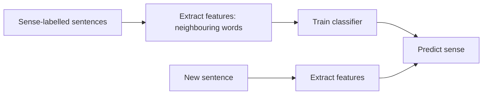
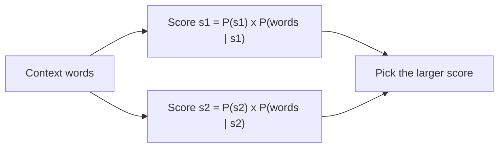
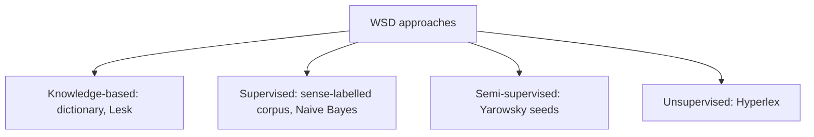

**In one line:** <mark>Supervised WSD treats word sense disambiguation as classification: train a classifier on text where each target word is marked with its correct sense, then use it to predict the sense in new sentences</mark>; Naive Bayes <mark>chooses the sense that maximises P(sense) times the product of P(context word | sense)</mark>. <Cite id="web-nlp-1-wiki-wsd" />

<Box kind="key">

**Key points to write:**

- <mark>WSD is needed because one word can have several meanings and the meaning changes with the context</mark> (machine translation, search, question answering).
- <mark>Supervised WSD learns from a sense-labelled corpus</mark>: each target word is tagged with its sense.
- Steps: **collect labelled data, extract features (neighbouring words), train the classifier, predict the sense of new sentences**.
- <mark>Naive Bayes: $\hat{s} = \arg\max_s P(s) \prod_j P(c_j \mid s)$</mark>; "naive" means the context words are treated as independent.
- Probabilities are found by **counting** in the labelled corpus.
- <mark>Disadvantage: a large sense-labelled corpus is costly</mark> (the knowledge acquisition bottleneck).

</Box>

## Core answer (5 marks, fits every question here)

<Box kind="definition">

**Supervised WSD** learns from sentences in which the sense of the target word is already marked, and uses what it learns to choose the sense in new sentences. <Cite id="web-nlp-1-wiki-wsd" />

</Box>

**Need of WSD:** many words are ambiguous, so their meaning changes with the context ("deposited money in the bank" and "the river bank"). WSD lets an NLP system analyze the surrounding words and find the intended sense, which improves language understanding and reduces ambiguity. <Cite id="class-nlp-pyq4" loc="p. 5" /> Without it, a translator may translate *bank* with the wrong word, and a search engine may show river pages for a money query.

**Steps of the supervised approach:**

1. **Collect a sense-labelled corpus:** each occurrence of the target word is marked with its sense.
2. **Extract features:** the words around the target (a window of nearby words), the words just before and after it, and the part of speech.
3. **Train a classifier** on these features (Naive Bayes, decision list, SVM or a neural network).
4. **Predict:** for a new sentence, extract the same features and choose the most probable sense.

**Conclusion:** supervised WSD is accurate when enough labelled data exists, but producing that data is costly.

## Extended answer (10 marks): add these

### 1. The Naive Bayes algorithm

For a word with senses $s_1, s_2, \ldots$ and context words $c_1, c_2, \ldots, c_n$ it chooses the sense

$$
\hat{s} = \arg\max_{s} \; P(s) \prod_{j=1}^{n} P(c_j \mid s)
$$

$P(s)$ is how often the sense occurs in the training data; $P(c_j \mid s)$ is how often the context word $c_j$ appears with that sense. Both are found by counting. "Naive" means the context words are treated as independent of each other, which is not strictly true but works well in practice. <Cite id="web-nlp-2-naive-bayes" />

### 2. Worked example

<Sum>

<Given>

Word *bank* with senses s1 (finance) and s2 (river). From a labelled corpus (made-up numbers): $P(s_1) = 0.6$, $P(s_2) = 0.4$; $P(\text{money} \mid s_1) = 0.3$, $P(\text{money} \mid s_2) = 0.05$; $P(\text{deposit} \mid s_1) = 0.2$, $P(\text{deposit} \mid s_2) = 0.02$. Context: *money*, *deposit*.

</Given>

<Find>

the sense of *bank*.

</Find>

<Steps>

1. Score for s1 $= 0.6 \times 0.3 \times 0.2 = 0.036$.
2. Score for s2 $= 0.4 \times 0.05 \times 0.02 = 0.0004$.
3. Compare: $0.036 > 0.0004$, so choose s1.

</Steps>

<Answer>

*bank* = finance sense (s1).

</Answer>

<Box kind="verify">

Normalize: $0.036 / (0.036 + 0.0004) = 0.989$, so s1 has about 99 percent probability and the two probabilities add to 1. The words *money* and *deposit* are far more common with the finance sense, so the answer makes sense.

</Box>

</Sum>

If a context word was never seen with a sense, its count is 0 and the whole product becomes 0; this is fixed by **add-one smoothing**, which adds 1 to every count.

### 3. Other supervised classifiers and features

| Item | Examples |
|---|---|
| Features | words in a window around the target, words at fixed positions (one before, one after), part of speech |
| Classifiers | Naive Bayes, decision list, SVM, neural networks |

Supervised methods have been the most successful WSD algorithms so far. <Cite id="web-nlp-1-wiki-wsd" />

### 4. Advantages and disadvantages

| Advantages | Disadvantages |
|---|---|
| High accuracy when labelled data is large | Needs a large sense-labelled corpus, which is costly to build |
| Simple and fast (Naive Bayes) | Works only for the words and senses seen in training |
| Easy to add new features | Independence assumption is not strictly true |

<Cite id="class-nlp-pyq4" loc="p. 8" />

## Fit it to each question

- **"Explain how the supervised learning approach can be applied for word sense disambiguation"** (10 marks) <PYQ id="2024-12-ce/q4a" />: core answer (definition, four steps, diagram), then sections 1 and 3 and the table in section 4.
- **"i) Why there is need of word sense disambiguation ii) Explain Naive Bayes Supervised algorithm for Word sense Disambiguation"** (10 marks) <PYQ id="2025-05-ce/q3a" />: "Need of WSD" paragraph for part (i); for part (ii) the formula, the diagram and the worked example in section 2.

## Exam tips

- **Write the formula** and say what $P(s)$ and $P(c_j \mid s)$ mean; then show the two scores.
- Say clearly that the data must be **sense-labelled**; that word separates supervised from the other methods.
- Mention the **independence assumption** as the reason for the word "naive".
