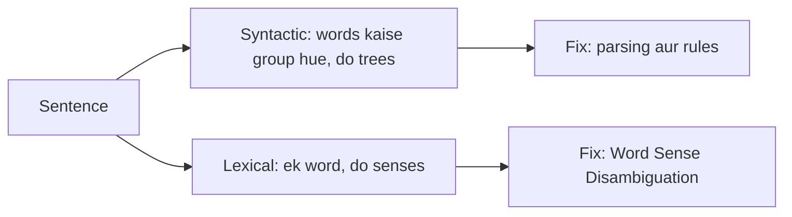
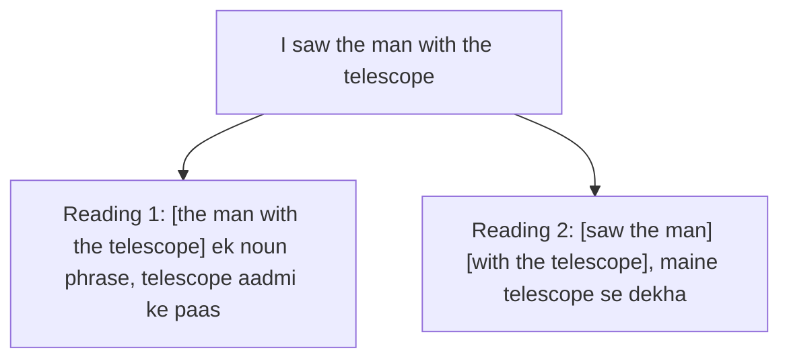

**Ek line mein:** <mark>Syntactic ambiguity sentence ke structure se aati hai; lexical ambiguity ek single word ke multiple meanings se</mark>. <Cite id="class-nlp-pyq4" loc="p. 6" />

<Box kind="key">

**Ye points likho:**

- <mark>Syntactic: sentence ke structure ya grammar se hoti hai</mark>. Example: "I saw the man with the telescope".
- <mark>Lexical: ek single word ke multiple meanings se hoti hai</mark>. Example: "He went to the bank".
- Syntactic **words ki grouping** (syntax) ke baare mein hai; lexical **word ke meaning** (semantics) ke baare mein.
- Remedy: syntactic ke liye <mark>parsing aur syntactic disambiguation rules</mark>; lexical ke liye <mark>Word Sense Disambiguation (WSD)</mark>.
- **Table likho, har ek ke do examples ke saath**.

</Box>

## Core answer (5 marks, yahan ke har question ke liye)

<Box kind="definition">

**Syntactic ambiguity** is caused by the structure or grammar of a sentence. **Lexical ambiguity** is caused by a single word having multiple meanings. <Cite id="class-nlp-pyq4" loc="p. 6" />

</Box>

| Aspect | Syntactic ambiguity | Lexical ambiguity |
|---|---|---|
| Definition | Caused by the structure or grammar of a sentence | Caused by a single word having multiple meanings |
| Focus | Syntax (sentence formation) | Semantics (word meanings) |
| Example | "I saw the man with the telescope." Telescope kiske paas hai? | "He went to the bank." Riverbank ya financial bank? |
| Example 2 | "Flying planes can be dangerous." | "The bat flew out of the cave." Animal ya cricket bat? |
| Resolution | Parsing techniques and syntactic disambiguation rules | Word Sense Disambiguation (WSD) |
| Relevance in NLP | Syntactic parsing and sentence structure analysis | Semantic analysis and lexical processing |

<Cite id="class-nlp-pyq4" loc="p. 6" /> <Cite id="class-nlp-m1" loc="p. 3" /> <Cite id="class-nlp-m1" loc="p. 4" />

**Conclusion:** words ki grouping badlo to syntactic ambiguity jaati hai; ek word ka sense badlo to lexical ambiguity jaati hai.

## Extended answer (10 marks): ye add karo

### 1. Ek syntactic example ke do readings

### 2. Ek lexical example ke do readings

"He deposited money in the bank": word *money* financial bank ki taraf point karta hai, isliye WSD wo sense chunta hai. <Cite id="class-nlp-pyq4" loc="p. 5" /> <Cite id="web-nlp-1-wiki-wsd" />

### 3. Dono mein farq kaise pehchanein

- Ambiguous word ko ek clear synonym se badlo. Agar doubt **chala gaya**, to lexical thi. Agar doubt **bacha**, to syntactic thi (doubt grouping mein hai, kisi word mein nahi).
- Ek sentence mein dono ek saath ho sakti hain: "She saw the bat with the telescope" mein lexical doubt (bat) aur syntactic doubt (telescope kiske paas) dono hain. <Cite id="web-nlp-1-wiki-syn-amb" /> <Cite id="web-nlp-1-wiki-lex-amb" />

## Har question mein kaise fit karein

- **"Differentiate between Syntactic ambiguity and Lexical Ambiguity."** (5 marks) <PYQ id="2022-12-ce/q1a" /> <PYQ id="2024-12-ce/q1e" /> <PYQ id="assignment-1/q1c" />: core table dono examples ke saath aur one-line conclusion; time ho to chhota diagram.

## Exam tips

- **Comparison table draw karo**, kam se kam paanch rows (definition, focus, example, resolution, relevance).
- **Har example ke do meanings** likho; do readings ke bina example ambiguity nahi dikhata.
- Remedies ka naam exact likho: syntactic ke liye **parsing**, lexical ke liye **WSD**.

Exam mein English mein likho.
