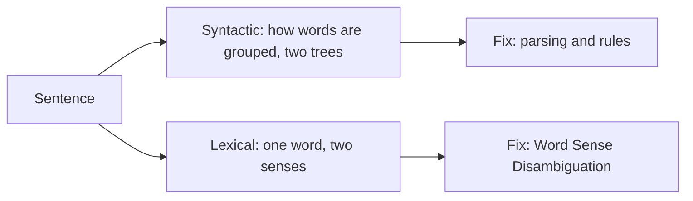
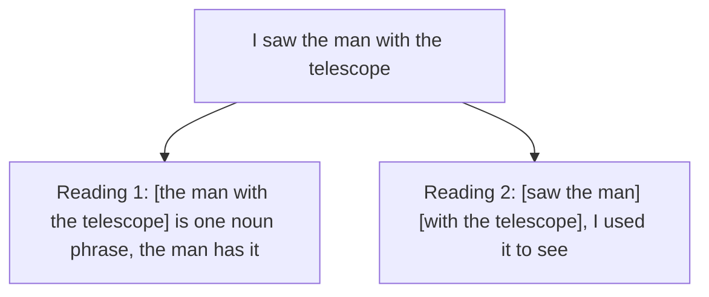

**In one line:** <mark>Syntactic ambiguity comes from the structure of a sentence; lexical ambiguity comes from a single word having multiple meanings</mark>. <Cite id="class-nlp-pyq4" loc="p. 6" />

<Box kind="key">

**Key points to write:**

- <mark>Syntactic: caused by the structure or grammar of the sentence</mark>. Example: "I saw the man with the telescope".
- <mark>Lexical: caused by a single word with multiple meanings</mark>. Example: "He went to the bank".
- Syntactic is about **grouping of words** (syntax); lexical is about **word meaning** (semantics).
- Remedy: <mark>parsing and syntactic disambiguation rules</mark> for syntactic; <mark>Word Sense Disambiguation (WSD)</mark> for lexical.
- Write a **table with two examples each**.

</Box>

## Core answer (5 marks, fits every question here)

<Box kind="definition">

**Syntactic ambiguity** is caused by the structure or grammar of a sentence. **Lexical ambiguity** is caused by a single word having multiple meanings. <Cite id="class-nlp-pyq4" loc="p. 6" />

</Box>

| Aspect | Syntactic ambiguity | Lexical ambiguity |
|---|---|---|
| Definition | Caused by the structure or grammar of a sentence | Caused by a single word having multiple meanings |
| Focus | Syntax (sentence formation) | Semantics (word meanings) |
| Example | "I saw the man with the telescope." Who has the telescope? | "He went to the bank." Riverbank or financial bank? |
| Example 2 | "Flying planes can be dangerous." | "The bat flew out of the cave." Animal or cricket bat? |
| Resolution | Parsing techniques and syntactic disambiguation rules | Word Sense Disambiguation (WSD) |
| Relevance in NLP | Syntactic parsing and sentence structure analysis | Semantic analysis and lexical processing |

<Cite id="class-nlp-pyq4" loc="p. 6" /> <Cite id="class-nlp-m1" loc="p. 3" /> <Cite id="class-nlp-m1" loc="p. 4" />

**Conclusion:** change the grouping of words and syntactic ambiguity goes; change the sense of one word and lexical ambiguity goes.

## Extended answer (10 marks): add these

### 1. The two readings of one syntactic example

### 2. The two readings of one lexical example

"He deposited money in the bank": the word *money* points to the financial bank, so WSD picks that sense. <Cite id="class-nlp-pyq4" loc="p. 5" /> <Cite id="web-nlp-1-wiki-wsd" />

### 3. How to tell them apart

- Replace the ambiguous word with one clear synonym. If the doubt **goes away**, it was lexical. If it **stays**, it was syntactic (the doubt is in the grouping, not in a word).
- A sentence can have both kinds at once: "She saw the bat with the telescope" has a lexical doubt (bat) and a syntactic doubt (who has the telescope). <Cite id="web-nlp-1-wiki-syn-amb" /> <Cite id="web-nlp-1-wiki-lex-amb" />

## Fit it to each question

- **"Differentiate between Syntactic ambiguity and Lexical Ambiguity."** (5 marks) <PYQ id="2022-12-ce/q1a" /> <PYQ id="2024-12-ce/q1e" /> <PYQ id="assignment-1/q1c" />: the core table with both examples and the one-line conclusion; a small diagram if time permits.

## Exam tips

- **Draw the comparison table** with at least five rows (definition, focus, example, resolution, relevance).
- Give **two meanings for every example**; examples without two readings do not show ambiguity.
- Name the remedies exactly: **parsing** for syntactic, **WSD** for lexical.
