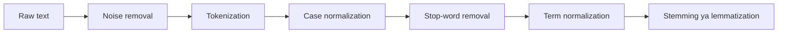
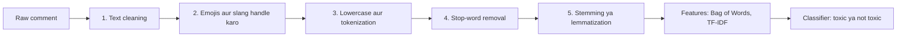

**Ek line mein:** <mark>Data preprocessing matlab text ko computer ko dene se pehle saaf karna</mark>; raw text <mark>noise removal, tokenization, case normalization, stop-word removal, term normalization aur stemming ya lemmatization</mark> se guzarta hai. <Cite id="class-nlp-m2" loc="p. 19" />

<Box kind="key">

**Preprocessing ke har question mein ye points likho:**

- <mark>Data preprocessing: cleaning a text before giving it to computers</mark>.
- Steps **order mein**: <mark>extraction aur noise removal, tokenization, case normalization (lowercase), stop-word removal, term normalization, stemming ya lemmatization</mark>; phir IR ke liye indexing.
- <mark>Tokenization: breaking a continuous stream of text into smaller meaningful units called tokens</mark> (aam taur pe words).
- <mark>Stop words bahut common words hain</mark> (the, is, a, and, in) jinme kam meaning hota hai.
- <mark>Stemming rules se endings kaatta hai</mark> (retrieved se retriev); <mark>lemmatization dictionary word deta hai</mark> (better se good).
- **Ek example sentence har step se guzarta hua** zaroor dikhao.

</Box>

## Core answer (5 marks, yahan ke har question ke liye)

<Box kind="definition">

**Data preprocessing** is cleaning a text before giving it to computers. Raw text messy hota hai, isliye use saaf karke chhote uniform pieces mein kaata jaata hai jinhe program count aur compare kar sake. <Cite id="class-nlp-m2" loc="p. 19" />

</Box>

**Steps** <Cite id="class-nlp-asol" loc="p. 11" /> <Cite id="class-nlp-asol" loc="p. 12" /> <Cite id="class-nlp-m6" loc="slide 33" />

1. **Extraction aur noise removal:** HTML tags, markdown, metadata, tabs aur line breaks hatao; ek encoding (UTF-8) use karo.
2. **Tokenization:** text ki stream ko tokens mein todo, aam taur pe words, whitespace aur punctuation se.
3. **Case normalization:** ek case, aksar lowercase, taaki Information aur information ek term bane.
4. **Stop-word removal:** bahut common words hatao jaise the, is, a, and, in.
5. **Term normalization:** commas, periods aur emojis hatao; U.S.A. aur USA ko ek form do.
6. **Stemming ya lemmatization:** words ko root pe laao.

**Example** (stemming Porter stemmer se checked)

| Step | Output |
|---|---|
| Raw text | `
The Cats are Running in the Garden!
` |
| Noise removal | The Cats are Running in the Garden! |
| Tokenization | The, Cats, are, Running, in, the, Garden, ! |
| Lowercase, punctuation nahi | the, cats, are, running, in, the, garden |
| Stop-words hata diye | cats, running, garden |
| Stemming | cat, run, garden |

**Conclusion:** preprocessing messy text ko clean tokens aur stems mein badalta hai jinhe model count aur compare kar sake.

## Extended answer (10 marks): ye add karo

### 1. Tokenization detail mein

Tokenization text ki continuous stream ko tokens mein todta hai. Hyphenated words (state-of-the-art) aur bina spaces wali languages mein ye mushkil hai. <Cite id="class-nlp-asol" loc="p. 11" /> <Cite id="web-nlp-1-slp3-ch2" /> Regular expression usual tool hai: "NLP is fun" se "NLP", "is", "fun". <Cite id="class-nlp-m2" loc="p. 18" />

### 2. Stop words aur normalization

- **Stop words** isliye hatate hain kyunki wo itne common hain ki documents ko alag batane mein madad nahi karte. Dhyan: *not* hatane se meaning ulta ho sakta hai ("not good"). <Cite id="web-nlp-1-wiki-stopword" />
- **Case aur term normalization** alag spellings ko ek term banate hain (USA, U.S.A., usa). <Cite id="web-nlp-1-wiki-textnorm" />

### 3. Stemming vs lemmatization

| Technique | Kya karta hai | Example |
|---|---|---|
| Stemming | Crude, heuristic process jo rules se word endings kaatti hai (Porter stemmer); fast, par non-dictionary roots mil sakte hain | retrieval, retrieved, retrieving se retriev |
| Lemmatization | Linguistic analysis jo vocabulary aur morphological rules se dictionary form (lemma) deta hai | better se good; mice se mouse |

<Cite id="class-nlp-asol" loc="p. 12" /> <Cite id="web-nlp-1-wiki-stemming" />

### 4. IR ka aakhri step: indexing

Cleaning ke baad information retrieval system **inverted index** banata hai aur terms ko TF-IDF ya BM25 se weight karta hai. <Cite id="class-nlp-asol" loc="p. 12" />

### 5. Toxic word identification ke liye wahi steps

Toxic word identification ek text classification task hai (toxic ya not toxic). Comments messy hote hain, isliye wahi pipeline chalti hai, do additions ke saath: **emojis ko words mein badlo** aur **slang ko normal word se map karo**. <Cite id="class-nlp-m6" loc="slide 18" /> <Cite id="class-nlp-m6" loc="slide 33" />

| Step | Output |
|---|---|
| Raw comment | `
You are SO stupid!!! Such an idiot 😡
` |
| Emoji se word, lowercase, punctuation nahi | you are so stupid such an idiot angry |
| Tokenization | you, are, so, stupid, such, an, idiot, angry |
| Stop-words hata diye | stupid, idiot, angry |

Extra (class files mein nahi): *not* jaisi negations rakho, aur *id1ot* jaisi chhupayi hui spellings ko asli word se map karo.

## Har question mein kaise fit karein

- **"Explain the different steps in text processing for Information Retrieval"** (5 marks, 10 marks) <PYQ id="2022-12-ce/q4b" /> <PYQ id="assignment-2/q6c" />: chhe steps plus aakhri step ke roop mein indexing (section 4); 10 marks ke liye section 1 se 3 add karo.
- **"Illustrate the concept of tokenization and stemming in Natural Language processing."** (5 marks) <PYQ id="2024-05-ce/q1b" />: tokenization (core step 2 aur section 1) aur stemming (section 3 aur Porter line), do-column comparison ke roop mein: meaning, works on, example, note.
- **"Explain the preprocessing operations in natural language processing"** (10 marks) <PYQ id="2024-12-ce/q2b" />: core answer plus section 1 se 3.
- **"Explain preprocessing steps of NLP with example in detail"** (10 marks) <PYQ id="2025-05/q4b" />: core answer example table ke saath, plus section 1 se 3.
- **"Explain pre-processing steps generally used in NLP."** (5 marks) <PYQ id="2025-05-ce/q1d" />: sirf core answer: flow, chhe steps, example table.
- **"Discuss pre-processing steps use in "toxic word identification" in semantic analysis application."** (10 marks) <PYQ id="2026-05/q6a" />: definition, phir section 5 (flow, paanch steps, example table); likho ki ye text classification hai.

## Exam tips

- **Pipeline draw karo** aur **ek example har step se** zaroor dikhao; zyaadatar marks yahin hain.
- **Order** rakho: noise removal, tokenization, lowercase, stop words, normalization, stemming.
- **Stemming (crude, word na bhi ho)** aur **lemmatization (dictionary word)** ka farq likho.

Exam mein English mein likho.
