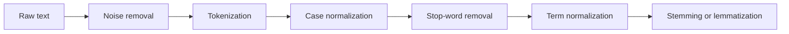
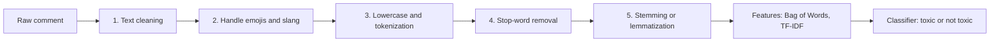

**In one line:** <mark>Data preprocessing is cleaning a text before giving it to computers</mark>; raw text goes through <mark>noise removal, tokenization, case normalization, stop-word removal, term normalization and stemming or lemmatization</mark>. <Cite id="class-nlp-m2" loc="p. 19" />

<Box kind="key">

**Key points to write (any preprocessing question):**

- <mark>Data preprocessing: cleaning a text before giving it to computers</mark>.
- Steps **in order**: <mark>extraction and noise removal, tokenization, case normalization (lowercase), stop-word removal, term normalization, stemming or lemmatization</mark>; then indexing for IR.
- <mark>Tokenization: breaking a continuous stream of text into smaller meaningful units called tokens</mark> (usually words).
- <mark>Stop words are very common words</mark> (the, is, a, and, in) that carry little meaning.
- <mark>Stemming chops endings by rules</mark> (retrieved to retriev); <mark>lemmatization returns the dictionary word</mark> (better to good).
- Always show **one example sentence going through every step**.

</Box>

## Core answer (5 marks, fits every question here)

<Box kind="definition">

**Data preprocessing** is cleaning a text before giving it to computers. Raw text is messy, so it is cleaned and cut into small uniform pieces that a program can count and compare. <Cite id="class-nlp-m2" loc="p. 19" />

</Box>

**Steps** <Cite id="class-nlp-asol" loc="p. 11" /> <Cite id="class-nlp-asol" loc="p. 12" /> <Cite id="class-nlp-m6" loc="slide 33" />

1. **Extraction and noise removal:** remove HTML tags, markdown, metadata, tabs and line breaks; use one encoding (UTF-8).
2. **Tokenization:** break the stream of text into tokens, usually words, using whitespace and punctuation.
3. **Case normalization:** one case, usually lowercase, so Information and information are one term.
4. **Stop-word removal:** drop very common words such as the, is, a, and, in.
5. **Term normalization:** remove commas, periods and emojis; make U.S.A. and USA one form.
6. **Stemming or lemmatization:** reduce words to their root.

**Example** (stemming checked with the Porter stemmer)

| Step | Output |
|---|---|
| Raw text | `
The Cats are Running in the Garden!
` |
| Noise removal | The Cats are Running in the Garden! |
| Tokenization | The, Cats, are, Running, in, the, Garden, ! |
| Lowercase, no punctuation | the, cats, are, running, in, the, garden |
| Stop-words removed | cats, running, garden |
| Stemming | cat, run, garden |

**Conclusion:** preprocessing turns messy text into clean tokens and stems that a model can count and compare.

## Extended answer (10 marks): add these

### 1. Tokenization in detail

Tokenization breaks a continuous stream of text into tokens. It is hard for hyphenated words such as state-of-the-art and for languages written without spaces. <Cite id="class-nlp-asol" loc="p. 11" /> <Cite id="web-nlp-1-slp3-ch2" /> A regular expression is the usual tool: "NLP is fun" gives "NLP", "is", "fun". <Cite id="class-nlp-m2" loc="p. 18" />

### 2. Stop words and normalization

- **Stop words** are removed because they are so common that they do not help to tell documents apart. Careful: removing *not* can flip the meaning ("not good"). <Cite id="web-nlp-1-wiki-stopword" />
- **Case and term normalization** make different spellings one term (USA, U.S.A., usa). <Cite id="web-nlp-1-wiki-textnorm" />

### 3. Stemming versus lemmatization

| Technique | What it does | Example |
|---|---|---|
| Stemming | A crude, heuristic process that chops off word endings using rules (Porter stemmer); fast, but can give non-dictionary roots | retrieval, retrieved, retrieving give retriev |
| Lemmatization | A linguistic analysis that uses vocabulary and morphological rules to return the dictionary form (lemma) | better gives good; mice gives mouse |

<Cite id="class-nlp-asol" loc="p. 12" /> <Cite id="web-nlp-1-wiki-stemming" />

### 4. Last step for IR: indexing

After cleaning, an information retrieval system builds an **inverted index** and weights terms with TF-IDF or BM25. <Cite id="class-nlp-asol" loc="p. 12" />

### 5. The same steps for toxic word identification

Toxic word identification is a text classification task (toxic or not toxic). Comments are messy, so the same pipeline is used with two additions: **turn emojis into words** and **map slang to the normal word**. <Cite id="class-nlp-m6" loc="slide 18" /> <Cite id="class-nlp-m6" loc="slide 33" />

| Step | Output |
|---|---|
| Raw comment | `
You are SO stupid!!! Such an idiot 😡
` |
| Emoji to word, lowercase, no punctuation | you are so stupid such an idiot angry |
| Tokenization | you, are, so, stupid, such, an, idiot, angry |
| Stop-words removed | stupid, idiot, angry |

Extra (not in the class files): keep negations such as *not*, and map disguised spellings such as *id1ot* back to the real word.

## Fit it to each question

- **"Explain the different steps in text processing for Information Retrieval"** (5 marks, 10 marks) <PYQ id="2022-12-ce/q4b" /> <PYQ id="assignment-2/q6c" />: the six steps plus indexing as the last step (section 4); for 10 marks add sections 1 to 3.
- **"Illustrate the concept of tokenization and stemming in Natural Language processing."** (5 marks) <PYQ id="2024-05-ce/q1b" />: tokenization (core step 2 and section 1) and stemming (section 3 and the Porter line), as a two-column comparison: meaning, works on, example, note.
- **"Explain the preprocessing operations in natural language processing"** (10 marks) <PYQ id="2024-12-ce/q2b" />: core answer plus sections 1 to 3.
- **"Explain preprocessing steps of NLP with example in detail"** (10 marks) <PYQ id="2025-05/q4b" />: core answer with the example table, plus sections 1 to 3.
- **"Explain pre-processing steps generally used in NLP."** (5 marks) <PYQ id="2025-05-ce/q1d" />: core answer only: flow, six steps, example table.
- **"Discuss pre-processing steps use in "toxic word identification" in semantic analysis application."** (10 marks) <PYQ id="2026-05/q6a" />: definition, then section 5 (flow, the five steps, example table); say that it is text classification.

## Exam tips

- **Draw the pipeline** and always include **one example through every step**; it carries most marks.
- Keep the **order**: noise removal, tokenization, lowercase, stop words, normalization, stemming.
- Say the difference between **stemming (crude, may not be a word)** and **lemmatization (dictionary word)**.
