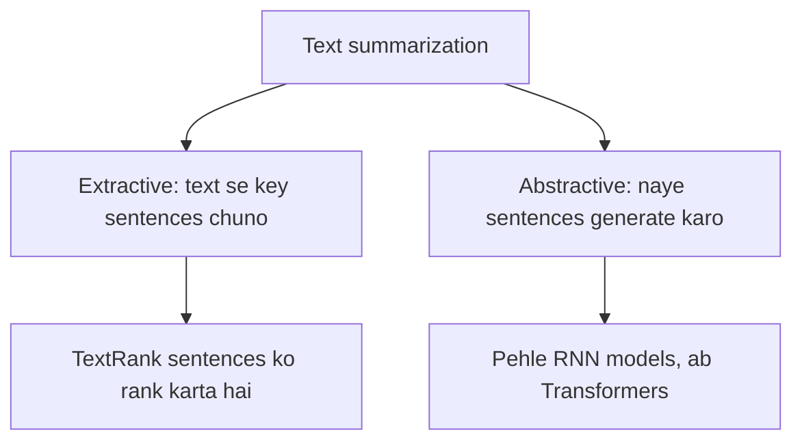
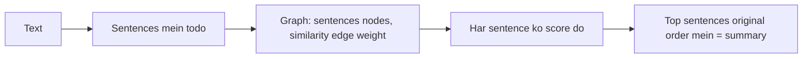

**Ek line mein:** <mark>Summarization algorithms se bade texts ko chhota karta hai aur zaroori information bachaye rakhta hai</mark>, do tareekon se: <mark>extractive (key sentences chuno) aur abstractive (naye sentences generate karo)</mark>. <Cite id="class-nlp-m6" loc="slide 23" />

<Box kind="key">

**Ye points likho:**

- <mark>Summarization: bade texts ko chhota karna aur essential information rakhna, key concepts nikalkar original meaning banaye rakhna</mark>.
- **Banking, law aur healthcare** ko tez decisions aur tez information retrieval mein madad.
- <mark>Extractive: original text ke key passages chunkar jodta hai; naya content nahi banata; TextRank sentences ko rank karta hai</mark>.
- <mark>Abstractive: key ideas ke liye bilkul naye sentences generate karta hai, concise aur coherent tareeke se rephrase karke; pehle RNNs, ab Transformers</mark>.
- Extractive **safe aur simple** hai; abstractive **fluent hai par errors add kar sakta hai**.
- **Do-type tree** aur **comparison table** draw karo.

</Box>

## Core answer (5 marks, yahan ke har question ke liye)

<Box kind="definition">

**Summarization** is a key technique in NLP that uses algorithms to reduce large texts while preserving essential information. By extracting key concepts and maintaining the original meaning, these systems help industries such as banking, law and healthcare make faster decisions and retrieve information faster. <Cite id="class-nlp-m6" loc="slide 23" /> <Cite id="class-nlp-asol" loc="p. 12" />

</Box>

**1. Extractive summarization** original text ke key passages chunkar aur jodkar automatically summary banata hai. Ye sabse important sentences nikalta hai bina naya content banaye; goal meaning bachaye rakhkar text chhota karna hai. **TextRank** algorithm widely use hota hai: ye sentences ko relevance aur importance se rank karke concise summary banata hai. <Cite id="class-nlp-m6" loc="slide 24" /> <Cite id="class-nlp-asol" loc="p. 13" />

**2. Abstractive summarization** key ideas batane ke liye bilkul naye sentences generate karta hai. Ye information ko zyada concise aur coherent tareeke se rephrase karta hai, aksar aise naye vocabulary ke saath jo original mein nahi tha. Transformer models ke saath ye popular hua; pehle recurrent neural networks (RNNs) wale models use hote the. <Cite id="class-nlp-m6" loc="slide 25" /> <Cite id="class-nlp-asol" loc="p. 13" />

| Point | Extractive | Abstractive |
|---|---|---|
| Naye sentences | nahi, original sentences copy | haan, naye likhta hai |
| Example method | TextRank | RNN, Transformer models |
| Vocabulary | original se | naya ho sakta hai |

**Conclusion:** extractive summaries chunti hain, abstractive summaries dobara likhti hain; dono text chhota karti hain aur meaning rakhti hain.

## Extended answer (10 marks): ye add karo

### 1. TextRank kaise kaam karta hai

TextRank text ko graph maanta hai: har sentence ek node, aur do sentences ke beech ka edge unki similarity se weighted. Sentences ko PageRank jaise score karte hain (jo sentence bahut important sentences se juda ho wo important) aur top sentences summary banate hain. <Cite id="web-nlp-2-textrank" />

1. Text ko sentences mein todo.
2. Graph banao: similar sentences ko jodo, similarity weight ke roop mein.
3. Har sentence ko score do ki wo baaki se kitna connected hai.
4. Top-scoring sentences rakho aur unhe original order mein likho.

<Sum>

<Given>

4 sentences ka text S1 se S4. Similarity: S1-S2 = 0.5, S1-S3 = 0.2, S1-S4 = 0.0, S2-S3 = 0.4, S2-S4 = 0.2, S3-S4 = 0.3. Summary length: 2 sentences. (Made-up similarities; yahan score simple total similarity hai, TextRank ka pehla step.)

</Given>

<Find>

summary ke do sentences.

</Find>

<Steps>

1. Score(S1) $= 0.5 + 0.2 + 0.0 = 0.7$.
2. Score(S2) $= 0.5 + 0.4 + 0.2 = 1.1$.
3. Score(S3) $= 0.2 + 0.4 + 0.3 = 0.9$.
4. Score(S4) $= 0.0 + 0.2 + 0.3 = 0.5$.
5. Top do: S2 (1.1) aur S3 (0.9). Text ke order mein likho.

</Steps>

<Answer>

Summary = S2, S3.

</Answer>

<Box kind="verify">

Har similarity apne do sentences ke liye ek-ek baar count hoti hai, isliye chaaron scores ka sum $2 \times (0.5 + 0.2 + 0 + 0.4 + 0.2 + 0.3) = 3.2$ hona chahiye, aur $0.7 + 1.1 + 0.9 + 0.5 = 3.2$.

</Box>

</Sum>

### 2. Abstractive summarization detail mein

Abstractive system poora text padhta hai, samajhta hai aur naye sentences likhta hai, jaise insaan main idea apne shabdon mein kehta hai. Shuruaati systems RNN encoder-decoder models use karte the; aaj Transformer models. <Cite id="class-nlp-m6" loc="slide 25" /> <Cite id="web-nlp-2-summarization" />

### 3. Advantages aur disadvantages

| | Extractive | Abstractive |
|---|---|---|
| Advantages | simple, sentences grammatical aur source ke sach | fluent, chhota, ideas merge kar sakta hai |
| Disadvantages | choppy ya repetitive ho sakta hai; sentence ke andar chhota nahi kar sakta | banana mushkil; galat facts add kar sakta hai |

### 4. Evaluation aur applications

- **Evaluation:** summary ko human reference summaries se compare karo, ROUGE jaise overlap measures se. <Cite id="class-nlp-m6" loc="slide 6" /> <Cite id="web-nlp-2-summarization" />
- **Applications:** tez decisions ke liye banking, law aur healthcare; news digests, search result snippets, meeting notes. <Cite id="class-nlp-m6" loc="slide 23" />

## Har question mein kaise fit karein

- **"Explain Text summarization in detail."** (10 marks) <PYQ id="2022-12-ce/q6a" /> <PYQ id="2024-12-ce/q6a" /> <PYQ id="assignment-2/q6d" />: poora core answer, phir sections 1 se 4 (TextRank steps, worked example, table aur applications).
- **"Text Summarization"** (5 marks) <PYQ id="2024-12/q6a" />: core answer.

## Exam tips

- **Draw karo:** extractive aur abstractive tree aur teen-row comparison table.
- Extractive ke liye **TextRank** aur abstractive ke liye **Transformers/RNN** likho.
- 10 marks ke liye **TextRank ke steps** aur applications (banking, law, healthcare) add karo.

Exam mein English mein likho.
