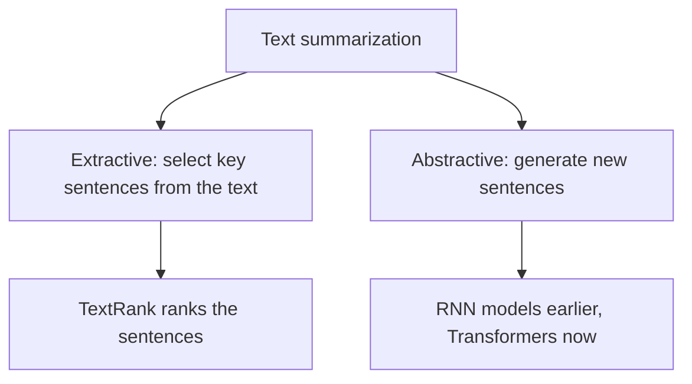
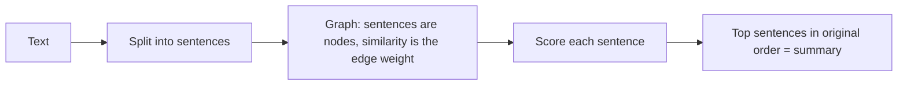

**In one line:** <mark>Summarization uses algorithms to reduce large texts while preserving essential information</mark>, in two ways: <mark>extractive (select key sentences) and abstractive (generate new sentences)</mark>. <Cite id="class-nlp-m6" loc="slide 23" />

<Box kind="key">

**Key points to write:**

- <mark>Summarization: reduce large texts while preserving essential information, extracting key concepts and keeping the original meaning</mark>.
- Helps **banking, law and healthcare** make faster decisions and retrieve information faster.
- <mark>Extractive: selects and combines key passages from the original text; creates no new content; TextRank ranks the sentences</mark>.
- <mark>Abstractive: generates entirely new sentences to convey the key ideas, rephrasing in a concise and coherent way; RNNs earlier, Transformers now</mark>.
- Extractive is **safe and simple**; abstractive is **fluent but may add errors**.
- Draw the **two-type tree** and a **comparison table**.

</Box>

## Core answer (5 marks, fits every question here)

<Box kind="definition">

**Summarization** is a key technique in NLP that uses algorithms to reduce large texts while preserving essential information. By extracting key concepts and maintaining the original meaning, these systems help industries such as banking, law and healthcare make faster decisions and retrieve information faster. <Cite id="class-nlp-m6" loc="slide 23" /> <Cite id="class-nlp-asol" loc="p. 12" />

</Box>

**1. Extractive summarization** automatically generates a summary by selecting and combining key passages from the original text. It extracts the most important sentences without creating new content; the goal is to preserve the meaning while condensing it. The **TextRank** algorithm is widely used: it ranks sentences by relevance and importance and builds a concise summary. <Cite id="class-nlp-m6" loc="slide 24" /> <Cite id="class-nlp-asol" loc="p. 13" />

**2. Abstractive summarization** generates entirely new sentences to convey the key ideas. It rephrases the information in a more concise and coherent manner, often with new vocabulary that was not in the original. It gained prominence with Transformer models; earlier, models based on recurrent neural networks (RNNs) were used. <Cite id="class-nlp-m6" loc="slide 25" /> <Cite id="class-nlp-asol" loc="p. 13" />

| Point | Extractive | Abstractive |
|---|---|---|
| New sentences | no, copies original sentences | yes, writes new ones |
| Example method | TextRank | RNN, Transformer models |
| Vocabulary | from the original | may be new |

**Conclusion:** extractive summaries select, abstractive summaries rewrite; both shorten the text and keep the meaning.

## Extended answer (10 marks): add these

### 1. How TextRank works

TextRank treats the text as a graph: each sentence is a node, and an edge between two sentences is weighted by how similar they are. Sentences are scored in the way PageRank scores web pages (a sentence linked to many important sentences is important), and the top sentences form the summary. <Cite id="web-nlp-2-textrank" />

1. Split the text into sentences.
2. Build the graph: join similar sentences, with the similarity as the weight.
3. Score each sentence by how well it is connected to the others.
4. Keep the top-scoring sentences and put them in the original order.

<Sum>

<Given>

A text of 4 sentences S1 to S4. Similarity: S1-S2 = 0.5, S1-S3 = 0.2, S1-S4 = 0.0, S2-S3 = 0.4, S2-S4 = 0.2, S3-S4 = 0.3. Summary length: 2 sentences. (Made-up similarities; the score here is the simple total similarity, the first step of TextRank.)

</Given>

<Find>

the two sentences of the summary.

</Find>

<Steps>

1. Score(S1) $= 0.5 + 0.2 + 0.0 = 0.7$.
2. Score(S2) $= 0.5 + 0.4 + 0.2 = 1.1$.
3. Score(S3) $= 0.2 + 0.4 + 0.3 = 0.9$.
4. Score(S4) $= 0.0 + 0.2 + 0.3 = 0.5$.
5. Top two: S2 (1.1) and S3 (0.9). Write them in text order.

</Steps>

<Answer>

Summary = S2, S3.

</Answer>

<Box kind="verify">

Each similarity is counted once for each of its two sentences, so the four scores add to $2 \times (0.5 + 0.2 + 0 + 0.4 + 0.2 + 0.3) = 3.2$, and $0.7 + 1.1 + 0.9 + 0.5 = 3.2$.

</Box>

</Sum>

### 2. Abstractive summarization in more detail

An abstractive system reads the whole text, understands it and writes new sentences, like a person who says the main idea in their own words. Early systems used RNN encoder-decoder models; today Transformer models are used. <Cite id="class-nlp-m6" loc="slide 25" /> <Cite id="web-nlp-2-summarization" />

### 3. Advantages and disadvantages

| | Extractive | Abstractive |
|---|---|---|
| Advantages | simple, sentences are grammatical and true to the source | fluent, short, can merge ideas |
| Disadvantages | may be choppy or repetitive; cannot shorten inside a sentence | harder to build; can add wrong facts |

### 4. Evaluation and applications

- **Evaluation:** compare the summary with human reference summaries, using overlap measures such as ROUGE. <Cite id="class-nlp-m6" loc="slide 6" /> <Cite id="web-nlp-2-summarization" />
- **Applications:** banking, law and healthcare for faster decisions; news digests, search result snippets, meeting notes. <Cite id="class-nlp-m6" loc="slide 23" />

## Fit it to each question

- **"Explain Text summarization in detail."** (10 marks) <PYQ id="2022-12-ce/q6a" /> <PYQ id="2024-12-ce/q6a" /> <PYQ id="assignment-2/q6d" />: the full core answer, then sections 1 to 4 (TextRank steps, the worked example, the table and the applications).
- **"Text Summarization"** (5 marks) <PYQ id="2024-12/q6a" />: the core answer.

## Exam tips

- **Draw** the extractive and abstractive tree and write the three-row comparison table.
- Name **TextRank** for extractive and **Transformers/RNN** for abstractive.
- For 10 marks add the **TextRank steps** and the applications (banking, law, healthcare).
