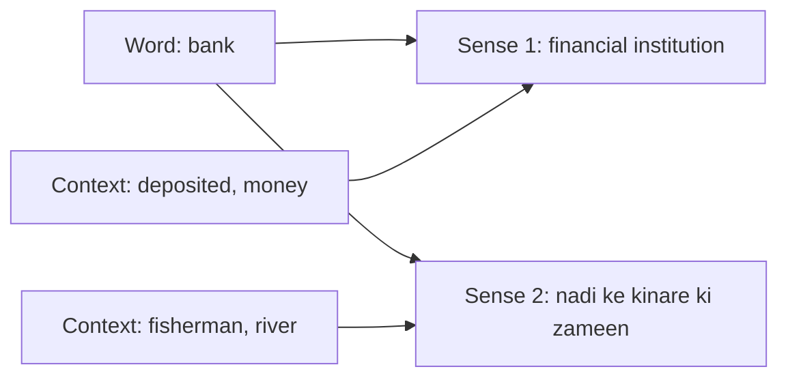
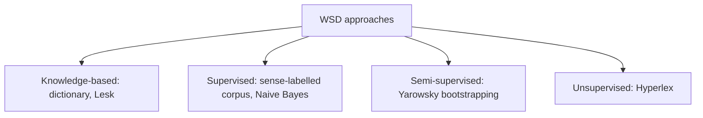

**Ek line mein:** <mark>Word Sense Disambiguation (WSD) tab sahi meaning dhoondhta hai jab word ke kai possible meanings hon</mark>, us context se jisme word aaya hai. <Cite id="class-nlp-pyq4" loc="p. 5" />

<Box kind="key">

**Ye points likho:**

- <mark>WSD kai meanings wale word ka sahi sense (meaning) dhoondhta hai</mark>.
- Wajah hai <mark>lexical ambiguity</mark>: ek word, kai senses (*bank*, *bat*, *bark*).
- <mark>Ye aas-paas ke words analyze karke intended sense pehchanta hai</mark>, jisse language understanding better hoti hai aur ambiguity kam hoti hai.
- Examples: "She deposited money in the **bank**" (financial institution), "The fisherman sat on the river **bank**" (nadi ke kinare ki zameen).
- Approaches: **knowledge-based (Lesk), supervised, semi-supervised (Yarowsky), unsupervised**.
- Uses: **machine translation, search, question answering, chatbots**.

</Box>

## Core answer (5 marks, yahan ke har question ke liye)

<Box kind="definition">

**Word Sense Disambiguation (WSD)** focuses on determining the correct meaning of a word when it has multiple possible interpretations. WSD lets an NLP system analyze the surrounding words and identify the intended sense, improving language understanding and reducing ambiguity. <Cite id="class-nlp-pyq4" loc="p. 5" />

</Box>

**Basics:** **sense** word ka ek meaning hai. Ek se zyada senses wala word ambiguous hota hai, aur kai meanings se aane wali ambiguity ko **lexical ambiguity** kehte hain. Meaning context ke saath badalta hai, yaani target word ke aas-paas ke words. <Cite id="class-nlp-pyq4" loc="p. 5" /> <Cite id="class-nlp-pyq4" loc="p. 6" /> <Cite id="web-nlp-1-wiki-lex-amb" />

**Examples:** <Cite id="class-nlp-pyq4" loc="p. 5" />

- "She deposited money in the bank." *Bank* financial institution hai.
- "The fisherman sat on the river bank." *Bank* nadi ke kinare ki zameen hai.

**Conclusion:** WSD context padhkar ambiguous word ka wo ek sense chunta hai jo speaker ne kaha tha.

## Extended answer (10 marks): ye add karo

### 1. WSD kyun chahiye

- **Machine translation:** ek English word ke alag senses ke liye target language mein alag words lag sakte hain.
- **Search aur question answering:** money bank ke sawal pe system ko nadi ke pages nahi dene chahiye.
- **Chatbots aur text understanding:** sentence ka meaning har word ke sense pe depend karta hai.

<Cite id="web-nlp-1-wiki-wsd" />

### 2. WSD ke approaches

| Approach | Labelled data chahiye? | Example |
|---|---|---|
| Knowledge-based | Nahi (dictionary) | Lesk |
| Supervised | Bada sense-labelled corpus | Naive Bayes |
| Semi-supervised | Chhota seed set | Yarowsky |
| Unsupervised | Nahi | Hyperlex |

Knowledge-based approach context words ko har sense ki dictionary definition se compare karta hai aur maximum overlap wala sense chunta hai. <Cite id="class-nlp-pyq4" loc="p. 5" />

### 3. Idea ka ek quick example

"She deposited money in the bank" mein *bank* ke liye, context word *money* financial sense ki definition mein hai aur river sense mein nahi, isliye financial sense ko 1 aur river sense ko 0 score milta hai. <Cite id="class-nlp-pyq4" loc="p. 5" />

### 4. Difficulties

- **Alag dictionaries** ek word ko alag number ke senses mein todti hain, isliye senses ki koi ek sahi list nahi. <Cite id="web-nlp-2-wordnet" />
- **Fine senses** ko alag karna humans ke liye bhi mushkil hai.
- Supervised methods ke liye **labelled data mehnga** hai. <Cite id="class-nlp-pyq4" loc="p. 8" /> <Cite id="web-nlp-1-wiki-wsd" />

## Har question mein kaise fit karein

- **"What do you mean by word sense disambiguation (WSD)?"** (5 marks) <PYQ id="2024-12/q1d" />: core answer.
- **"What is word sense disambiguation?"** (5 marks) <PYQ id="2024-12-ce/q1a" />: core answer; zyada detail chahiye to section 2 ki approaches table add karo.

## Exam tips

- *bank* ke **dono examples** do, aur wo context words bhi jo sense decide karte hain.
- Wajah likho: **lexical ambiguity**.
- End mein **approaches** (Lesk, supervised, Yarowsky) pe ek line likho.

Exam mein English mein likho.
