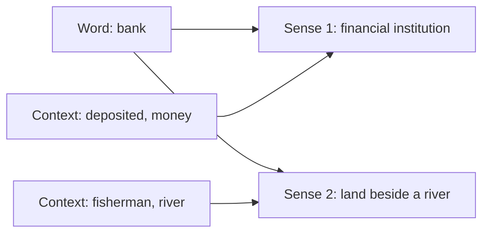
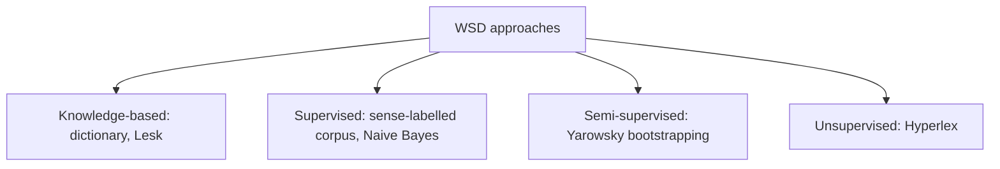

**In one line:** <mark>Word Sense Disambiguation (WSD) focuses on determining the correct meaning of a word when it has multiple possible interpretations</mark>, using the context in which the word appears. <Cite id="class-nlp-pyq4" loc="p. 5" />

<Box kind="key">

**Key points to write:**

- <mark>WSD finds the correct sense (meaning) of a word that has several meanings</mark>.
- The cause is <mark>lexical ambiguity</mark>: one word, many senses (*bank*, *bat*, *bark*).
- <mark>It analyzes the surrounding words and identifies the intended sense</mark>, which improves language understanding and reduces ambiguity.
- Examples: "She deposited money in the **bank**" (financial institution), "The fisherman sat on the river **bank**" (land beside a river).
- Approaches: **knowledge-based (Lesk), supervised, semi-supervised (Yarowsky), unsupervised**.
- Uses: **machine translation, search, question answering, chatbots**.

</Box>

## Core answer (5 marks, fits every question here)

<Box kind="definition">

**Word Sense Disambiguation (WSD)** focuses on determining the correct meaning of a word when it has multiple possible interpretations. WSD lets an NLP system analyze the surrounding words and identify the intended sense, improving language understanding and reducing ambiguity. <Cite id="class-nlp-pyq4" loc="p. 5" />

</Box>

**Basics:** a **sense** is one meaning of a word. A word with more than one sense is ambiguous, and the ambiguity caused by a word with several meanings is called **lexical ambiguity**. The meaning changes with the context, which means the words around the target word. <Cite id="class-nlp-pyq4" loc="p. 5" /> <Cite id="class-nlp-pyq4" loc="p. 6" /> <Cite id="web-nlp-1-wiki-lex-amb" />

**Examples:** <Cite id="class-nlp-pyq4" loc="p. 5" />

- "She deposited money in the bank." *Bank* is a financial institution.
- "The fisherman sat on the river bank." *Bank* is the land beside a river.

**Conclusion:** WSD reads the context to choose the one sense of an ambiguous word that the speaker meant.

## Extended answer (10 marks): add these

### 1. Why WSD is needed

- **Machine translation:** one English word may need different words in the target language for different senses.
- **Search and question answering:** the system must not return river pages for a question about a money bank.
- **Chatbots and text understanding:** the meaning of a sentence depends on the sense of each word.

<Cite id="web-nlp-1-wiki-wsd" />

### 2. Approaches to WSD

| Approach | Labelled data needed | Example |
|---|---|---|
| Knowledge-based | None (a dictionary) | Lesk |
| Supervised | Large sense-labelled corpus | Naive Bayes |
| Semi-supervised | Small seed set | Yarowsky |
| Unsupervised | None | Hyperlex |

The knowledge-based approach compares the context words with the dictionary definitions of each sense and selects the sense with the maximum overlap. <Cite id="class-nlp-pyq4" loc="p. 5" />

### 3. A quick example of the idea

For *bank* in "She deposited money in the bank", the context word *money* appears in the definition of the financial sense and not in the river sense, so the financial sense scores 1 and the river sense scores 0. <Cite id="class-nlp-pyq4" loc="p. 5" />

### 4. Difficulties

- **Different dictionaries** split a word into a different number of senses, so there is no single correct list of senses. <Cite id="web-nlp-2-wordnet" />
- **Fine senses** are hard to tell apart, even for humans.
- **Labelled data is costly** for the supervised methods. <Cite id="class-nlp-pyq4" loc="p. 8" /> <Cite id="web-nlp-1-wiki-wsd" />

## Fit it to each question

- **"What do you mean by word sense disambiguation (WSD)?"** (5 marks) <PYQ id="2024-12/q1d" />: the core answer.
- **"What is word sense disambiguation?"** (5 marks) <PYQ id="2024-12-ce/q1a" />: the core answer; add the approaches table from section 2 if you want a fuller answer.

## Exam tips

- **Always give both examples** of *bank* with the context words that decide the sense.
- Name the cause: **lexical ambiguity**.
- End with one line on the **approaches** (Lesk, supervised, Yarowsky).
