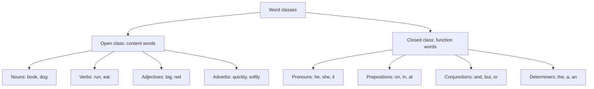
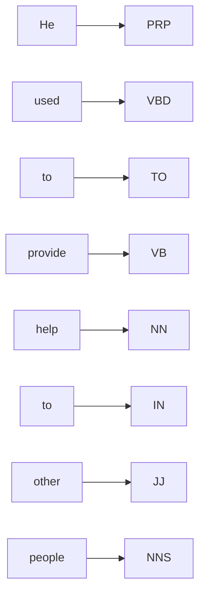
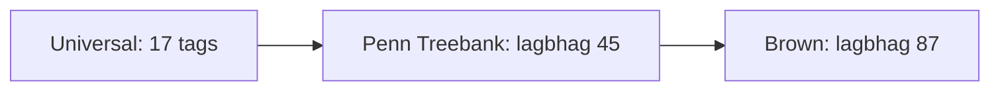

**Ek line mein:** <mark>Open class words (nouns, verbs, adjectives, adverbs) mein naye words aasani se add hote hain; closed class words (pronouns, prepositions, conjunctions, determiners) mein nahi</mark>. POS tagging har word ko uski class ka tag deta hai. <Cite id="class-nlp-pyq3" loc="p. 1" />

<Box kind="key">

**Ye points likho:**

- <mark>Open class: naye vocabulary readily accept karti hai, content words jo meaning dete hain</mark>: noun, verb, adjective, adverb.
- <mark>Closed class: naye members readily accept nahi karti, function words jo grammar dikhate hain</mark>: pronoun, preposition, conjunction, determiner.
- Har class ke **do-teen examples** do (book, run, big, quickly; he, on, and, the).
- <mark>POS tagging har word ko ek grammatical category (tag) deta hai</mark> jaise noun ya verb; tags ki list ko **tagset** kehte hain.
- Tagsets: **Penn Treebank** (lagbhag 45 tags: NN, VB, DT ...), **Universal POS** (17 tags), purana Brown tagset.
- Tagger closed-class words achhe se jaanta hai; **unseen word** lagbhag hamesha open class hota hai.

</Box>

## Core answer (5 marks, yahan ke har question ke liye)

<Box kind="definition">

**Open class words** readily accept new vocabulary additions and changes; they are content words that convey meaning. **Closed class words** do not readily accept new members; they are function words that serve grammatical purposes. <Cite id="class-nlp-pyq3" loc="p. 1" />

</Box>

**Ye split kyun hai:** naye nouns aur verbs hamesha aate rehte hain (*iPhone*, *to fax*), lekin naya preposition shayad hi kabhi banta hai. <Cite id="web-nlp-1-slp3-seqlabel" loc="§18.1" />

| Point | Open class | Closed class |
|---|---|---|
| Naye words | Aasani se add | Shayad hi kabhi |
| Word ka type | Content words (meaning) | Function words (grammar) |
| Examples | book, run, big, quickly | he, on, and, the |

<Cite id="class-nlp-pyq3" loc="p. 1" />

**Conclusion:** open classes meaning leke chalti hain aur badhti rehti hain; closed classes grammar ko jodti hain aur stable rehti hain.

## Extended answer (10 marks): ye add karo

### 1. POS tagging kya hai?

<Box kind="definition">

**POS tagging** is a fundamental task in NLP where each word in a sentence is assigned a grammatical category such as noun, verb, adjective or adverb. <Cite id="class-nlp-pyq3" loc="p. 4" />

</Box>

Example: The/DT quick/JJ brown/JJ fox/NN jumps/VBZ over/IN the/DT lazy/JJ dog/NN. <Cite id="class-nlp-pyq3" loc="p. 4" />

### 2. Sentence "He used to provide help to other people" ko tag karna

Har word ko wo tag milta hai jo yahan uske kaam se match karta hai. <Cite id="class-nlp-pyq3" loc="p. 1" />

| Word | POS tag | Word class |
|---|---|---|
| He | PRP | Pronoun (closed) |
| used | VBD | Verb, past tense (open) |
| to | TO | Infinitive marker |
| provide | VB | Verb (open) |
| help | NN | Noun (open) |
| to | IN | Preposition (closed) |
| other | JJ | Adjective (open) |
| people | NNS | Plural noun (open) |

*Kyun:* *used* past tense hai; pehla *to* verb *provide* se pehle aata hai, isliye infinitive marker hai; *help* wo cheez hai jo provide hoti hai, isliye noun hai; doosra *to* noun phrase *other people* se pehle aata hai, isliye preposition hai. (Penn Treebank khud har *to* ko TO tag deta hai; table class jaisa hi likho.)

### 3. Tagsets

| Tagset | Size | Note |
|---|---|---|
| Penn Treebank | lagbhag 45 tags (36 core) | English; NN, NNS, NNP, VB, VBD, VBZ, MD, DT, JJ, IN, TO, PRP, RB |
| Universal POS (Universal Dependencies) | 17 tags | kai languages ke liye: NOUN, VERB, ADJ, ADV, PRON, ADP, DET ... |
| Brown corpus | lagbhag 87 tags | purana, zyada detail |

<Cite id="web-nlp-2-penn-treebank" /> <Cite id="web-nlp-2-ud-pos" /> <Cite id="web-nlp-1-slp3-seqlabel" loc="§18.1" /> <Cite id="web-nlp-1-wiki-pos" />

### 4. Tagging ke liye classes kyun matter karti hain

Tagger kuch closed-class words achhe se seekh leta hai, isliye unseen word lagbhag hamesha open-class hota hai. <Cite id="class-nlp-pyq3" loc="p. 5" /> Open-class words hi ambiguous bhi hote hain: *book* "read a book" mein noun hai aur "book a ticket" mein verb. <Cite id="web-nlp-2-part-of-speech" />

## Har question mein kaise fit karein

- **"Describe open class words and closed class words in English with examples."** (5 marks) <PYQ id="2022-12-ce/q1c" />: sirf core answer (definitions, diagram, examples ke saath table).
- **"Explain open and closed word classes in English Language. Show how the tags are assigned to the words of the sentence: He used to provide help to other people"** (5 marks) <PYQ id="2024-12/q1a" /> aur (10 marks) <PYQ id="assignment-1/q3a" />: core answer, phir section 2 (table aur diagram). 10 marks ke liye tag-meaning lines aur tagged-corpus image add karo.
- **"Explain types of word classes in English natural language processing"** (5 marks) <PYQ id="2025-05/q1d" />: core answer; chaar open aur chaar closed classes examples ke saath likho.
- **"Define POS tagging. What are the different tagsets use in POS tagging?"** (5 marks) <PYQ id="2026-05/q1d" />: section 1 (definition aur example) aur section 3 (tagset table).

## Exam tips

- **Draw karo:** open/closed tree, har leaf ke neeche examples ke saath.
- Hamesha **examples** do (bina examples ke word class likhoge to marks kategi).
- Tag assignment mein word, tag aur class ki table likho, aur batao ki do *to* alag kyun hain.

Exam mein English mein likho.
