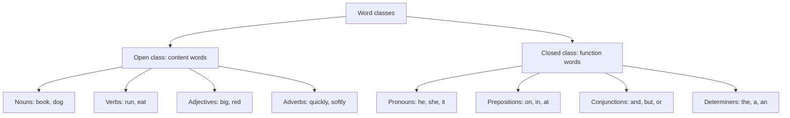
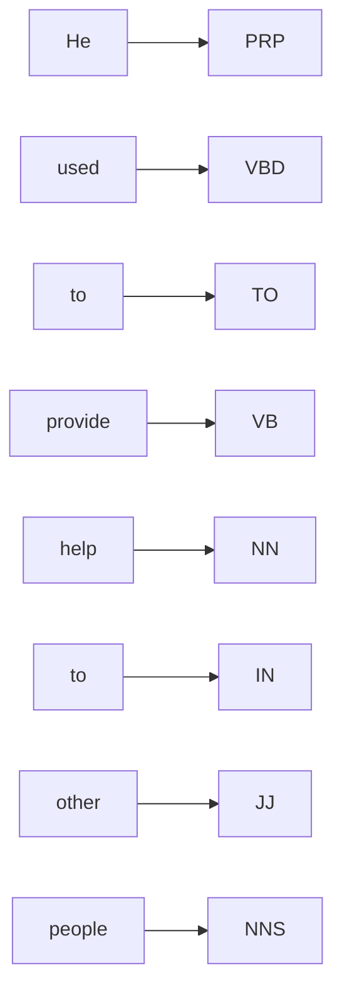
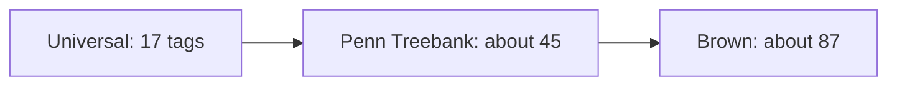

**In one line:** <mark>Open class words (nouns, verbs, adjectives, adverbs) readily accept new words; closed class words (pronouns, prepositions, conjunctions, determiners) do not</mark>. POS tagging gives every word its class tag. <Cite id="class-nlp-pyq3" loc="p. 1" />

<Box kind="key">

**Key points to write:**

- <mark>Open class: readily accept new vocabulary, content words that carry meaning</mark>: noun, verb, adjective, adverb.
- <mark>Closed class: do not readily accept new members, function words that show grammar</mark>: pronoun, preposition, conjunction, determiner.
- Give **two or three examples** of each class (book, run, big, quickly; he, on, and, the).
- <mark>POS tagging assigns each word a grammatical category (tag)</mark> such as noun or verb; the list of tags is the **tagset**.
- Tagsets: **Penn Treebank** (about 45 tags: NN, VB, DT ...), **Universal POS** (17 tags), older Brown tagset.
- A tagger knows closed-class words well; an **unseen word** is almost always open class.

</Box>

## Core answer (5 marks, fits every question here)

<Box kind="definition">

**Open class words** readily accept new vocabulary additions and changes; they are content words that convey meaning. **Closed class words** do not readily accept new members; they are function words that serve grammatical purposes. <Cite id="class-nlp-pyq3" loc="p. 1" />

</Box>

**Why the split exists:** new nouns and verbs appear all the time (*iPhone*, *to fax*), but a new preposition is rarely invented. <Cite id="web-nlp-1-slp3-seqlabel" loc="§18.1" />

| Point | Open class | Closed class |
|---|---|---|
| New words | Easily added | Hardly ever added |
| Kind of word | Content words (meaning) | Function words (grammar) |
| Examples | book, run, big, quickly | he, on, and, the |

<Cite id="class-nlp-pyq3" loc="p. 1" />

**Conclusion:** open classes carry the meaning and keep growing; closed classes hold the grammar together and stay stable.

## Extended answer (10 marks): add these

### 1. What is POS tagging?

<Box kind="definition">

**POS tagging** is a fundamental task in NLP where each word in a sentence is assigned a grammatical category such as noun, verb, adjective or adverb. <Cite id="class-nlp-pyq3" loc="p. 4" />

</Box>

Example: The/DT quick/JJ brown/JJ fox/NN jumps/VBZ over/IN the/DT lazy/JJ dog/NN. <Cite id="class-nlp-pyq3" loc="p. 4" />

### 2. Tagging the sentence "He used to provide help to other people"

Each word gets the tag that matches its job here. <Cite id="class-nlp-pyq3" loc="p. 1" />

| Word | POS tag | Word class |
|---|---|---|
| He | PRP | Pronoun (closed) |
| used | VBD | Verb, past tense (open) |
| to | TO | Infinitive marker |
| provide | VB | Verb (open) |
| help | NN | Noun (open) |
| to | IN | Preposition (closed) |
| other | JJ | Adjective (open) |
| people | NNS | Plural noun (open) |

*Why:* *used* is past tense; the first *to* comes before the verb *provide*, so it is the infinitive marker; *help* is the thing provided, so it is a noun; the second *to* comes before the noun phrase *other people*, so it is a preposition. (The Penn Treebank itself gives the tag TO to every *to*; write the table as in class.)

### 3. Tagsets

| Tagset | Size | Note |
|---|---|---|
| Penn Treebank | about 45 tags (36 core) | English; NN, NNS, NNP, VB, VBD, VBZ, MD, DT, JJ, IN, TO, PRP, RB |
| Universal POS (Universal Dependencies) | 17 tags | works for many languages: NOUN, VERB, ADJ, ADV, PRON, ADP, DET ... |
| Brown corpus | about 87 tags | older, finer detail |

<Cite id="web-nlp-2-penn-treebank" /> <Cite id="web-nlp-2-ud-pos" /> <Cite id="web-nlp-1-slp3-seqlabel" loc="§18.1" /> <Cite id="web-nlp-1-wiki-pos" />

### 4. Why the classes matter for tagging

A tagger learns the few closed-class words well, so an unseen word is almost always an open-class word. <Cite id="class-nlp-pyq3" loc="p. 5" /> Open-class words are also the ambiguous ones: *book* is a noun in "read a book" and a verb in "book a ticket". <Cite id="web-nlp-2-part-of-speech" />

## Fit it to each question

- **"Describe open class words and closed class words in English with examples."** (5 marks) <PYQ id="2022-12-ce/q1c" />: the core answer only (definitions, diagram, table with examples).
- **"Explain open and closed word classes in English Language. Show how the tags are assigned to the words of the sentence: He used to provide help to other people"** (5 marks) <PYQ id="2024-12/q1a" /> and (10 marks) <PYQ id="assignment-1/q3a" />: core answer, then section 2 (table and diagram). For 10 marks add the tag-meaning lines and the tagged-corpus image.
- **"Explain types of word classes in English natural language processing"** (5 marks) <PYQ id="2025-05/q1d" />: core answer; name the four open and four closed classes with examples.
- **"Define POS tagging. What are the different tagsets use in POS tagging?"** (5 marks) <PYQ id="2026-05/q1d" />: section 1 (definition and example) and section 3 (tagset table).

## Exam tips

- **Draw** the open/closed tree with examples under each leaf.
- Always give **examples** (a word class without examples loses marks).
- For tag assignment, write a table with word, tag and class, and say *why* the two *to* differ.
