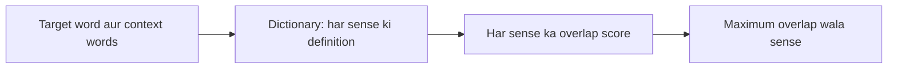
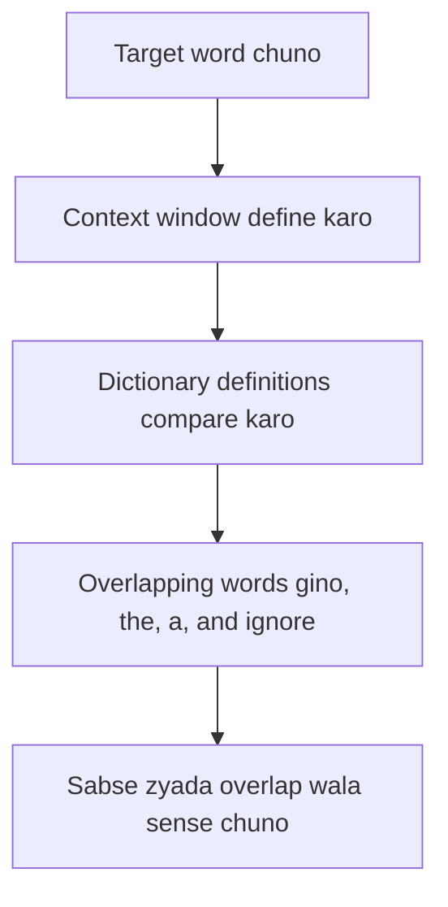
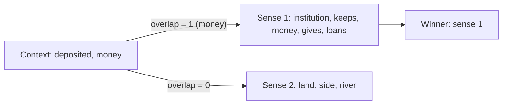
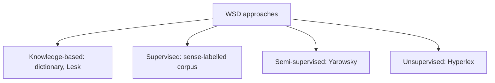

**Ek line mein:** <mark>Word Sense Disambiguation (WSD) tab sahi meaning dhoondhta hai jab word ke kai possible meanings hon</mark>, aur dictionary-based approach (Lesk's algorithm) <mark>wo sense chunta hai jiski dictionary definition ka context words ke saath overlap sabse zyada ho</mark>. <Cite id="class-nlp-pyq4" loc="p. 5" />

<Box kind="key">

**Har WSD / Lesk question mein ye points likho:**

- <mark>WSD focuses on determining the correct meaning of a word when it has multiple possible interpretations</mark>; meaning context pe depend karta hai.
- <mark>Dictionary (knowledge-based) approach: context words ko har sense ki dictionary definition se compare karo, overlap calculate karo, maximum overlap wala sense chuno</mark>.
- <mark>Lesk's algorithm (Michael Lesk, 1986)</mark>: ek neighbourhood ke words ka theme similar hota hai, aur ye unki definitions mein dikhta hai.
- **Steps:** target word chuno, context window define karo, definitions compare karo, overlaps gino (the, a, and ignore), sabse zyada wala chuno.
- Example: "I deposited money in the bank": *money* ke overlap se **financial institution** milta hai.
- <mark>Advantages: simple, labelled data nahi chahiye. Disadvantages: similar senses pe low accuracy, low recall, dictionary pe dependent</mark>.

</Box>

## Core answer (5 marks, yahan ke har question ke liye)

<Box kind="definition">

**Word Sense Disambiguation (WSD)** focuses on determining the correct meaning of a word when it has multiple possible interpretations. WSD lets an NLP system analyze the surrounding words and identify the intended sense. <Cite id="class-nlp-pyq4" loc="p. 5" />

</Box>

**Kyun chahiye:** "She deposited money in the bank" (financial institution) aur "The fisherman sat on the river bank" (nadi ke kinare ki zameen) mein same word ke alag meanings hain. <Cite id="class-nlp-pyq4" loc="p. 5" />

**Dictionary-based (knowledge-based) approach:** ye dictionaries aur semantic networks jaise lexical resources use karta hai. Lesk algorithm isi approach pe chalta hai. <Cite id="class-nlp-pyq4" loc="p. 5" />

1. Context words ko candidate senses ki dictionary definitions se compare karo.
2. Context words aur definition words ke beech overlap calculate karo.
3. Maximum overlap score wala sense chuno.

Ye maanta hai ki coherent text mein saath aaye words related hote hain, aur ye unki dictionary definitions mein dikhta hai. **Advantage:** annotated training data nahi chahiye aur decisions samjhana aasan hai. <Cite id="class-nlp-pyq4" loc="p. 5" />

**Conclusion:** dictionary-based approach wo sense chunta hai jiski definition context ke sabse zyada words share kare.

## Extended answer (10 marks): ye add karo

### 1. Lesk's algorithm step by step

Lesk's algorithm (Michael E. Lesk, 1986) seminal dictionary-based method hai. Ye maanta hai ki ek neighbourhood ke words ka theme similar hota hai. Simplified version mein uncertain word ki dictionary definition ko uski neighbourhood ke terms se compare karte hain. <Cite id="class-nlp-pyq4" loc="p. 3" /> <Cite id="web-nlp-2-lesk" />

1. **Select word:** target word chuno.
2. **Define context window:** uske aas-paas ke words ka group.
3. **Compare definitions:** target word ki dictionary definitions ko context words se compare karo.
4. **Count overlaps:** common words gino; *the*, *a*, *and* exclude karo.
5. **Choose the most overlapping definition:** ye is context mein sabse likely meaning hai. <Cite id="class-nlp-pyq4" loc="p. 3" />

### 2. Worked example

<Sum>

<Given>

Sentence "I deposited money in the bank". *bank* ke do senses (chhoti made-up definitions): sense 1 "an institution that keeps money and gives loans"; sense 2 "the land at the side of a river".

</Given>

<Find>

Lesk's algorithm ne *bank* ka kaunsa sense chuna.

</Find>

<Steps>

1. Target word: *bank*. Context window: *deposited*, *money*.
2. Definitions se common words hatao (an, the, of, at, that, and, in).
3. Sense 1 mein bachte hain: institution, keeps, money, gives, loans. Context ke saath overlap = *money*, yaani **1**.
4. Sense 2 mein bachte hain: land, side, river. Context ke saath overlap = **0**.
5. Sabse zyada overlap 1 hai, sense 1 ka.

</Steps>

<Answer>

*bank* = financial institution (sense 1).

</Answer>

<Box kind="verify">

"The fisherman sat on the river bank" try karo. Context: *fisherman*, *sat*, *river*. Sense 1 overlap = 0, sense 2 overlap = *river* = 1, to wo nadi ke kinare wala sense chunta hai. Alag context, alag answer, bilkul sahi.

</Box>

</Sum>

**Original Lesk example, "pine cone".** Original algorithm *dono* words ki definitions compare karta hai aur wo senses ki jodi dhoondhta hai jinke common words sabse zyada hon. <Cite id="web-nlp-2-lesk" />

<Sum>

<Given>

*pine*: sense 1 "kind of evergreen tree with needle-shaped leaves", sense 2 "waste away through sorrow or illness". *cone*: sense 1 "solid body which narrows to a point", sense 2 "something of this shape whether solid or hollow", sense 3 "fruit of an evergreen tree". (Lesk ke example ke style mein chhoti definitions.)

</Given>

<Find>

*pine* aur *cone* ke wo senses jo saath jaate hain.

</Find>

<Steps>

1. Common words hatao (of, with, to, a, or, an, this, kind).
2. pine 1 mein bachte hain: evergreen, tree, needle-shaped, leaves. cone 3 mein: fruit, evergreen, tree. Common words: *evergreen*, *tree*, overlap **2**.
3. pine 2 (waste, away, sorrow, illness) ka kisi bhi cone sense se kuch common nahi: overlap 0.
4. cone 1 aur cone 2 (solid, body, narrows, point, something, shape, hollow) ka pine 1 se kuch common nahi: overlap 0.

</Steps>

<Answer>

*pine* sense 1 aur *cone* sense 3 (overlap 2): evergreen tree aur uska fruit.

</Answer>

</Sum>

### 3. Advantages aur disadvantages

| Advantages | Disadvantages |
|---|---|
| Implement karna simple, kuch lines ka code | Kai similar senses hon to accuracy kam |
| Labelled training data nahi chahiye | Low recall: overlap zero ya bahut kam ho to fail |
| Jin naye words ki dictionary definition ho unpe chalta hai | Dictionary ki quality aur completeness pe depend |
| Grammar pe depend nahi | Chhoti definitions ki exact wording pe sensitive |

<Cite id="class-nlp-pyq4" loc="p. 3" /> <Cite id="class-nlp-pyq4" loc="p. 4" /> <Cite id="web-nlp-2-lesk" />

### 4. Variants aur WSD methods mein jagah

- **Simplified Lesk:** har sense ko sirf context words se compare karo (pehle example jaisa).
- **Extended Lesk:** WordNet se related words ki definitions bhi use karo, jisse match karne ko zyada words milte hain. <Cite id="web-nlp-2-lesk" /> <Cite id="web-nlp-2-wordnet" />
- **Doosre WSD families:** supervised (sense-labelled corpus chahiye), semi-supervised (Yarowsky) aur unsupervised (Hyperlex). <Cite id="web-nlp-1-wiki-wsd" />

## Har question mein kaise fit karein

- **"What do you mean by word sense disambiguation (WSD)? Discuss dictionary based approach for WSD."** (10 marks) <PYQ id="2022-12-ce/q5a" />: core answer, phir section 1 aur pehla worked example.
- **"What is Word Sense Disambiguation? Explain the dictionary based approach to WSD."** (10 marks) <PYQ id="2023-05-ce/q2a" /> <PYQ id="2025-05/q3b" /> <PYQ id="assignment-2/q4c" />: poora core answer (definition, teen steps, diagram), phir section 1, ek example aur table.
- **"Explain dictionary-based approach (Lesk algorithm) for WSD with suitable example."** (10 marks) <PYQ id="2023-12-ce/q4a" />: WSD pe ek line, teen-step approach, phir Lesk ke paanch steps dono worked examples ke saath.
- **"Explain the Lesk algorithm for Word Sense Disambiguation."** (10 marks) <PYQ id="2024-05-ce/q4a" /> <PYQ id="2026-05/q4a" />: Lesk ki history, paanch steps flow diagram ke saath, ek example, advantages aur disadvantages.
- **"Explain Lesk's algorithm in detail."** (10 marks) <PYQ id="2024-12/q5a" /> <PYQ id="assignment-2/q4b" />: sections 1 se 4 sab kuch.

## Exam tips

- **Overlap count zaroor dikhao** (bank: money = 1 vs river = 0); example ke marks isi se milte hain.
- Lesk ke paanch steps **same order** mein likho aur "ignore the, a, and" bolo.
- **Advantages aur disadvantages dono** likho; bahut students disadvantages bhool jaate hain.

Exam mein English mein likho.
