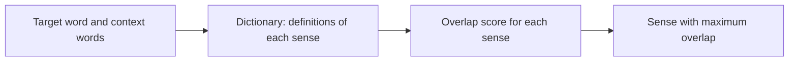
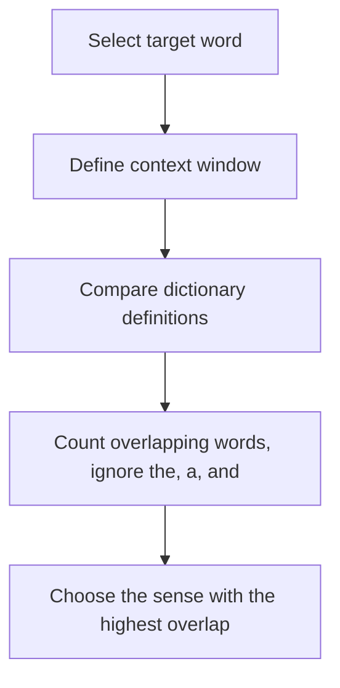
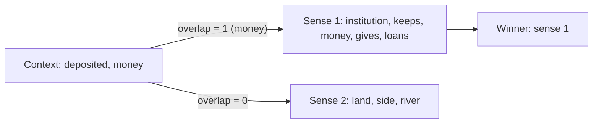
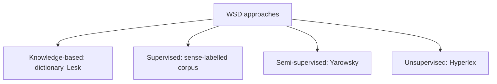

**In one line:** <mark>Word Sense Disambiguation (WSD) finds the correct meaning of a word when it has several possible meanings</mark>, and the dictionary-based approach (Lesk's algorithm) <mark>selects the sense whose dictionary definition has the maximum overlap with the context words</mark>. <Cite id="class-nlp-pyq4" loc="p. 5" />

<Box kind="key">

**Key points to write (any WSD / Lesk question):**

- <mark>WSD focuses on determining the correct meaning of a word when it has multiple possible interpretations</mark>; the meaning depends on the context.
- <mark>Dictionary (knowledge-based) approach: compare context words with the dictionary definitions of each sense, calculate the overlap, select the sense with maximum overlap</mark>.
- <mark>Lesk's algorithm (Michael Lesk, 1986)</mark>: words in a neighbourhood share a theme, and this shows in their definitions.
- **Steps:** select the target word, define a context window, compare definitions, count overlaps (ignore the, a, and), choose the highest.
- Example: "I deposited money in the bank": overlap with *money* gives the **financial institution**.
- <mark>Advantages: simple, needs no labelled data. Disadvantages: low accuracy for similar senses, low recall, dictionary dependent</mark>.

</Box>

## Core answer (5 marks, fits every question here)

<Box kind="definition">

**Word Sense Disambiguation (WSD)** focuses on determining the correct meaning of a word when it has multiple possible interpretations. WSD lets an NLP system analyze the surrounding words and identify the intended sense. <Cite id="class-nlp-pyq4" loc="p. 5" />

</Box>

**Why it is needed:** "She deposited money in the bank" (financial institution) and "The fisherman sat on the river bank" (land beside a river) use the same word with different meanings. <Cite id="class-nlp-pyq4" loc="p. 5" />

**Dictionary-based (knowledge-based) approach:** it uses lexical resources such as dictionaries and semantic networks. The Lesk algorithm works on this approach. <Cite id="class-nlp-pyq4" loc="p. 5" />

1. Compare the context words with the dictionary definitions of the candidate senses.
2. Calculate the overlap between the context words and the definition words.
3. Select the sense with the maximum overlap score.

It assumes that words used together in coherent text are related, and this shows in their dictionary definitions. **Advantage:** it needs no annotated training data and its decisions are easy to explain. <Cite id="class-nlp-pyq4" loc="p. 5" />

**Conclusion:** the dictionary-based approach picks the sense whose definition shares the most words with the context.

## Extended answer (10 marks): add these

### 1. Lesk's algorithm step by step

Lesk's algorithm (Michael E. Lesk, 1986) is the seminal dictionary-based method. It assumes that words in a given neighbourhood have a similar theme. In the simplified version, the dictionary definition of the uncertain word is compared with the terms in its neighbourhood. <Cite id="class-nlp-pyq4" loc="p. 3" /> <Cite id="web-nlp-2-lesk" />

1. **Select word:** choose the target word.
2. **Define context window:** a group of nearby words around it.
3. **Compare definitions:** compare the dictionary definitions of the target word with the context words.
4. **Count overlaps:** count the common words; exclude *the*, *a*, *and*.
5. **Choose the most overlapping definition:** this is the most likely meaning in this context. <Cite id="class-nlp-pyq4" loc="p. 3" />

### 2. Worked example

<Sum>

<Given>

Sentence "I deposited money in the bank". Two senses of *bank* (short made-up definitions): sense 1 "an institution that keeps money and gives loans"; sense 2 "the land at the side of a river".

</Given>

<Find>

the sense of *bank* chosen by Lesk's algorithm.

</Find>

<Steps>

1. Target word: *bank*. Context window: *deposited*, *money*.
2. Remove common words from the definitions (an, the, of, at, that, and, in).
3. Sense 1 keeps: institution, keeps, money, gives, loans. Overlap with the context = *money*, so **1**.
4. Sense 2 keeps: land, side, river. Overlap with the context = **0**.
5. The highest overlap is 1, for sense 1.

</Steps>

<Answer>

*bank* = financial institution (sense 1).

</Answer>

<Box kind="verify">

Try "The fisherman sat on the river bank". Context: *fisherman*, *sat*, *river*. Sense 1 overlap = 0, sense 2 overlap = *river* = 1, so it picks the land beside the river. Different context, different answer, as it should be.

</Box>

</Sum>

**Original Lesk example, "pine cone".** The original algorithm compares the definitions of *both* words and finds the pair of senses with the most common words. <Cite id="web-nlp-2-lesk" />

<Sum>

<Given>

*pine*: sense 1 "kind of evergreen tree with needle-shaped leaves", sense 2 "waste away through sorrow or illness". *cone*: sense 1 "solid body which narrows to a point", sense 2 "something of this shape whether solid or hollow", sense 3 "fruit of an evergreen tree". (Short definitions in the style of Lesk's example.)

</Given>

<Find>

the senses of *pine* and *cone* that go together.

</Find>

<Steps>

1. Remove common words (of, with, to, a, or, an, this, kind).
2. pine 1 keeps: evergreen, tree, needle-shaped, leaves. cone 3 keeps: fruit, evergreen, tree. Common words: *evergreen*, *tree*, overlap **2**.
3. pine 2 (waste, away, sorrow, illness) shares nothing with any cone sense: overlap 0.
4. cone 1 and cone 2 (solid, body, narrows, point, something, shape, hollow) share nothing with pine 1: overlap 0.

</Steps>

<Answer>

*pine* sense 1 and *cone* sense 3 (overlap 2): the evergreen tree and its fruit.

</Answer>

</Sum>

### 3. Advantages and disadvantages

| Advantages | Disadvantages |
|---|---|
| Simple to implement, a few lines of code | Low accuracy when a word has several similar senses |
| Needs no labelled training data | Low recall: fails when the overlap is zero or very small |
| Works for new words that have dictionary definitions | Depends on the quality and completeness of the dictionary |
| Does not depend on grammar | Sensitive to the exact wording of short definitions |

<Cite id="class-nlp-pyq4" loc="p. 3" /> <Cite id="class-nlp-pyq4" loc="p. 4" /> <Cite id="web-nlp-2-lesk" />

### 4. Variants and place among WSD methods

- **Simplified Lesk:** compare each sense with the context words only (as in the first example).
- **Extended Lesk:** also use the definitions of related words from WordNet, which gives more words to match. <Cite id="web-nlp-2-lesk" /> <Cite id="web-nlp-2-wordnet" />
- **Other WSD families:** supervised (needs a sense-labelled corpus), semi-supervised (Yarowsky) and unsupervised (Hyperlex). <Cite id="web-nlp-1-wiki-wsd" />

## Fit it to each question

- **"What do you mean by word sense disambiguation (WSD)? Discuss dictionary based approach for WSD."** (10 marks) <PYQ id="2022-12-ce/q5a" />: core answer, then section 1 and the first worked example.
- **"What is Word Sense Disambiguation? Explain the dictionary based approach to WSD."** (10 marks) <PYQ id="2023-05-ce/q2a" /> <PYQ id="2025-05/q3b" /> <PYQ id="assignment-2/q4c" />: full core answer (definition, three steps, diagram), then section 1, one example and the table.
- **"Explain dictionary-based approach (Lesk algorithm) for WSD with suitable example."** (10 marks) <PYQ id="2023-12-ce/q4a" />: one line on WSD, the three-step approach, then Lesk's five steps with both worked examples.
- **"Explain the Lesk algorithm for Word Sense Disambiguation."** (10 marks) <PYQ id="2024-05-ce/q4a" /> <PYQ id="2026-05/q4a" />: Lesk's history, five steps with the flow diagram, one example, advantages and disadvantages.
- **"Explain Lesk's algorithm in detail."** (10 marks) <PYQ id="2024-12/q5a" /> <PYQ id="assignment-2/q4b" />: everything in sections 1 to 4.

## Exam tips

- **Always show a worked overlap count** (bank: money = 1 against river = 0); this is what earns the example marks.
- Write the five Lesk steps in the **same order** and say "ignore the, a, and".
- Name both **advantages and disadvantages**; many students forget the disadvantages.
