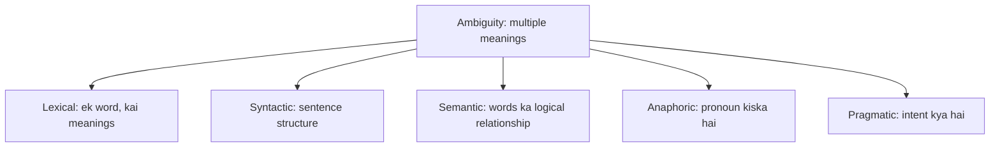
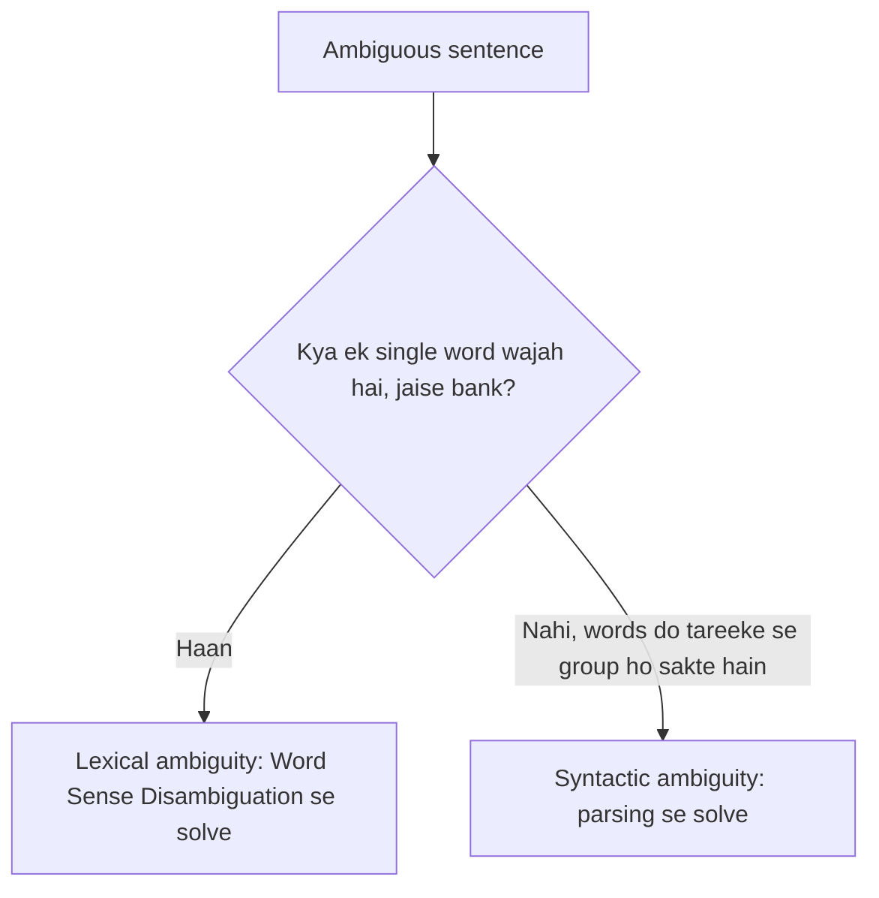
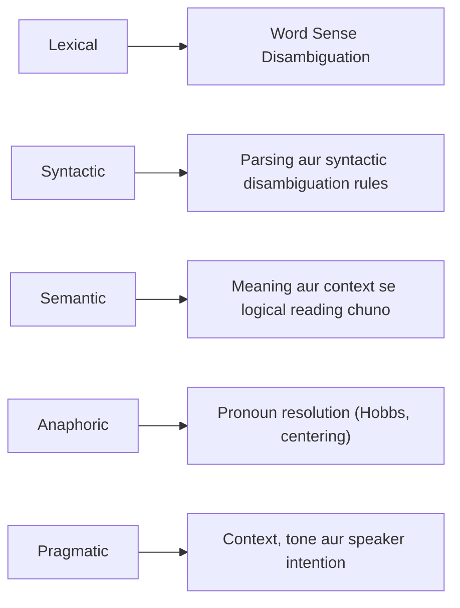

Naye ideas se pehle wo purani baatein jo chahiye. Agar aapko pata hai to seedha agle section par jao.

## Basics pehle

- Ek **word** ke ek se zyada meaning ho sakte hain (bank, bat). Ek **sentence** ek se zyada tareeke se bana ho sakta hai.
- Log sahi meaning **context** se chunte hain: aas-paas ke words aur situation. Computer ko ye feel nahi hota, isliye use sikhana padta hai.
- NLP ke paanch stages (words, grammar, meaning, sentences ke beech links, intention) <Syl m="1" /> "Introduction" mein hain. Neeche har ambiguity type inhi stages mein se ek se judi hai.

## Ambiguity kya hai?

<Box kind="definition">

**Ambiguity in NLP:** a word, sentence or phrase with multiple meanings. <Cite id="class-nlp-m1" loc="p. 3" />

</Box>

Teacher ka example: **"I saw a man with telescope."** Maine telescope use kiya, ya us aadmi ke paas telescope tha? <Cite id="class-nlp-m1" loc="p. 3" />

Ye syllabus <Syl m="1" /> hai.

## Ambiguity ke types

Class paanch types batati hai. <Cite id="class-nlp-m1" loc="p. 3" />

### 1) Lexical ambiguity

Ambiguity caused by a single word having multiple meanings. <Cite id="class-nlp-pyq4" loc="p. 6" /> Teacher aath examples dete hain (I1 aur I2 do interpretations hain). <Cite id="class-nlp-m1" loc="p. 3" /> <Cite id="class-nlp-m1" loc="p. 4" />

| Sentence | Interpretation 1 | Interpretation 2 |
|---|---|---|
| I saw a bat in a cave | Bat, ek flying mammal | Bat, ek playing toy (cricket bat) |
| He deposited money in the bank | Bank (financial) | River bank |
| The bark was rough | Dog ka bark | Ped ka outer covering |
| She fix the pitch | Voice pitch | Cricket pitch (3rd: presentation pitch) |
| I need a new mouse | Electronic mouse | Chhota rat |
| They are looking at the board | Lakdi ka piece | Board of directors (3rd: holding board) |
| He dropped the glass | Drinking glass | Glass ka tukda |
| The athlete broke the record | Musical record disk | Game score record |

### 2) Syntactic ambiguity

One sentence interprets multiple meanings based on its sentence structure. <Cite id="class-nlp-m1" loc="p. 4" /> Wahi words do tareeke se group ho sakte hain. <Cite id="class-nlp-m1" loc="p. 4" /> <Cite id="class-nlp-m1" loc="p. 5" />

| Sentence | Interpretation 1 | Interpretation 2 |
|---|---|---|
| Visiting relatives can be boring | Hum unse milne ja rahe hain | Wo humse milne aa rahe hain |
| Call me a taxi | Mere liye cab book karo | Mujhe taxi naam se bulao |
| The chicken is ready to eat | Pakka hua chicken khane ke liye ready hai | Zinda chicken khilane ke liye ready hai |
| Flying planes can be dangerous | Plane udana khatarnak hai | Jo aeroplanes ud rahe hain wo khatarnak ho sakte hain |
| Look at the dog with one eye | Ek aankh wala dog jo us par dekh raha hai | Sirf ek aankh se dog ko dekhna |
| We need more intelligent leaders | Aise leaders jinki intelligence zyada ho | Leaders ki sankhya zyada |
| She hit the man with an umbrella | Usne umbrella ko weapon banakar maara | Usne ek aise aadmi ko maara jiske paas umbrella tha |
| I shot an elephant in my pajama | Maine pajama pehne hue elephant ko shoot kiya | Maine pajama pehna aur phir elephant ko shoot kiya (elephant pajama mein tha) |

### 3) Semantic ambiguity

Ye tab hoti hai jab grammatical structure clear ho par words ke beech logical relationship multiple meanings allow kare. <Cite id="class-nlp-m1" loc="p. 6" />

| Sentence | Interpretation 1 | Interpretation 2 |
|---|---|---|
| Someone ate every slice of pizza | Ek hi bhookhe insaan ne poora pizza kha liya | Har slice ko kisi na kisi ne khaya |
| All students did not pass the exam | Ek bhi student pass nahi hua | Pass rate 70% tha |
| John and Mary are married | Dono ek dusre se married hain | John kisi se married hai aur Mary kisi se married hai |
| I have not slept for 2 days | 48 ghante nahi soya | In 2 dinon mein bahut kam soya |

### 4) Anaphoric ambiguity

Ye tab hoti hai jab ek pronoun ya referring expression text mein pehle aaye ek se zyada nouns ki taraf point kar sakta hai. <Cite id="class-nlp-m1" loc="p. 6" /> Poora topic <Syl m="5" /> mein hai.

| Sentence | Pronoun ka matlab kaun ya kya? |
|---|---|
| When the car crashed into the wall, it was severely damaged | Car damage hui, ya wall damage hui |
| Mary told Susan that she had won the competition | Mary jeeti, ya Susan jeeti |
| The children ate the cake because they were very sweet | Bachhe sweet the, ya cake sweet tha |
| Dad yelled at Timmy because he left the door open | Timmy ne door khula chhoda, ya Dad ne |

<Cite id="class-nlp-m1" loc="p. 7" />

### 5) Pragmatic ambiguity

Ye tab hoti hai jab sentence ka literal dictionary meaning clear ho par underlying intent ya goal bilkul alag ho. <Cite id="class-nlp-m1" loc="p. 7" />

| Sentence | Literal reading | Intended meaning |
|---|---|---|
| Do you know the time? | Haan ya na | Mujhe time batao |
| My coffee is cold | Sirf ek fact | Ek complaint |

<Cite id="class-nlp-m1" loc="p. 8" />

## Syntactic ambiguity versus lexical ambiguity

Ye difference bahut baar puchha gaya. Class ka answer ek table hai. <Cite id="class-nlp-pyq4" loc="p. 6" />

| Aspect | Syntactic ambiguity | Lexical ambiguity |
|---|---|---|
| Definition | Ambiguity caused by the structure or grammar of a sentence | Ambiguity caused by a single word having multiple meanings |
| Source | Sentence structure leads to more than one possible interpretation | Word meaning leads to confusion because it has different senses |
| Focus | Syntax (sentence formation) | Semantics (word meanings) |
| Example | "I saw the man with the telescope." Telescope kiske paas hai? | "He went to the bank." Riverbank ya financial bank? |
| Example 2 | "Flying planes can be dangerous." Planes udana ya udte hue planes? | "The bat flew out of the cave." Bat (animal) ya bat (cricket)? |
| Resolution | Parsing techniques and syntactic disambiguation rules | Word Sense Disambiguation (WSD) |
| Relevance in NLP | Syntactic parsing and sentence structure analysis | Semantic analysis and lexical processing |

## Ambiguity ko resolve karne ke tareeke

Class do types ka resolution batati hai aur baaki ke tools aage ke modules mein dikhati hai. <Cite id="class-nlp-pyq4" loc="p. 6" />

- **Lexical:** Word Sense Disambiguation dhundta hai ki is context mein word ka kaun sa sense hai. <Cite id="class-nlp-pyq4" loc="p. 5" /> Example: "money" "bank" ke saath ho to financial bank.
- **Syntactic:** parser possible structures banata hai aur rules ya probabilities ek chunte hain. <Cite id="class-nlp-pyq4" loc="p. 6" />
- **Anaphoric:** pronoun resolution pronoun ko uske noun se link karta hai; class Hobbs ka algorithm (syntax tree par upar chadhta hai aur gender, number, distance check karta hai) aur Centering algorithm padhati hai. <Cite id="class-nlp-asol" loc="p. 3" />
- **Pragmatic:** literal meaning ke aage context, tone aur speaker ki intention dekho. <Cite id="class-nlp-asol" loc="p. 1" />
- **Semantic:** aas-paas ke sentences aur common sense decide karte hain ki kaun sa logical reading hai (ye class files mein worked out nahi hai, isliye ek line mein likho).

## NLP ke challenges

Main challenge ye hai ki **natural language har stage par ambiguous hai**, isliye shuru ki ek galat choice baad ke stages bigaad deti hai. <Cite id="class-nlp-m1" loc="p. 3" />

| Stage | Challenge | Example |
|---|---|---|
| Lexical | Ek word, kai meanings | bank, bat, bark |
| Syntactic | Ek sentence, kai structures | I saw a man with telescope |
| Semantic | Words ka logic aur scope | All students did not pass |
| Discourse | Pronoun kaun sa noun hai | Mary told Susan that she had won |
| Pragmatic | Asli intention | Do you know the time? |

Class files ke aur challenges: figurative language jaise idioms aur metaphors ("I'm falling for you" girne ke baare mein nahi hai), <Cite id="class-nlp-asol" loc="p. 1" /> wo words jo model ne pehle nahi dekhe (out-of-vocabulary words), idioms aur informal language, aur wo models jo ek domain mein achhe chalte hain par dusre mein nahi. <Cite id="class-nlp-pyq3" loc="p. 5" />

## NLP ke applications

Class files mein padhaye gaye applications ye hain. <Cite id="class-nlp-m6" loc="slide 1" />

| Application | Ek line | Example |
|---|---|---|
| Machine translation | Text ya speech ko ek language se dusri mein automatically translate karta hai | Website aur app localization, subtitles <Cite id="class-nlp-m6" loc="slide 1" /> <Cite id="class-nlp-m6" loc="slide 7" /> |
| Information retrieval | Bade collection se relevant documents dhundta hai aur query ke liye rank karta hai | Search engine <Cite id="class-nlp-m6" loc="slide 9" /> |
| Question answering | Human-language questions ka precise facts ya short passages se jawab deta hai | Who, what ya when poochna <Cite id="class-nlp-m6" loc="slide 15" /> |
| Text classification | Text ko predefined labels assign karta hai | Spam detection, topic labeling <Cite id="class-nlp-m6" loc="slide 18" /> |
| Summarization | Bade text ko chhota karta hai aur essential information rakhta hai | Banking, law, healthcare reports <Cite id="class-nlp-m6" loc="slide 23" /> |
| Sentiment analysis | Opinions aur emotions dhundta hai: positive, negative ya neutral | Customer feedback <Cite id="class-nlp-m6" loc="slide 26" /> |
| Named entity recognition | Logon, jagahon, organizations aur dates ke naam dhundta hai | Amazon company versus the Amazon forest <Cite id="class-nlp-m6" loc="slide 35" /> |
| Language models | Agla word predict karte hain aur sentences ko score dete hain | Text prediction, spelling correction <Cite id="class-nlp-m6" loc="slide 40" /> <Cite id="class-nlp-pyq2" loc="p. 8" /> |
| Speech assistants | Bole hue requests samajhte aur jawab dete hain | Alexa, Siri, ChatGPT <Cite id="class-nlp-m1" loc="p. 1" /> |

## Ye kahan puchha gaya

| Agar question kehta hai | Kya likhna hai | Kab aaya |
|---|---|---|
| "What is ambiguity? Explain its types and ways to resolve it" | Definition, examples ke saath paanch types, resolution | <PYQ id="2024-12/q4b" /> <PYQ id="assignment-1/q1b" /> |
| "Ambiguities at each level of NLP with an example" | Paanch types, har ek apne stage se juda | <PYQ id="2023-05-ce/q3a" /> |
| "Differentiate syntactic and lexical ambiguity" (5 marks) | Comparison table | <PYQ id="2022-12-ce/q1a" /> <PYQ id="2024-12-ce/q1e" /> <PYQ id="assignment-1/q1c" /> |
| "Challenges and applications of NLP" | Har stage par ambiguity, phir applications table | <PYQ id="2025-05/q6a" /> <PYQ id="assignment-1/q1d" /> <PYQ id="2023-05-ce/q1a" /> |
| "Challenges in the various stages of NLP" | Stage-by-challenge table | <PYQ id="2023-12-ce/q2b" /> |
| "Applications of NLP" (5 marks) | Applications table short mein | <PYQ id="2024-05-ce/q1a" /> |

## Quick revision

- Ambiguity: a word, sentence or phrase with multiple meanings.
- Lexical: ek word, kai meanings (bank). Syntactic: structure (I saw a man with telescope). Semantic: logic (someone ate every slice of pizza). Anaphoric: pronoun (Mary told Susan that she had won). Pragmatic: intent (Do you know the time?).
- Syntactic syntax ke baare mein hai aur parsing se solve hoti hai; lexical word meaning ke baare mein hai aur WSD se solve hoti hai.
- Challenge: NLP ke har stage par ambiguity.
- Applications: machine translation, information retrieval, question answering, text classification, summarization, sentiment analysis, named entity recognition, language models, speech assistants.

**Conclusion.** Ambiguity NLP ki jad ki mushkil hai: wahi words kai tareeke se padhe ja sakte hain, aur har type ko apna ilaaj chahiye. <Cite id="class-nlp-m1" loc="p. 3" />
