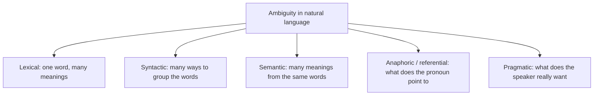
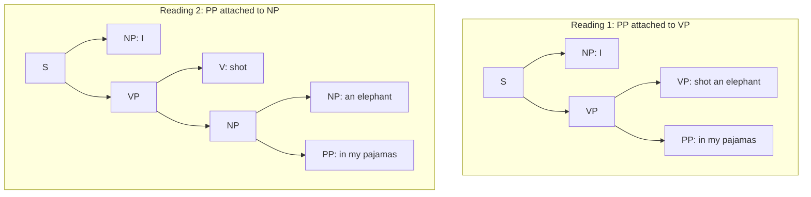

Naye ideas se pehle, wo purane ideas jo aapko chahiye.

## The basics first

- **Natural language** wo language hai jo log bolte aur likhte hain (English, Hindi, Marathi). Ye programming language nahi hai.
- **NLP** (Natural Language Processing) AI ka wo hissa hai jo computer ko human language padhna, samajhna aur banana sikhata hai. <Cite id="ambiguity-challenges-wiki-nlp" /> <Cite id="ambiguity-challenges-ibm-nlp" />
- **Word** wo sabse chhoti unit hai jo hum aam taur pe handle karte hain. **Sentence** words ka group hai. **Parser** ek program hai jo pata lagata hai ki sentence ke words kaise group hue hain.
- **Context** word ke aas-paas ki har cheez hai: baaki words, pichhle sentences, bolne wala kaun hai aur situation kya hai.
- **Programming language** mein har statement ka bilkul ek hi matlab hota hai. Natural language mein aisa nahi hota, aur yehi gap is note ki core problem hai. <Cite id="ambiguity-challenges-tp-nlp" />

Ye note syllabus <Syl m="1" /> ke items 1.6 (ambiguity in natural language, challenges of NLP) aur 1.7 (applications of NLP) cover karta hai.

## What is ambiguity?

**Definition.** **Ambiguity** ka matlab hai ki ek word, phrase ya sentence ko ek se zyada tarike se samjha ja sakta hai. <Cite id="ambiguity-challenges-tp-nlp" /> <Cite id="ambiguity-challenges-wiki-ambiguity" />

**Ye kyun zaroori hai.** Insaan lagbhag hamesha bina notice kiye sahi matlab chun leta hai, kyunki hum context aur common sense use karte hain. Computer ke paas default mein dono nahi hote. Agar wo galat matlab chun le, to translation galat hoga, answer galat hoga, ya chatbot kuch ajeeb kar dega.

**Everyday analogy.** Dost ka text aata hai "I'll be there in a minute". Aap jaante ho iska matlab "jaldi" hai, "60 second mein" nahi, kyunki aap apne dost ko jaante ho. Program aapke dost ko nahi jaanta, isliye usse rules ya examples dene padte hain taaki wo bhi waisa hi guess kar sake.

**Ek famous example.** "I made her duck" ke kam se kam paanch matlab ho sakte hain: maine uski duck pakayi; maine wo duck pakayi jo wo khane wali thi; maine uske liye ek (toy) duck banayi; maine use jaldi se sar jhukane pe majboor kiya; maine jaadu se use duck bana diya. Simple dikhne wale words (made, her, duck) mein se har ek ke kai roles hote hain. <Cite id="ambiguity-challenges-jm2-ch1" />

## Types of ambiguity

<Cite id="ambiguity-challenges-gfg-ambiguity" loc="diagram" /> <Cite id="ambiguity-challenges-tp-ambiguities" />

### 1. Lexical ambiguity

**Definition.** Ek word ke ek se zyada meaning ya ek se zyada part of speech hote hain. <Cite id="ambiguity-challenges-tp-nlp" />

- **Alag meanings.** "I went to the **bank**" (money bank ya river bank). "A **bat**" (jaanwar ya cricket bat). <Cite id="ambiguity-challenges-gfg-ambiguity" />
- **Alag part of speech.** "I need to **mail** my friend the files" (verb) aur "I found the **mail**" (noun). "Silver" noun, adjective ya verb ho sakta hai. <Cite id="ambiguity-challenges-tp-ambiguities" /> <Cite id="ambiguity-challenges-tp-nlp" />
- Do sub-kinds: **polysemy** (ek word ke related meanings, jaise bank building aur bank organisation) aur **homonymy** (unrelated meanings jo bas spelling share karte hain, jaise bass machhli aur bass awaaz). <Cite id="ambiguity-challenges-wiki-polysemy" /> <Cite id="ambiguity-challenges-tp-ambiguities" />
- **Fix:** word sense disambiguation (WSD): wo sense chuno jo aas-paas ke words ke saath fit ho. "he served the dish" mein paas ke words "serve" aur "dish" dono ke food senses ki taraf ishara karte hain. <Cite id="ambiguity-challenges-nltk-ch1" loc="§5.1" /> <Cite id="ambiguity-challenges-wiki-wsd" /> <Cite id="ambiguity-challenges-navigli2009" />

### 2. Syntactic (structural) ambiguity

**Definition.** Saare words clear hain, lekin sentence ko ek se zyada grammatical structure mein group kiya ja sakta hai, isliye uske ek se zyada parse trees hote hain. <Cite id="ambiguity-challenges-wiki-synamb" />

**Example.** "I shot an elephant in my pajamas." *in my pajamas* batata hai ki main kahan tha, ya kaunsa elephant? <Cite id="ambiguity-challenges-nltk-ch8" loc="§1.2" />

<Cite id="ambiguity-challenges-nltk-ch8" loc="§1.2" /> <Cite id="ambiguity-challenges-wiki-synamb" />

Aur examples: "The boy kicked the ball in his jeans" (jeans kisne pehni thi?) aur "The man saw the girl with the telescope". <Cite id="ambiguity-challenges-gfg-ambiguity" /> <Cite id="ambiguity-challenges-tp-nlp" />

**Fix:** sentence ko parse karo, phir sabse likely tree chuno (probabilistic parsing), ya meaning aur context use karo. <Cite id="ambiguity-challenges-slp3" />

#### How fast the readings multiply

"on the hill" ya "with a telescope" jaisa har extra phrase kai jagah attach ho sakta hai, isliye parses ki sankhya tezi se badhti hai. Ek chhoti counting ise concrete bana deti hai.

<Sum>

<Given>

Sentence "I saw the man on the hill with a telescope". Isme do prepositional phrases hain: PP1 = "on the hill" aur PP2 = "with a telescope".

</Given>

<Find>

kitne alag readings hain, is rule ke saath ki ek phrase verb "saw", noun "man" ya noun "hill" se attach ho sakta hai, aur attachments ek-dusre ko cross nahi kar sakte.

</Find>

<Steps>

1. PP1 ("on the hill") verb se attach ho sakta hai (main hill pe tha) ya "man" se (aadmi hill pe tha). Ye 2 choices hain. *Reason: PP1 "the man" ke turant baad aata hai, isliye sirf verb phrase ya wo noun ise le sakta hai.*
2. Agar PP1 verb se attach hai, to PP2 ("with a telescope") verb se attach ho sakta hai (maine telescope use kiya) ya "hill" se (hill pe telescope hai). Ye 2 readings hain. *Reason: "man" us hisse ke andar hai jise PP1 ne skip kiya, aur attachments cross nahi kar sakte.*
3. Agar PP1 "man" se attach hai, to PP2 verb se (maine telescope use kiya), "the man on the hill" se (us aadmi ke paas telescope hai), ya "hill" se (hill pe telescope hai) attach ho sakta hai. Ye 3 readings hain. *Reason: ab poora noun phrase "the man on the hill" bhi available hai.*
4. Jodo: $2 + 3 = 5$.

</Steps>

<Answer>

5 readings.

</Answer>

<Box kind="verify">

Doosre tarike se dobara ginti. "verb + noun + $k$ prepositional phrases" ke readings ki sankhya Catalan number $C_n = \dfrac{(2n)!}{(n+1)!\,n!}$ hai jahan $n = k+1$. $k = 2$, $n = 3$ ke liye: $\dfrac{720}{24 \times 6} = 5$. Match karta hai. Ek phrase ($n = 2$) ke liye: $\dfrac{24}{6 \times 2} = 2$, jo "I shot an elephant in my pajamas" ke do readings hain. Teen phrases ($n = 4$) ke liye: $\dfrac{40320}{120 \times 24} = 14$, yaani ambiguity tezi se badhti hai.

</Box>

</Sum>

### 3. Semantic ambiguity

**Definition.** Words aur structure clear hain, phir bhi meaning khula hua hai. <Cite id="ambiguity-challenges-gfg-ambiguity" />

- "Visiting relatives can be annoying": visiting karna annoying hai, ya jo relatives visit karte hain wo annoying hain? <Cite id="ambiguity-challenges-gfg-ambiguity" />
- **Scope ambiguity:** "All students learn a programming language": sab ke liye ek hi language, ya har student ki apni? <Cite id="ambiguity-challenges-tp-ambiguities" />
- "He ate the burnt lasagna and pie": sirf lasagna jala tha, ya dono? <Cite id="ambiguity-challenges-tp-ambiguities" />

**Fix:** context aur world knowledge use karo, aur logical forms jo scope ko explicit bana dein.

### 4. Anaphoric (referential) ambiguity

**Definition.** Ek pronoun ya phrase (**anaphor**) jaise *it, she, they* pichhli ek se zyada cheezon (**antecedent**) ki taraf point kar sakta hai. <Cite id="ambiguity-challenges-wiki-anaphora" />

- "The horse ran up the hill. It was very steep. It soon got tired." Pehla "it" hill hai, doosra horse. <Cite id="ambiguity-challenges-tp-nlp" />
- "Michelle told Romany that she ate the cake": kisne khaya? <Cite id="ambiguity-challenges-tp-ambiguities" />
- "The thieves stole the paintings. They were subsequently sold / caught / found." "They" paintings hain, thieves hain, ya unclear. <Cite id="ambiguity-challenges-nltk-ch1" loc="§5.2" />
- Mushkil version Winograd schema hai: "The trophy does not fit in the suitcase because **it** is too big" versus "...too small". Sirf common sense batata hai ki "it" kaunsa noun hai. <Cite id="ambiguity-challenges-wiki-winograd" />

**Fix:** anaphora aur coreference resolution (module 6 mein).

### 5. Pragmatic ambiguity

**Definition.** Sentence clear hai, lekin speaker *chahta* kya hai wo situation pe depend karta hai. <Cite id="ambiguity-challenges-tp-nlp" /> <Cite id="ambiguity-challenges-gfg-ambiguity" />

- "Can you open the window?" kagaz pe ability ka sawaal hai, lekin kamre mein ye polite request hai. <Cite id="ambiguity-challenges-gfg-ambiguity" />
- "I like you too": pehle kisne kya kaha uske hisaab se same sentence ke do alag matlab ho sakte hain. <Cite id="ambiguity-challenges-tp-nlp" />

**Fix:** discourse aur dialogue modelling, aur speaker ke goals ki knowledge (module 6).

### Other kinds you may be asked

- **Phonetic (speech) ambiguity:** sounds kai word sequences se match karti hain: "recognize speech" aur "wreck a nice beach" lagbhag same sunai dete hain, aur "horse" aur "hoarse" ka pronunciation same hai. Speech recognisers language model se likely text chunte hain. <Cite id="ambiguity-challenges-tp-ambiguities" />
- **Morphological ambiguity:** ek word ko ek se zyada tarike se parts mein toda ja sakta hai: "unlockable" ya to *un + lockable* (lock nahi ho sakta) ya *unlock + able* (unlock ho sakta hai).
- **Part-of-speech ambiguity:** "Time flies like an arrow" mein *flies* ko verb padh sakte hain, ya *time flies* ko ek tarah ka insect. POS taggers ko har word ke liye ek tag chunna padta hai. <Cite id="ambiguity-challenges-tp-ambiguities" /> <Cite id="ambiguity-challenges-spacy" />
- **Ellipsis:** words chhod diye jaate hain: "John likes apples, and Mary does too". <Cite id="ambiguity-challenges-gfg-ambiguity" />

### Lexical ambiguity versus syntactic ambiguity

<PYQ id="2022-12-ce/q1a" /> <PYQ id="2024-12-ce/q1e" />

| Point | Lexical ambiguity | Syntactic ambiguity |
|---|---|---|
| Source | Ek **word** ke kai meanings ya tags | Words ka **grouping** (sentence structure) |
| Number of parses | Aam taur pe ek parse, lekin word ka sense unclear | Do ya zyada alag parse trees |
| Example | "I went to the **bank**" (river ya money) | "I saw the man **with a telescope**" |
| Example 2 | "bat", "mail", "silver" | "I shot an elephant in my pajamas" |
| Level of NLP | Lexical (word) level | Syntactic (sentence) level |
| Typical fix | Word sense disambiguation, POS tagging | Parsing (probabilistic ya context-based) |

<Cite id="ambiguity-challenges-gfg-ambiguity" /> <Cite id="ambiguity-challenges-tp-ambiguities" /> <Cite id="ambiguity-challenges-wiki-synamb" />

Exam mein English mein likho: "Lexical ambiguity arises when a single word has more than one meaning, while syntactic ambiguity arises when the structure of a sentence allows more than one parse."

## Ambiguity at each level of NLP

<PYQ id="2023-05-ce/q3a" />

Language processor stages mein kaam karta hai, aur har stage ko apni kism ki ambiguity milti hai. Ek stage ki galat choice agle stage ko pass ho jaati hai.

```mermaid
%% caption: Language processing ke stages aur har stage ko kaunsi ambiguity settle karni hai. Shuruaati stage ki error aage ke saare stages tak flow karti hai.
flowchart LR
  A["Speech or text"] --> B["Phonetic and phonological: which words were said"]
  B --> C["Morphological: how a word splits into parts"]
  C --> D["Lexical: which sense and which POS tag"]
  D --> E["Syntactic: which parse tree"]
  E --> F["Semantic: which meaning and scope"]
  F --> G["Discourse: what does it refer to"]
  G --> H["Pragmatic: what does the speaker want"]
```

<Cite id="ambiguity-challenges-jm2-ch1" /> <Cite id="ambiguity-challenges-tp-ambiguities" />

| Level | What is decided | Ambiguous example |
|---|---|---|
| Phonetic / speech | Sound kin words se match karti hai | "recognize speech" or "wreck a nice beach" |
| Morphological | Word kaise split hota hai | "unlockable" |
| Lexical | Word ka meaning ya POS | "bank", "mail" |
| Syntactic | Kaunsa parse tree | "I saw the man with a telescope" |
| Semantic | Kaunsa meaning, kaunsa scope | "All students learn a language" |
| Discourse | Pronoun kisko refer karta hai | "Michelle told Romany that she ate the cake" |
| Pragmatic | Asli intention | "Can you open the window?" |

## Ways to resolve ambiguity

<PYQ id="2024-12/q4b" />

1. **Context.** Paas ke words aur pichhle sentences use karo. "Bank" ke saath "river" ho to matlab river ka kinara.
2. **Word sense disambiguation.** Context se word ka sense chuno, dictionary overlap method, supervised classifiers ya neural embeddings se (module 4). <Cite id="ambiguity-challenges-wiki-wsd" /> <Cite id="ambiguity-challenges-navigli2009" />
3. **POS tagging.** Sentence ke hisaab se har word ka part of speech decide karo (module 3). spaCy aur NLTK jaisi libraries ye karti hain. <Cite id="ambiguity-challenges-spacy" />
4. **Parsing.** Parse trees banao; probabilistic grammar ke saath sabse high-probability tree chuno. <Cite id="ambiguity-challenges-slp3" /> <Cite id="ambiguity-challenges-nltk-ch8" />
5. **Coreference / anaphora resolution.** Har pronoun ko sahi antecedent se jodo (module 6).
6. **World knowledge aur pragmatics.** Duniya ke facts (hill koi insaan nahi hai) aur speaker ke goals.
7. **Statistical aur neural models.** BERT aur GPT jaise models bahut saare text se seekhte hain ki words kaise use hote hain, isliye likely meaning ko prefer karte hain. <Cite id="ambiguity-challenges-gfg-ambiguity" />
8. **User se poocho.** Chatbot jab decide nahi kar paaye to pooch sakta hai "Do you mean the river bank or the money bank?"

Sach baat: inme se koi bhi perfect nahi hai; Winograd schema jaise tests abhi bhi dikhate hain ki computers ko wo common sense chahiye jo dena mushkil hai. <Cite id="ambiguity-challenges-wiki-winograd" />

## Challenges of NLP

<PYQ id="2023-05-ce/q1a" /> <PYQ id="2023-12-ce/q2b" /> <PYQ id="2025-05/q6a" />

**Ye mushkil kyun hai.** Computers ko structured, exact data chahiye, lekin human language unstructured aur ambiguous hai. <Cite id="ambiguity-challenges-tp-nlp" /> Main difficulties:

1. **Ambiguity** har level pe (upar dekho).
2. **Context aur common sense.** Samajhne ke liye duniya ke wo facts chahiye jo sentence mein kabhi likhe nahi hote. <Cite id="ambiguity-challenges-wiki-winograd" />
3. **Idioms, figurative language aur sarcasm.** "It's raining cats and dogs" janwaron ke baare mein nahi hai; "Great, another Monday" ka matlab "great" ka ulta ho sakta hai. Plain text mein tone of voice aur body language missing hoti hai. <Cite id="ambiguity-challenges-ibm-nlp" />
4. **Slang, naye words aur informal spelling.** Naye words aate rehte hain, log "gr8" likhte hain aur languages mix karte hain (Hinglish), isliye fixed dictionary peeche reh jaati hai. <Cite id="ambiguity-challenges-ibm-nlp" />
5. **Kai languages aur dialects.** Word order, scripts aur grammar alag hote hain; zyadatar languages ka data English se bahut kam hai. Translation mein word order badalna padta hai aur kai word translations mein se chunna padta hai. <Cite id="ambiguity-challenges-nltk-ch1" loc="§5.4" /> <Cite id="ambiguity-challenges-wiki-mt" />
6. **Noisy input.** Spelling mistakes, kharab grammar, mumbled speech, background noise aur accents. <Cite id="ambiguity-challenges-ibm-nlp" />
7. **Names aur unknown words.** "Alice Springs" ko German mein translate karke wapas laaya gaya to "Alice jump" ban gaya, kyunki system ko nahi pata tha ki ye jagah ka naam hai. <Cite id="ambiguity-challenges-nltk-ch1" loc="§5.4" />
8. **Data mein bias.** Skewed text pe train hua model skewed answers deta hai. <Cite id="ambiguity-challenges-ibm-nlp" />
9. **Resources aur cost.** Bade models ko bahut data, computing power aur energy chahiye; chhoti languages ke paas dono kam hain.

### Challenges at the various stages

<PYQ id="2023-12-ce/q2b" />

| Stage | Main challenge |
|---|---|
| Speech / pre-processing | Noise, accents, sentence aur word boundaries, spelling errors |
| Morphological and lexical | Word forms, unknown words, kai senses, POS ambiguity |
| Syntactic | Bahut saare possible parse trees, lambe sentences, kuch languages mein free word order |
| Semantic | Scope, context mein word meaning, idioms, figurative language |
| Discourse | Sentences ke beech pronoun aur reference links, ellipsis |
| Pragmatic | Intent, politeness, sarcasm, world knowledge |

<Cite id="ambiguity-challenges-jm2-ch1" /> <Cite id="ambiguity-challenges-tp-nlp" />

## Applications of NLP

<PYQ id="2024-05-ce/q1a" /> <PYQ id="2025-05/q6a" />

| Application | What it does | Ambiguity it must handle |
|---|---|---|
| Machine translation | Text ko ek language se doosri mein badalta hai (Google Translate) | Word sense aur word order. <Cite id="ambiguity-challenges-wiki-mt" /> |
| Search engines | Query ka intent samajhte hain, sirf keywords nahi | "jaguar" car ya janwar. <Cite id="ambiguity-challenges-ibm-nlp" /> |
| Chatbots and virtual assistants | Users se baat karte hain aur kaam karte hain (Siri, customer care bots) | Intent aur context. <Cite id="ambiguity-challenges-ibm-nlp" /> <Cite id="ambiguity-challenges-jtp-nlp" /> |
| Question answering | Documents ya knowledge se sawaal ka jawaab deta hai | Question words ka kaunsa sense. <Cite id="ambiguity-challenges-wiki-qa" /> |
| Sentiment analysis | Review ya post positive hai ya negative, ye pata karta hai | Sarcasm, negation. <Cite id="ambiguity-challenges-wiki-sentiment" /> |
| Text summarization | Lambe text ko chhota karta hai aur main points rakhta hai | Kya important hai. <Cite id="ambiguity-challenges-wiki-summ" /> |
| Speech recognition and voice assistants | Speech ko text mein badalte hain aur uspe act karte hain | Milti-julti sounds. <Cite id="ambiguity-challenges-nltk-ch1" loc="§5.5" /> |
| Information extraction | Text se names, dates aur facts nikalta hai (finance, legal, health records) | Name aur reference ambiguity. <Cite id="ambiguity-challenges-ibm-nlp" /> |
| Spam detection, spell and grammar checkers | Junk mail filter karte hain aur writing theek karte hain | Words ka context. <Cite id="ambiguity-challenges-jtp-nlp" /> |
| Text generation | Emails, articles, code ka draft likhta hai | Sahi aur consistent rehna. <Cite id="ambiguity-challenges-ibm-nlp" /> |

Ye applications rule-based systems se statistical aur neural systems tak kaise badhin, uski chhoti history yahan hai: <Cite id="ambiguity-challenges-wiki-history" />.

## Summary

Natural language har level pe ambiguous hai, sounds aur word forms se leke word meaning, sentence structure, meaning aur reference tak, aur speaker ke intent tak. NLP systems har ek ko context, tagging, parsing, disambiguation aur learned models se settle karte hain, aur bachi hui difficulty (common sense, figurative language, kai languages, noisy aur biased data) wahi hai jo NLP ko mushkil lekin bahut useful field banati hai.
