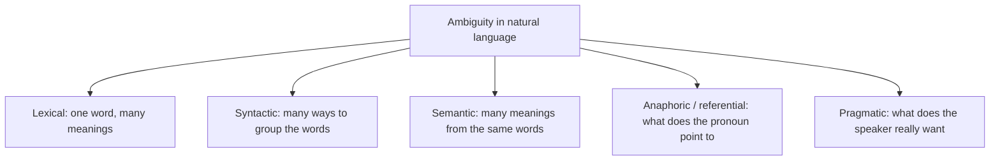
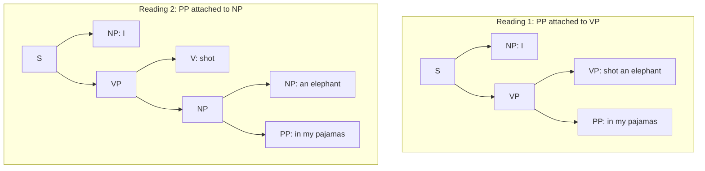

Before the new ideas, here are the few old ones you need.

## The basics first

- **Natural language** is the language people speak and write (English, Hindi, Marathi). It is not a programming language.
- **NLP** (Natural Language Processing) is the part of AI that lets computers read, understand and produce human language. <Cite id="ambiguity-challenges-wiki-nlp" /> <Cite id="ambiguity-challenges-ibm-nlp" />
- A **word** is the smallest unit we usually handle. A **sentence** is a group of words. A **parser** is a program that works out how the words of a sentence are grouped.
- **Context** is everything around a word: the other words, the earlier sentences, who is speaking and the situation.
- A **programming language** has exactly one meaning for each statement. A natural language does not, and that gap is the core problem of this note. <Cite id="ambiguity-challenges-tp-nlp" />

This note covers syllabus <Syl m="1" /> items 1.6 (ambiguity in natural language, challenges of NLP) and 1.7 (applications of NLP).

## What is ambiguity?

**Definition.** **Ambiguity** means that a word, phrase or sentence can be understood in more than one way. <Cite id="ambiguity-challenges-tp-nlp" /> <Cite id="ambiguity-challenges-wiki-ambiguity" />

**Why it matters.** A person nearly always picks the right meaning without noticing, because we use context and common sense. A computer has neither by default. If it picks the wrong meaning, the translation is wrong, the answer is wrong or the chatbot does something silly.

**Everyday analogy.** A friend texts "I'll be there in a minute". You know it means "soon", not "in 60 seconds", because you know your friend. A program does not know your friend, so it has to be given rules or examples to guess the same way.

**A famous example.** "I made her duck" can mean at least five things: I cooked the duck belonging to her; I cooked the duck she was going to eat; I made a (toy) duck for her; I made her lower her head quickly; I magically turned her into a duck. Words that look simple (made, her, duck) each carry several roles. <Cite id="ambiguity-challenges-jm2-ch1" />

## Types of ambiguity

<Cite id="ambiguity-challenges-gfg-ambiguity" loc="diagram" /> <Cite id="ambiguity-challenges-tp-ambiguities" />

### 1. Lexical ambiguity

**Definition.** One word has more than one meaning or more than one part of speech. <Cite id="ambiguity-challenges-tp-nlp" />

- **Different meanings.** "I went to the **bank**" (money bank or river bank). "A **bat**" (the animal or the cricket bat). <Cite id="ambiguity-challenges-gfg-ambiguity" />
- **Different part of speech.** "I need to **mail** my friend the files" (verb) and "I found the **mail**" (noun). "Silver" can be a noun, an adjective or a verb. <Cite id="ambiguity-challenges-tp-ambiguities" /> <Cite id="ambiguity-challenges-tp-nlp" />
- Two sub-kinds: **polysemy** (related meanings of one word, such as the bank building and the bank organisation) and **homonymy** (unrelated meanings that happen to share spelling, such as bass the fish and bass the sound). <Cite id="ambiguity-challenges-wiki-polysemy" /> <Cite id="ambiguity-challenges-tp-ambiguities" />
- **Fix:** word sense disambiguation (WSD): pick the sense that fits the neighbouring words. In "he served the dish" the nearby words point to food senses of both "serve" and "dish". <Cite id="ambiguity-challenges-nltk-ch1" loc="§5.1" /> <Cite id="ambiguity-challenges-wiki-wsd" /> <Cite id="ambiguity-challenges-navigli2009" />

### 2. Syntactic (structural) ambiguity

**Definition.** The words are all clear, but the sentence can be grouped into more than one grammatical structure, so it has more than one parse tree. <Cite id="ambiguity-challenges-wiki-synamb" />

**Example.** "I shot an elephant in my pajamas." Does *in my pajamas* tell where I was, or which elephant? <Cite id="ambiguity-challenges-nltk-ch8" loc="§1.2" />

<Cite id="ambiguity-challenges-nltk-ch8" loc="§1.2" /> <Cite id="ambiguity-challenges-wiki-synamb" />

Other examples: "The boy kicked the ball in his jeans" (who wore the jeans?) and "The man saw the girl with the telescope". <Cite id="ambiguity-challenges-gfg-ambiguity" /> <Cite id="ambiguity-challenges-tp-nlp" />

**Fix:** parse the sentence, then choose the most likely tree (probabilistic parsing), or use the meaning and the context. <Cite id="ambiguity-challenges-slp3" />

#### How fast the readings multiply

Each extra phrase like "on the hill" or "with a telescope" can attach in several places, so the number of parses grows quickly. A small count makes this concrete.

<Sum>

<Given>

The sentence "I saw the man on the hill with a telescope". It has two prepositional phrases: PP1 = "on the hill" and PP2 = "with a telescope".

</Given>

<Find>

the number of different readings, using the rule that a phrase may attach to the verb "saw", to the noun "man", or to the noun "hill", and that the attachments may not cross.

</Find>

<Steps>

1. PP1 ("on the hill") can attach to the verb (I was on the hill) or to "man" (the man was on the hill). That is 2 choices. *Reason: PP1 comes right after "the man", so only the verb phrase or that noun can take it.*
2. If PP1 attaches to the verb, PP2 ("with a telescope") can attach to the verb (I used the telescope) or to "hill" (the hill has a telescope on it). That is 2 readings. *Reason: "man" is already inside the part that PP1 skipped over, and attachments may not cross.*
3. If PP1 attaches to "man", PP2 can attach to the verb (I used the telescope), to "the man on the hill" (that man has the telescope), or to "hill" (the hill has a telescope). That is 3 readings. *Reason: now the whole noun phrase "the man on the hill" is available as well.*
4. Add them: $2 + 3 = 5$.

</Steps>

<Answer>

5 readings.

</Answer>

<Box kind="verify">

Recount a second way. For "verb + noun + $k$ prepositional phrases" the number of readings is the Catalan number $C_n = \dfrac{(2n)!}{(n+1)!\,n!}$ with $n = k+1$. For $k = 2$, $n = 3$: $\dfrac{720}{24 \times 6} = 5$. It matches. For one phrase ($n = 2$): $\dfrac{24}{6 \times 2} = 2$, the two readings of "I shot an elephant in my pajamas". For three phrases ($n = 4$): $\dfrac{40320}{120 \times 24} = 14$, so ambiguity grows fast.

</Box>

</Sum>

### 3. Semantic ambiguity

**Definition.** The words and the structure are clear, but the meaning is still open. <Cite id="ambiguity-challenges-gfg-ambiguity" />

- "Visiting relatives can be annoying": is the visiting annoying, or are the relatives who visit annoying? <Cite id="ambiguity-challenges-gfg-ambiguity" />
- **Scope ambiguity:** "All students learn a programming language": one language for everybody, or each student has their own? <Cite id="ambiguity-challenges-tp-ambiguities" />
- "He ate the burnt lasagna and pie": was only the lasagna burnt, or both? <Cite id="ambiguity-challenges-tp-ambiguities" />

**Fix:** use context and world knowledge, and logical forms that make the scope explicit.

### 4. Anaphoric (referential) ambiguity

**Definition.** A pronoun or phrase (**anaphor**) such as *it, she, they* could point back to more than one earlier thing (**antecedent**). <Cite id="ambiguity-challenges-wiki-anaphora" />

- "The horse ran up the hill. It was very steep. It soon got tired." The first "it" is the hill, the second is the horse. <Cite id="ambiguity-challenges-tp-nlp" />
- "Michelle told Romany that she ate the cake": who ate? <Cite id="ambiguity-challenges-tp-ambiguities" />
- "The thieves stole the paintings. They were subsequently sold / caught / found." "They" is the paintings, the thieves, or unclear. <Cite id="ambiguity-challenges-nltk-ch1" loc="§5.2" />
- The hard version is the Winograd schema: "The trophy does not fit in the suitcase because **it** is too big" versus "...too small". Only common sense tells you which noun "it" is. <Cite id="ambiguity-challenges-wiki-winograd" />

**Fix:** anaphora and coreference resolution (covered in module 6).

### 5. Pragmatic ambiguity

**Definition.** The sentence is clear, but what the speaker *wants* depends on the situation. <Cite id="ambiguity-challenges-tp-nlp" /> <Cite id="ambiguity-challenges-gfg-ambiguity" />

- "Can you open the window?" is a question about ability on paper, but in a room it is a polite request. <Cite id="ambiguity-challenges-gfg-ambiguity" />
- "I like you too": the same sentence can mean two different things depending on who said what before. <Cite id="ambiguity-challenges-tp-nlp" />

**Fix:** discourse and dialogue modelling, and knowledge of the speaker's goals (module 6).

### Other kinds you may be asked

- **Phonetic (speech) ambiguity:** the sounds fit several word sequences: "recognize speech" and "wreck a nice beach" sound almost the same, and "horse" and "hoarse" are pronounced alike. Speech recognisers use a language model to choose the likelier text. <Cite id="ambiguity-challenges-tp-ambiguities" />
- **Morphological ambiguity:** a word can be split into parts in more than one way: "unlockable" can be *un + lockable* (cannot be locked) or *unlock + able* (can be unlocked).
- **Part-of-speech ambiguity:** "Time flies like an arrow" can be read with *flies* as a verb, or with *time flies* as a kind of insect. POS taggers must pick one tag per word. <Cite id="ambiguity-challenges-tp-ambiguities" /> <Cite id="ambiguity-challenges-spacy" />
- **Ellipsis:** words are left out: "John likes apples, and Mary does too". <Cite id="ambiguity-challenges-gfg-ambiguity" />

### Lexical ambiguity versus syntactic ambiguity

<PYQ id="2022-12-ce/q1a" /> <PYQ id="2024-12-ce/q1e" />

| Point | Lexical ambiguity | Syntactic ambiguity |
|---|---|---|
| Source | One **word** with several meanings or tags | The **grouping** of words (sentence structure) |
| Number of parses | Usually one parse, but the word's sense is unclear | Two or more different parse trees |
| Example | "I went to the **bank**" (river or money) | "I saw the man **with a telescope**" |
| Example 2 | "bat", "mail", "silver" | "I shot an elephant in my pajamas" |
| Level of NLP | Lexical (word) level | Syntactic (sentence) level |
| Typical fix | Word sense disambiguation, POS tagging | Parsing (probabilistic or context-based) |

<Cite id="ambiguity-challenges-gfg-ambiguity" /> <Cite id="ambiguity-challenges-tp-ambiguities" /> <Cite id="ambiguity-challenges-wiki-synamb" />

## Ambiguity at each level of NLP

<PYQ id="2023-05-ce/q3a" />

A language processor works in stages, and each stage meets its own kind of ambiguity. A wrong choice at one stage is passed to the next one.

```mermaid
%% caption: The stages of language processing and the ambiguity each one has to settle. An error at an early stage flows down to all later stages.
flowchart LR
  A["Speech or text"] --> B["Phonetic and phonological: which words were said"]
  B --> C["Morphological: how a word splits into parts"]
  C --> D["Lexical: which sense and which POS tag"]
  D --> E["Syntactic: which parse tree"]
  E --> F["Semantic: which meaning and scope"]
  F --> G["Discourse: what does it refer to"]
  G --> H["Pragmatic: what does the speaker want"]
```

<Cite id="ambiguity-challenges-jm2-ch1" /> <Cite id="ambiguity-challenges-tp-ambiguities" />

| Level | What is decided | Ambiguous example |
|---|---|---|
| Phonetic / speech | Which words match the sound | "recognize speech" or "wreck a nice beach" |
| Morphological | How a word is split | "unlockable" |
| Lexical | Meaning or POS of a word | "bank", "mail" |
| Syntactic | Which parse tree | "I saw the man with a telescope" |
| Semantic | Which meaning, which scope | "All students learn a language" |
| Discourse | What a pronoun refers to | "Michelle told Romany that she ate the cake" |
| Pragmatic | The real intention | "Can you open the window?" |

## Ways to resolve ambiguity

<PYQ id="2024-12/q4b" />

1. **Context.** Use the neighbouring words and earlier sentences. "Bank" next to "river" means the river side.
2. **Word sense disambiguation.** Choose the sense of a word from context, using a dictionary overlap method, supervised classifiers or neural embeddings (module 4). <Cite id="ambiguity-challenges-wiki-wsd" /> <Cite id="ambiguity-challenges-navigli2009" />
3. **POS tagging.** Decide the part of speech of each word using the sentence (module 3). Libraries such as spaCy and NLTK do this. <Cite id="ambiguity-challenges-spacy" />
4. **Parsing.** Build parse trees; with a probabilistic grammar, pick the highest-probability tree. <Cite id="ambiguity-challenges-slp3" /> <Cite id="ambiguity-challenges-nltk-ch8" />
5. **Coreference / anaphora resolution.** Link each pronoun to the right antecedent (module 6).
6. **World knowledge and pragmatics.** Facts about the world (a hill is not a person) and about the speaker's goals.
7. **Statistical and neural models.** Models such as BERT and GPT learn from huge text how words are used and so favour the likely meaning. <Cite id="ambiguity-challenges-gfg-ambiguity" />
8. **Ask the user.** A chatbot can ask "Do you mean the river bank or the money bank?" when it cannot decide.

Honest note: none of these is perfect; tests such as the Winograd schema still show that computers need common sense that is hard to supply. <Cite id="ambiguity-challenges-wiki-winograd" />

## Challenges of NLP

<PYQ id="2023-05-ce/q1a" /> <PYQ id="2023-12-ce/q2b" /> <PYQ id="2025-05/q6a" />

**Why it is hard.** Computers need structured, exact data, but human language is unstructured and ambiguous. <Cite id="ambiguity-challenges-tp-nlp" /> The main difficulties:

1. **Ambiguity** at every level (above).
2. **Context and common sense.** Understanding needs facts about the world that are never written in the sentence. <Cite id="ambiguity-challenges-wiki-winograd" />
3. **Idioms, figurative language and sarcasm.** "It's raining cats and dogs" is not about animals; "Great, another Monday" may mean the opposite of "great". Tone of voice and body language are missing in plain text. <Cite id="ambiguity-challenges-ibm-nlp" />
4. **Slang, new words and informal spelling.** New words appear, people write "gr8" and mix languages (Hinglish), so a fixed dictionary falls behind. <Cite id="ambiguity-challenges-ibm-nlp" />
5. **Many languages and dialects.** Word order, scripts and grammar differ; most languages have far less data than English. Translation has to change word order and pick among several word translations. <Cite id="ambiguity-challenges-nltk-ch1" loc="§5.4" /> <Cite id="ambiguity-challenges-wiki-mt" />
6. **Noisy input.** Spelling mistakes, bad grammar, mumbled speech, background noise and accents. <Cite id="ambiguity-challenges-ibm-nlp" />
7. **Names and unknown words.** "Alice Springs" was translated into German and back as "Alice jump", because the system did not know it was a place name. <Cite id="ambiguity-challenges-nltk-ch1" loc="§5.4" />
8. **Bias in data.** A model trained on skewed text gives skewed answers. <Cite id="ambiguity-challenges-ibm-nlp" />
9. **Resources and cost.** Large models need much data, computing power and energy; small languages have little of either.

### Challenges at the various stages

<PYQ id="2023-12-ce/q2b" />

| Stage | Main challenge |
|---|---|
| Speech / pre-processing | Noise, accents, sentence and word boundaries, spelling errors |
| Morphological and lexical | Word forms, unknown words, many senses, POS ambiguity |
| Syntactic | Many possible parse trees, long sentences, free word order in some languages |
| Semantic | Scope, word meaning in context, idioms, figurative language |
| Discourse | Pronoun and reference links across sentences, ellipsis |
| Pragmatic | Intent, politeness, sarcasm, world knowledge |

<Cite id="ambiguity-challenges-jm2-ch1" /> <Cite id="ambiguity-challenges-tp-nlp" />

## Applications of NLP

<PYQ id="2024-05-ce/q1a" /> <PYQ id="2025-05/q6a" />

| Application | What it does | Ambiguity it must handle |
|---|---|---|
| Machine translation | Converts text from one language to another (Google Translate) | Word sense and word order. <Cite id="ambiguity-challenges-wiki-mt" /> |
| Search engines | Understand the intent of a query, not just keywords | "jaguar" the car or the animal. <Cite id="ambiguity-challenges-ibm-nlp" /> |
| Chatbots and virtual assistants | Talk to users and do tasks (Siri, customer care bots) | Intent and context. <Cite id="ambiguity-challenges-ibm-nlp" /> <Cite id="ambiguity-challenges-jtp-nlp" /> |
| Question answering | Answers a question from documents or knowledge | Which sense of the question words. <Cite id="ambiguity-challenges-wiki-qa" /> |
| Sentiment analysis | Finds whether a review or post is positive or negative | Sarcasm, negation. <Cite id="ambiguity-challenges-wiki-sentiment" /> |
| Text summarization | Shortens a long text and keeps the main points | What is important. <Cite id="ambiguity-challenges-wiki-summ" /> |
| Speech recognition and voice assistants | Turn speech into text and act on it | Similar sounds. <Cite id="ambiguity-challenges-nltk-ch1" loc="§5.5" /> |
| Information extraction | Pull names, dates and facts from text (finance, legal, health records) | Name and reference ambiguity. <Cite id="ambiguity-challenges-ibm-nlp" /> |
| Spam detection, spell and grammar checkers | Filter junk mail and fix writing | Context of words. <Cite id="ambiguity-challenges-jtp-nlp" /> |
| Text generation | Drafts emails, articles, code | Staying correct and consistent. <Cite id="ambiguity-challenges-ibm-nlp" /> |

A short history of how these grew from rule-based systems to statistical and neural ones is in <Cite id="ambiguity-challenges-wiki-history" />.

## Summary

Natural language is ambiguous at every level, from sounds and word forms through word meaning, sentence structure, meaning and reference to the speaker's intent. NLP systems settle each one using context, tagging, parsing, disambiguation and learned models, and the leftover difficulty (common sense, figurative language, many languages, noisy and biased data) is what makes NLP a hard but very useful field.
